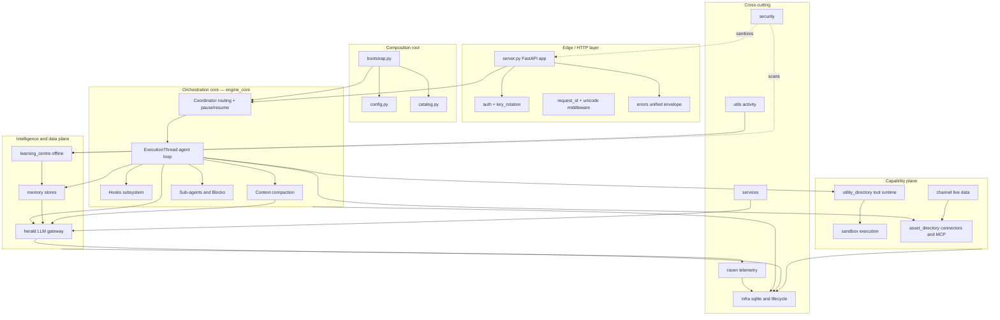
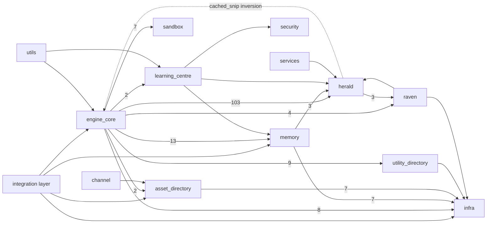

# September Intelligence Engine — Architecture Atlas

> A complete, deep architectural map of the **September intelligence engine v3** (`engine sandbox`) — a unified agentic execution runtime. **~62,000 LOC** across **13 subsystems** plus the integration layer, packaged `september-engine 3.2.0`, Python 3.11+, FastAPI + SQLite + sqlite-vec, model access via the **citadel** gateway.

## What this engine is

The engine is a **single-tenant, one-process agentic runtime**: a hardened container running one user's autonomous AI agent. It receives a user message over HTTP, routes it to a persistent conversation **thread**, runs an **agentic LLM loop** (model → tool calls → results → model) with context compaction, memory, sub-agents, and a security sandbox, and **streams the result back as a sequence of typed `Block` frames over SSE**. It learns from each session offline, vaults external-service credentials, and runs untrusted agent-generated code one ring deeper inside `bwrap + seccomp + Landlock`.

It is the **source of truth** for its wire contracts. Four external systems surround it: the **product frontend** (calls `/execute`), the **orchestrator** (`bap-engine`, provisions + rotates keys), **citadel** (the model gateway that holds all provider keys and enforces quota), and **bap-backend** (the connector control plane that drives the engine's `/assets/*` API — no webhooks). The trust boundaries and the v2 wire renames are detailed in [System Context](#sec-10-system-context-md); all codenames are decoded in the [Glossary](#sec-90-glossary-md).

## The subsystem map

*LOC = non-blank Python lines; reproduce it with the command in the note below the table.*

| Subsystem | LOC | Files | Role (one line) |
|---|---:|---:|---|
| **engine_core** | 25,188 | 57 | The agent loop, threading, hooks, context compaction, sub-agents, tool execution, the Block wire |
| **sandbox** | 10,269 | 27 | Secure command/tool execution: permission pipeline + bwrap/seccomp/Landlock + egress proxy |
| **asset_directory** | 6,414 | 18 | External connectors: OAuth, credential vault, MCP client, DB-backed per-tool permissions, product control plane |
| **herald** | 5,415 | 22 | LLM provider gateway/router to citadel; types, retries, media, catalog, usage |
| **memory** | 3,003 | 14 | Working / episodic / knowledge / social-graph / soul memory; embeddings; consciousness |
| **utility_directory** | 1,449 | 8 | Capability registry + tool runtime (`ToolDef`/`ToolRegistry`); subprocess env scrubbing |
| **learning_centre** | 1,177 | 4 | Offline batch pipeline turning learning-signals into durable memory |
| **raven** | 726 | 6 | Observability/telemetry event store (`obs_*` tables) |
| **security** | 680 | 5 | Secret scanning + Unicode sanitization (a stateless leaf) |
| **channel** | 637 | 6 | Live-data plane: pinned read-only polled queries fanned to craft UIs |
| **utils** | 486 | 3 | Session-liveness state machine + the activity policy that throttles autonomous work |
| **infra** | 644 | 8 | The single SQLite connection, migrations, graceful shutdown, bg-tasks |
| **services** | 101 | 2 | "While you were away" LLM recap |
| **(integration)** | 6,026 | 14 | `server.py`, `bootstrap.py`, `config.py`, `catalog.py`, `auth.py`, `errors.py`, key rotation |

The LOC column counts **non-blank Python lines**: every `*.py` line under the subsystem's directory
that is not empty or whitespace-only (comments count; blank lines do not). Reproduce a subsystem's
figure with `find src/<subsystem> -name '*.py' -exec grep -v '^[[:space:]]*$' {} \; | wc -l`; across
all of `src/` the same count totals **62,215** non-blank lines in **194** files. The `(integration)`
row is the 14 modules that sit directly in `src/` rather than in a subsystem package. Re-measure with
that command when these numbers are next reviewed; a raw `wc -l` count — which adds ~10,700 blank
lines — will not reproduce them.

## The layered architecture

## The inter-subsystem dependency graph

The arrow weight is the number of import sites — `engine_core → herald (103)` is by far the dominant edge: the agent loop lives and dies by model access. `infra` is the universal substrate (imported by 40 modules). Note the **one layering inversion**: `herald → engine_core` (provider.py imports `cached_snip`).

## Chapter map — the six planes

The sidebar groups the chapters into six planes; this is the same grouping, made explicit. Each subsystem deep-dive follows one template: **Purpose → Responsibilities → Internal components → Key files → Key types → Data flow + diagrams → Public API → Inbound/Outbound deps → Invariants & gotchas → Refactoring seams.**

| Plane | Chapters |
|---|---|
| **Foundations** | [System Context](#sec-10-system-context-md) · [Request Walkthrough](#sec-15-request-walkthrough-md) · [Data Model](#sec-20-data-model-md) · [Block Wire Contract](#sec-25-block-contract-md) |
| **Integration** | [Server / Bootstrap / Auth](#sec-30-integration-server-md) |
| **engine_core** | [Agent Loop & Threading](#sec-40-engine-core-loop-md) · [Context & Compaction](#sec-42-engine-core-context-compaction-md) · [Hooks](#sec-44-engine-core-hooks-md) · [Sub-Agents, Tools & Blocks](#sec-46-engine-core-agents-tools-blocks-md) |
| **Capability plane** | [Sandbox](#sec-50-sandbox-md) · [Asset Directory & Channels](#sec-56-asset-directory-channel-md) · [Utility / Activity / Infra](#sec-60-utility-utils-infra-md) |
| **Intelligence plane** | [Herald (LLM Gateway)](#sec-52-herald-md) · [Memory](#sec-54-memory-md) · [Learning / Security / Raven](#sec-58-learning-security-raven-md) |
| **Cross-cutting** | [Security & Deployment](#sec-70-security-deployment-md) · [Boundaries & Refactoring Map](#sec-80-boundaries-refactoring-md) · [Glossary](#sec-90-glossary-md) |

`learning_centre` belongs to the **Intelligence plane** (see the dependency graph above); it is documented in chapter 58 — bundled with `security` and `raven` — purely for brevity.

## How to read this atlas

Each subsystem has its own deep-dive section with: responsibilities, an internal-component breakdown, a key-file table, key types, the primary data flow, 2–3 Mermaid diagrams, inbound/outbound dependencies, invariants & gotchas, and refactoring seams. The cross-cutting sections cover the **data model** (every SQLite table), the **Block wire contract** (the 27-type product surface), the **security & deployment model** (the two-ring trust boundary), and a **boundaries & refactoring map** that synthesizes the whole codebase into a plan for your next work.

**Reading paths** — pick by goal:

- **End-to-end request:** [System Context](#sec-10-system-context-md) → [Request Walkthrough](#sec-15-request-walkthrough-md) → [Server](#sec-30-integration-server-md) → [Agent Loop](#sec-40-engine-core-loop-md) → [Herald](#sec-52-herald-md) → [Sub-Agents/Tools/Blocks](#sec-46-engine-core-agents-tools-blocks-md) → [Block Contract](#sec-25-block-contract-md)
- **Planning your next work:** [Overview](#sec-00-overview-md) → [Boundaries & Refactoring Map](#sec-80-boundaries-refactoring-md) → the relevant god-module chapter ([Agent Loop](#sec-40-engine-core-loop-md) / [Context & Compaction](#sec-42-engine-core-context-compaction-md) / [Sandbox](#sec-50-sandbox-md) / [Server](#sec-30-integration-server-md))
- **Security model:** [System Context](#sec-10-system-context-md) (trust boundaries) → [Security & Deployment](#sec-70-security-deployment-md) → [Sandbox](#sec-50-sandbox-md) → [Learning / Security / Raven](#sec-58-learning-security-raven-md)
- **Data & contracts:** [Data Model](#sec-20-data-model-md) → [Block Wire Contract](#sec-25-block-contract-md) → [Memory](#sec-54-memory-md)
- **New to the codenames?** Start at the [Glossary](#sec-90-glossary-md) — it decodes `citadel` / `herald` / `raven` / `bap-engine` / `bap-backend`.

A **diagram index** of every Mermaid figure in the atlas follows at the end of this chapter.

## Diagram index

Every Mermaid figure in the atlas (35 total), in reading order.

| # | Diagram | Type | Chapter |
|---:|---|---|---|
| 1 | Layered architecture | flowchart | [Overview](#sec-00-overview-md) |
| 2 | Inter-subsystem dependency graph | flowchart | [Overview](#sec-00-overview-md) |
| 3 | System context — the engine and its world | flowchart | [System Context](#sec-10-system-context-md) |
| 4 | Memory store schema (vector + FTS) | flowchart | [Data Model](#sec-20-data-model-md) |
| 5 | Execution / conversation domain | flowchart | [Data Model](#sec-20-data-model-md) |
| 6 | The 27 Block types, by group | flowchart | [Block Wire Contract](#sec-25-block-contract-md) |
| 7 | `bootstrap.py` composition root | flowchart | [Server / Bootstrap / Auth](#sec-30-integration-server-md) |
| 8 | `/execute` streaming sequence | sequence | [Server / Bootstrap / Auth](#sec-30-integration-server-md) |
| 9 | Agent turn lifecycle | flowchart | [Agent Loop & Threading](#sec-40-engine-core-loop-md) |
| 10 | Thread state machine | state | [Agent Loop & Threading](#sec-40-engine-core-loop-md) |
| 11 | Compaction pipeline | flowchart | [Context & Compaction](#sec-42-engine-core-context-compaction-md) |
| 12 | Prompt + charter assembly | flowchart | [Context & Compaction](#sec-42-engine-core-context-compaction-md) |
| 13 | Hook lifecycle & dispatch | flowchart | [Hooks Subsystem](#sec-44-engine-core-hooks-md) |
| 14 | Hook execution sequence | sequence | [Hooks Subsystem](#sec-44-engine-core-hooks-md) |
| 15 | Sub-agent fork & isolation | flowchart | [Sub-Agents, Tools & Blocks](#sec-46-engine-core-agents-tools-blocks-md) |
| 16 | Streaming tool execution & Block fold | flowchart | [Sub-Agents, Tools & Blocks](#sec-46-engine-core-agents-tools-blocks-md) |
| 17 | Permission pipeline | flowchart | [Sandbox](#sec-50-sandbox-md) |
| 18 | Sandbox rings (bwrap / seccomp / Landlock) | flowchart | [Sandbox](#sec-50-sandbox-md) |
| 19 | OAuth connection sequence | sequence | [Asset Directory & Channels](#sec-56-asset-directory-channel-md) |
| 20 | Connection state machine | state | [Asset Directory & Channels](#sec-56-asset-directory-channel-md) |
| 21 | Tool runtime & subprocess env | flowchart | [Utility / Activity / Infra](#sec-60-utility-utils-infra-md) |
| 22 | Activity state machine | flowchart | [Utility / Activity / Infra](#sec-60-utility-utils-infra-md) |
| 23 | SQLite substrate & lifecycle | flowchart | [Utility / Activity / Infra](#sec-60-utility-utils-infra-md) |
| 24 | Herald request sequence (→ citadel) | sequence | [Herald (LLM Gateway)](#sec-52-herald-md) |
| 25 | Model routing (`pick_model`) | flowchart | [Herald (LLM Gateway)](#sec-52-herald-md) |
| 26 | Memory subsystem facade | flowchart | [Memory System](#sec-54-memory-md) |
| 27 | Memory write / read flow | flowchart | [Memory System](#sec-54-memory-md) |
| 28 | Learning pipeline | flowchart | [Learning / Security / Raven](#sec-58-learning-security-raven-md) |
| 29 | Secret scan & sanitization flow | flowchart | [Learning / Security / Raven](#sec-58-learning-security-raven-md) |
| 30 | Raven telemetry flow | flowchart | [Learning / Security / Raven](#sec-58-learning-security-raven-md) |
| 31 | Two-ring trust model | flowchart | [Security & Deployment](#sec-70-security-deployment-md) |
| 32 | Defense layers, end to end | flowchart | [Security & Deployment](#sec-70-security-deployment-md) |
| 33 | Deployment topology | flowchart | [Security & Deployment](#sec-70-security-deployment-md) |
| 34 | Boundary health scorecard | flowchart | [Boundaries & Refactoring Map](#sec-80-boundaries-refactoring-md) |
| 35 | Suggested sequencing | flowchart | [Boundaries & Refactoring Map](#sec-80-boundaries-refactoring-md) |
