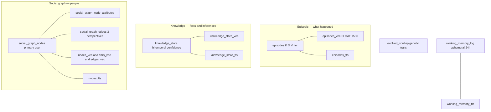
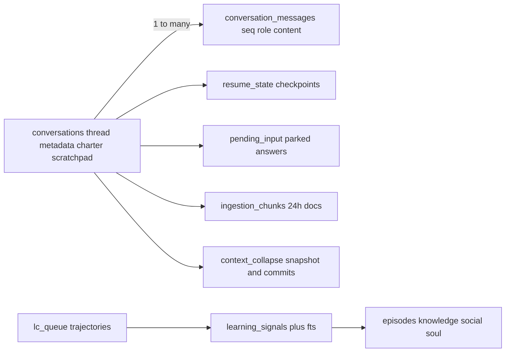

## Data Model — The SQLite Backbone

The engine persists **everything** to a single `brain.sqlite` file (WAL mode, one writer) via the `SqlitePool`, with the **sqlite-vec** extension for vector search and **FTS5** for keyword search. Migrations are **13 files numbered 001-013, with 006 absent and 012 used twice → 12 distinct prefixes** (`migrations/*.sql`, applied in filename order, tracked by full filename in `schema_migrations`). Together they define **33 base tables** plus **10 virtual tables** (5 vec0 + 5 fts5). The data model *is* the real subsystem boundary — each table is owned by exactly one subsystem.

### Tables grouped by owning subsystem

| Migration | Tables | Owner | Notes |
|---|---|---|---|
| `001_memory_schema` | `episodes`, `knowledge_store`, `social_graph_nodes`, `social_graph_node_attributes`, `social_graph_edges`, `evolved_soul` | **memory** | Each long-term store has a `_vec` (vec0 FLOAT[1536]) + `_fts` companion |
| `002_utility_directory` | `user_agents`, `user_skills`, `user_tools` | **utility_directory** | User-state overlay over the in-memory platform Catalog; LC is the sole writer |
| `003_asset_directory` | `server_registry`, `connections`, `oauth_pkce`, `action_registry`, `execution_log`, `connection_permissions`, `connection_events` | **asset_directory** | `connections.credentials`/`refresh_token` are encrypted-at-rest BLOBs; `connections` also carries provenance/account_ref/owner_ref/label/enabled/idempotency_key, plus `token_issued_at` (when the current token was minted — NULL falls back to `created_at`), which is what the 80%-lifetime proactive refresh measures elapsed lifetime against; per-tool grants live in `connection_permissions` (allow/ask/deny + enabled + managed lock), out-of-run state changes in `connection_events` (lifecycle in [Asset Directory & Channels](#sec-56-asset-directory-channel-md)); `server_registry` carries the vet audit trail (`vetted`/`vetted_at`/`vetted_by` plus `vet_decision` — NULL means never reviewed, and a recorded `'rejected'` keeps the server out of the pending queue instead of resurfacing it forever — and its `vet_reason`) and `instructions`, the server's own usage guidance read off the MCP initialize handshake and capped at ingestion like every other server-controlled string |
| `004_trajectories_lc` | `trajectories`, `lc_queue` | **engine_core / learning_centre** | The Learning Centre work queue |
| `005_resume_state` | `resume_state`, `pending_input` | **engine_core** | Crash-recovery checkpoints + parked-input store (replaces Redis) |
| `007_conversations` | `conversations`, `conversation_messages` | **engine_core** | Per-thread history; 24h TTL; `UNIQUE(thread_id, seq)`; `conversations` also carries the thread-routing fields `summary`/`current_state`/`recent_turns` (all NOT NULL with safe defaults, `recent_turns` a JSON list of up to 3 short strings) |
| `008_learning_signals` | `learning_signals` (+ `learning_signals_fts`) | **learning_centre** | FTS5 kept in sync by insert/delete triggers |
| `009_compaction_config` | `compaction_config` | **engine_core (compaction)** | Seeded KV thresholds |
| `010_working_memory_log` | `working_memory_log` (+ `working_memory_fts`) | **memory** | The SQLite working-memory backend; 24h TTL |
| `011_microcompact_config` | `microcompact_config` | **engine_core (compaction)** | Seeded KV (`enabled`, `gap_threshold_minutes`, `keep_recent`) |
| `012_context_collapse` | `context_collapse_snapshot`, `context_collapse_commits` | **engine_core (compaction)** | Last-wins snapshot + append-only commits |
| `012_ingestion_chunks` | `ingestion_chunks` | **engine_core** | Chunked documents (24h TTL) — ⚠ shares the `012` prefix |
| `013_observability_and_gateway_tables` | `obs_events`, `obs_counters_daily`, `gw_cache_state`, `gw_config_snapshot` | **raven / herald** | Telemetry events + daily rollups + gateway cache stats |

### The memory store (vector + FTS, the richest data domain)

This section covers only the *schema* — table shapes and the vec/fts companion pattern. The retrieval, hybrid keyword+semantic scoring, and decay semantics that run over these tables are documented in [Memory](#sec-54-memory-md).

### The execution / conversation domain

### Storage characteristics & invariants

- **Single connection, WAL, single writer.** All writes serialize through `SqlitePool`; `busy_timeout=5000`. Callers must `await db.commit()` themselves.
- **Vectors are float32 blobs.** `serialize_f32`/`deserialize_f32` pack little-endian; queried with `vec_distance_cosine` gated on `db.vec_available`. A degraded (zero) embedding is still truthy and gets stored — so `_vec` tables can contain non-semantic rows.
- **Bitemporal + supersede, never hard-delete (knowledge).** `valid_from`/`valid_until` (reality) vs `recorded_at`/`superseded_at` (system knowledge); searches must filter `superseded_at IS NULL`.
- **Tiered archival (episodes).** `episode` tier <30d uncompressed; `archive` tier ≥30d gzip-compressed `value_compressed`, `value` nulled — still searchable via K+D.
- **TTL data.** working memory, conversations, ingestion chunks, resume-state all carry 24h–72h TTLs, swept by the LC scheduler and `cleanup_expired` routines.
- **Encrypted at rest.** `connections.credentials`/`refresh_token` are stored as opaque encrypted BLOBs; the MultiFernet scheme and zero-downtime key rotation are documented in [Asset Directory & Channels](#sec-56-asset-directory-channel-md).
- **Migration footguns.** Of the 13 files numbered 001-013, `006` is absent and `012` is used twice (`context_collapse`, `ingestion_chunks`) → 12 distinct prefixes. Both `012`s apply (each is tracked by its full filename in `schema_migrations`), but the "number = apply order" convention is broken.
- **Counters written at insert time (raven).** `RavenStore.track` upserts `obs_counters_daily` directly; `rollup_events_to_counters` only counts (avoids double-counting). Sub-day queries scan `obs_events` exactly; day+ queries use the counters table — the data source flips at exactly 86400s.
