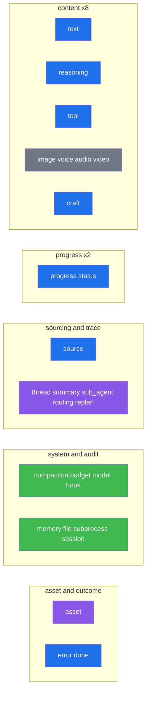

## The Block Wire Contract — The Product Surface

The `/execute` endpoint streams **one envelope, the `Block`, in exactly 27 types**. This is the engine's single most important external contract — the SDK types every `block.payload` as a discriminated union over these types. Internally the engine has ~60 event dataclasses on a bus; the fold to blocks happens only at the serialization boundary (`src/engine_core/blocks.py`), gated and buffered per thread. The fold itself (the `FOLD` map, the per-instance id derivation, the discriminator stamping) is implemented by `BlockSerializer` in that module (see [Sub-Agents/Tools/Blocks](#sec-46-engine-core-agents-tools-blocks-md)); the streaming machine that drives the fold per event and frames the result lives in `src/server.py` (see [Server/Bootstrap/Auth](#sec-30-integration-server-md)).

### The envelope & frame

```python
@dataclass
class Block:
    type: str        # one of the 27 types
    payload: dict    # the folded event body (+ stamped discriminator)
    thread_id: str   # lifted OUT of payload into the envelope
    id: str          # derived from the logical instance — NOT a fresh uuid
    ts: str          # iso8601 utc
```

The SSE frame has exactly five keys (`id, type, thread_id, ts, payload`); there is **no `v` version field** by design. `done` and `error` are *synthesized* at the `/execute` boundary, not folded from events.

### The 27 types, by group



| Group | Types | Gate |
|---|---|---|
| **content** | `text`, `reasoning`, `tool`, `image`, `voice`, `audio`, `video`, `craft` | always (reasoning needs super_thinking; media/craft/tool need their flag) |
| **sourcing** | `source` | sources flag |
| **progress** | `progress`, `status` | always |
| **trace** | `thread`, `summary`, `sub_agent`, `routing`, `replan` | telemetry ≥ trace (`routing` is always on — it is the turn's shape, not telemetry about it) |
| **asset** | `asset` (one block; `payload.kind` = required/action/permission_request/status) | `assets` flag (default on) |
| **system** | `compaction`, `budget`, `model`, `hook` | telemetry = full |
| **audit** | `memory`, `file`, `subprocess`, `session` | telemetry = full |
| **outcome** | `error`, `done` | always (synthesized) |

### The id rule (concurrency-safe reconciliation)

`Block.id` is derived from the *logical instance*, never a fresh uuid, so a client doing "replace by id" never collides two concurrent same-type blocks: append-streams use `{type}:{turn_id}:{thread_id}` (deltas append to one block); `tool` uses `tool:{tool_use_id}`; `sub_agent` uses `sub_agent:{agent_id}`; `source` uses `source:{turn_id}:{handle}`. `turn_id` comes from the request correlation id (`x-request-id`), not from events.

Two of these scopes exist because a turn can fan out into several threads, and a single turn id is not enough to keep them apart:

- **Append streams carry the owning thread.** `TextDelta` and `ThinkingDelta` have no `turn_id` field, so without the thread scope every segment of a fanned-out turn folded to the same `text:{turn_id}`. The envelope `thread_id` was still correct and the sink still routed correctly, so nothing on the wire looked wrong - but a client appending by id interleaved two threads' prose token by token, and `voice:{turn_id}` made the product's TTS speak two threads as one utterance. A block with no owning thread keeps the plain `{type}:{turn_id}`.
- **A per-segment `done` carries its thread**: `done:{turn_id}:{thread_id}`. The aggregate that closes the turn keeps `done:{turn_id}`. Otherwise the N per-segment dones and the aggregate all shared one id and replace-by-id collapsed them into a single entry whose `thread_id` mutated from one thread to the next and finally to null - losing the per-thread identity the engine promises, even though the numbers survive in the aggregate's `segments` list.

### The fail-open rule (the SDK must mirror it)

`passes_gates()` returns `True` for any block `type` it does not recognize — a new block type is **never silently dropped** by the gate. The SDK must mirror this: an unknown `type` on the wire passes through to the consumer.

### Terminal sequence & cancellation

A turn ends with a synthesized `done` block (`{status, num_turns, cost_usd, duration_ms, quota}`) followed by a typed `DONE_SENTINEL` so the stream closes on a *structural* signal — never by byte-matching `"type":"done"` (a tool/craft payload could carry that literal). A waiting craft emits `done.status="awaiting"` (carrying the `block_id`) and closes the stream while the turn task stays parked; the client answers with a fresh `/execute` `block_input`. The `done`/`error` synthesis and the sentinel-driven close are owned by the streaming machine in `src/server.py` (see [Server/Bootstrap/Auth](#sec-30-integration-server-md)).

### The error code taxonomy

Every error is the envelope `{"error":{"code","message","retryable","details"}}`. The product switches on `code`, not HTTP status:

| code | http | retryable | meaning |
|---|---|---|---|
| `invalid_key` | 401 | no | bad engine key |
| `key_not_configured` | 503 | yes | no key set (fail-closed) |
| `engine_not_operational` | 503 | yes | coordinator down / shutting down |
| `subsystem_unavailable` | 503 | yes | required subsystem missing |
| `execution_failed` | 500 | no | turn failed |
| `llm_unavailable` | 502 | yes | provider unreachable |
| `tool_failed` | 500 | no | tool error |
| `media_content_error` | 400 | no | media broke the API after recovery |
| `context_overflow_unrecoverable` | 500 | no | all compaction tiers exhausted |
| `input_timeout` / `input_not_found` | 408 / 404 | no | user input window |
| `asset_not_found` / `asset_not_active` | 404 / 409 | no | connection state |
| `action_not_found` | 404 | no | tool not on server |
| `auth_expired` | 401 | yes | reconnect connector |
| `circuit_open` | 429 | yes | breaker open |
| `server_unavailable` | 502 | yes | MCP unreachable |
| `invalid_params` | 422 | no | bad request / Unicode reject |
| `oauth_state_mismatch` | 403 | no | callback state does not match the connection (possible CSRF) |
| `permission_locked` | 409 | no | managed policy pins the permission; it cannot be loosened |
| `action_not_permitted` | 403 | no | the connection's per-tool policy denies this action |
| `token_exchange_failed` | 400 | no | cross-app token exchange rejected (`details.upstream_status` separates a bad subject token from a down IdP) |
| `mcp_protocol_error` | 502 | no | MCP server returned a JSON-RPC protocol error |
| `channel_session_not_found` | 404 | no | channel session |
| `op_not_read_only` | 400 | no | channel write attempt |
| `channel_limit_exceeded` | 429 | yes | >256 channels |
| `rate_limited` | 429 | yes | 60/60s window |
| `quota_exhausted` | 429 | no | plan tokens (citadel) |
| `budget_exhausted` | 402 | no | pay-per-use (citadel) |
| `subscription_suspended` | 403 | no | citadel |
| `rotation_in_progress` | 409 | yes | concurrent key rotation |
| `internal_error` | 500 | no | sanitized catch-all |

Six further codes sit below the domain vocabulary as transport-level fallbacks. `STATUS_TO_CODE` (`src/errors.py`) maps a bare HTTP status onto one of them whenever a response never reached a subsystem that owns a domain code: an unmatched-route 404 raised by Starlette, or an ad-hoc `HTTPException` carrying only a plain-string detail. `engine_error_from_status()` builds them, preserving the ad-hoc message when there is one and always rendering at the original status even when that status is outside the map (the code falls back to `internal_error`, the status is never rewritten). A product switching on `code` reads them as "the engine rejected this before any subsystem saw it" - that is the whole difference between `not_found` and `asset_not_found`.

| code | http | retryable | meaning |
|---|---|---|---|
| `bad_request` | 400 | no | malformed request, no domain owner |
| `unauthorized` | 401 | no | unauthenticated, not the engine-key path |
| `forbidden` | 403 | no | refused, no domain owner |
| `not_found` | 404 | no | unmatched route |
| `conflict` | 409 | no | state conflict, no domain owner |
| `service_unavailable` | 503 | yes | generic unavailability |

Two statuses in `STATUS_TO_CODE` resolve to domain codes rather than generic ones, because the domain vocabulary already covers them exactly: 422 maps to `invalid_params` and 429 to `rate_limited`.

### Why this matters for planning

The block contract is **generated from the live code** (`scripts/gen_block_contract.py` → `contract/block-types.md`; `tests/test_block_contract.py` fails on drift). It is the cleanest seam in the system: the internal event bus can be refactored freely as long as the `FOLD` map and the 27-type assertion hold. Adding a new surface means adding an event class + a fold entry in `BlockSerializer` (see [Sub-Agents/Tools/Blocks](#sec-46-engine-core-agents-tools-blocks-md)) — that is how `image`/`voice`/`audio`/`video` arrived, and none of them needed a wire-version bump.
