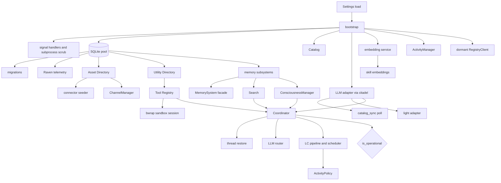
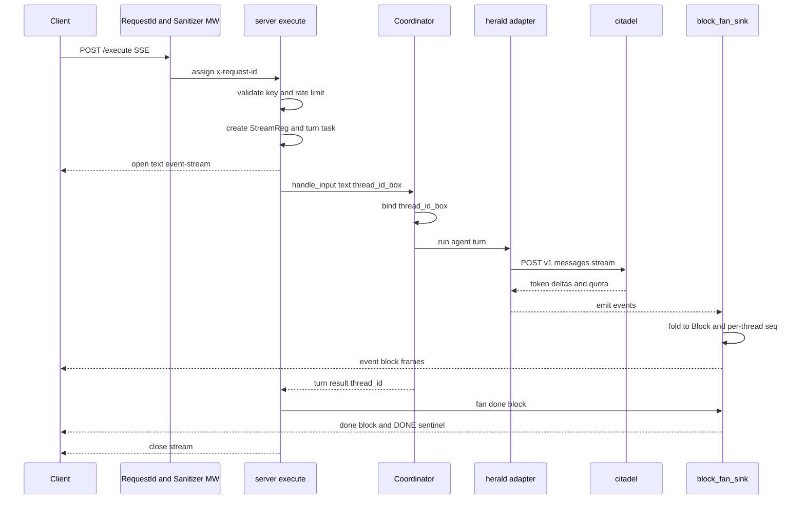

## Integration Layer — Server, Bootstrap, Config, Auth & Wire Contract

**Purpose:** The network-facing skin of the engine — a single FastAPI app (`src/server.py`, ~117KB / ~2,982 lines) that wraps a fully-wired `EngineState` (assembled by `src/bootstrap.py`, ~44KB) and exposes the agentic runtime as a fail-closed, ephemeral, key-authenticated HTTP/SSE surface whose flagship product is the `/execute` block-streaming endpoint.

**Key files:**

| File | LOC | Role |
|---|---|---|
| `src/server.py` | ~2,982 | The FastAPI app: every route, the SSE streaming machine, middleware, exception handlers, rate limiter, lifespan |
| `src/bootstrap.py` | ~1,025 | Composition root — `bootstrap()` builds one `EngineState` + `BootReport`; `shutdown()` tears it down LIFO |
| `src/config.py` | ~614 | `Settings` dataclass + `Settings.load()` + `validate()` — all env-driven config |
| `src/catalog.py` | ~549 | In-memory folder-backed registry of skills/agents/tools + `core_soul`; `load_catalog`, `match_skills`, hot reload |
| `src/auth.py` | ~234 | `x-engine-key` + `x-admin-key` auth state, constant-time verify, hot-rotation primitives, persisted-hash write |
| `src/errors.py` | ~407 | `ErrorCode` enum, `ERROR_META`, `EngineError`, `error_from_exception` (see [Block Wire Contract](#sec-25-block-contract-md) for the canonical taxonomy) |
| `src/key_rotation.py` | ~210 | `install_pending_key` control op: overlap window, `expire_rotation` background promotion, persist-on-promote |
| `src/api_models.py` | ~727 | Pydantic **response** models (request models stay inline in `server.py`) |

**Key types:**

| Type | Where | What it is |
|---|---|---|
| `EngineState` | `bootstrap.py` | Flat dataclass holding ~40 subsystem refs; `is_operational ≡ coordinator is not None` |
| `Settings` | `config.py` | All engine config; loaded via `Settings.load()`, gated by `validate()` |
| `ExecuteRequest` | `server.py` (inline) | The `/execute` request body — tagged-union `input` + output gates + per-turn knobs |
| `Block` | `engine_core/blocks.py` | The wire frame (see [Block Wire Contract](#sec-25-block-contract-md)) |
| `AuthState` | `auth.py` | `primary_hash` + optional `pending_hash` + `overlap_expires_at` + `swap_lock` |
| `ErrorCode` / `EngineError` | `errors.py` | String-enum code + the raisable-and-returnable error value |

### bootstrap.py — the composition root

`bootstrap(settings)` is a single linear async function that builds one `EngineState` (a flat holder of ~40 subsystem refs) and a `BootReport`. DI is **explicit constructor injection** — no container. Every step is wrapped in try/except (`record`/`record_disabled`/`warn`) so a non-critical failure degrades. The operational gate is `state.is_operational ≡ coordinator is not None`. LIFO teardown is registered as each durable subsystem is built.

Major construction phases: (1) signals & subprocess hardening; (2) settings validation (gate); (3) SQLite + migrations + Raven; (4) Catalog + orphan cleanup; (5) LLM adapters (primary via citadel, catalog_sync, light adapter); (6) embeddings + pre-embed skills; (7) Asset Directory stack (CredentialStore, CircuitBreaker, ConnectionManager, ExecutionLogger, AssetDirectory) + the dormant RegistryClient; (8) Utility Directory; (9) Memory + Soul + Search; (10) EventEmitter + ActivityManager + Tool Registry (`hydrate_tools`); (11) Sandbox (one `LocalBwrapProvider` session, network default-DENY) + sandbox tools; (12) Utility/Assets/ChannelManager; (13) ConsciousnessManager; (14) **Coordinator** (the operational keystone) + thread restore + LLM router; (15) Learning Centre (LCPipeline + LCScheduler) + ActivityPolicy + process-cleanup infra; (16) finalize.

### Startup & shutdown lifecycle

The whole process lifecycle lives in one `lifespan` contextmanager (`server.py`) wrapping `bootstrap`/`shutdown`:

1. **Process start** — `uvicorn src.server:app`. `lifespan` enters. (`python -m src` is *not* a server entrypoint: `src/__main__.py` imports `main` from the repo-root `tui.py` and launches the terminal client against a separately-running engine, so no `lifespan` runs.)
2. **Logging** + pin `engine_id_var`.
3. **Key resolution** (persisted-first) — persisted `$SEPTEMBER_HOME/credentials/engine_key_hash` → `ENGINE_KEY_HASH` → `hash_key(ENGINE_API_KEY)`; validate-before-init (a corrupt hash can't crash boot — it's skipped and the surface 503s). The admin key (`x-admin-key`) resolves the same way from `ENGINE_ADMIN_KEY_HASH` / `ENGINE_ADMIN_KEY`.
4. **`Settings.load()`** → **`bootstrap(settings)`** (migrations run inside bootstrap before any subsystem touches the schema).
5. **Wire-up** — record `boot_completed_at`, register the `drain_server` drain callback, register the single global `block_fan_sink` on the emitter.
6. **Server ready** — `yield`; `/health` flips to 200 (503 if `!success`).
7. **Shutdown** — Uvicorn lifespan exit or SIGHUP → `graceful_shutdown` sets `shutting_down`, arms a failsafe, runs the drain.
8. **Drain** (`drain_server`) — pushes `None` sentinels to all SSE queues, resolves parked input futures, waits ≤30s, force-cancels stragglers.
9. **Teardown** — stop `catalog_sync` polling, then `shutdown(state)`: record shutdown, clear spawn observer, uninstall the interrupt source, stop orphan detectors + sandbox cleanup, then the infra cleanup registry runs LIFO (lc_scheduler → coordinator → SQLite) — and `shutdown` closes `state.db` directly afterward, since the registry is process-global and a nested shutdown that already cleared it would otherwise leave this engine's own database open.

### Config model

`Settings` is a declarative dataclass: every field is declared once via `setting()` with its env var name, typed default, and semantic check together in the field metadata; `load()` and `validate()` are generic loops over `dataclasses.fields()`. Three entry points: `Settings.load()` (parse-only, aggregates ALL parse errors in one `ConfigError`, semantically lenient — module-level CORS read and `/health/deep` rely on this), `validate()` (full per-field + cross-field checks, returns every error), and `Settings.load_validated()` — the boot entry point in the server lifespan that raises ONE `ConfigError` carrying every parse and semantic error together. **Boot hard-fails on any config error**: the `ConfigError` propagates out of the lifespan and uvicorn refuses to start; a misconfigured engine never serves. `parse_bool` stays strict (`true`/`false` only); ints/floats now fail with the same env-var-naming message style. Every field validates (URL shapes, enums, positive/non-negative numerics, Fernet key shape, CORS origin shapes, absolute-path lists, activity-timeout ordering `idle < away < disconnect`). **Model fields are pure optional overrides**: defaults live in herald's launch block (`src/herald/defaults.py`), empty means "herald default", and every RESOLVED model id is validated against the citadel-synced catalog right after the first sync (`src/herald/model_validation.py`) — fatal when synced, loud warning when degraded. `lc_provider` is gone (the provider label derives from the catalog entry). Groups: citadel gateway (`cdt_url`/`cdt_key`, `engine_id`), models (overrides only + `max_tokens`, `global_cache_ttl`), storage (`sqlite_db_path` defaulting to `$SEPTEMBER_HOME/brain.sqlite`, catalog/migrations dirs — see [Data Model](#sec-20-data-model-md)), asset directory (`ad_encryption_key` Fernet, OAuth redirect base, `SEPTEMBER_REGISTRY_URL`, asset-log retention), channels, activity/sandbox TTLs, and 16 feature gates (each enumerated with its default in `.env.example`; a meta-test keeps `.env.example` in lockstep with the field spec). The engine holds **no provider keys** — every model/embedding credential lives in citadel; the engine carries only the citadel token.

### catalog.py

At this level, the **catalog is an in-memory, folder-backed registry of agents, skills, and tools** plus the `core_soul` document, with layered name-shadowing. `load_catalog` loads **agents** and **tools** single-source from `/catalog/core/{agents,tools}`; **skills** come from a list of `SkillRoot(path, source)` values resolved by `load_skills_from_roots`, precedence by list order (a later root shadows an earlier one by name) rather than a hardcoded call site — `default_skill_roots()` composes the normal boot list (core `/catalog/core/skills`, then user `$SEPTEMBER_HOME/skills/`). `CatalogEntry.source` ∈ {core, user, forked, lc_created, managed}. Supports semantic skill matching (`match_skills`, hybrid `0.3·keyword + 0.7·semantic`) and hot reload (`reload_user_skills`). Only user/forked/lc_created skills are writable (platform → 403).

### The HTTP API surface

With the app assembled, here is the engine's own HTTP surface. (For the external systems that call these routes and who owns what, see [System Context](#sec-10-system-context-md).)

Auth: **engine** = `x-engine-key`; **admin** = `x-admin-key`; **none** = unauthenticated probes/redirects (rate-limited).

**Execution / streaming** — `POST /execute` (run a turn, stream `Block` frames over SSE — the primary product surface), `GET /execute/replay?turn_id=&thread_id=&after=` (replay buffered blocks for reconnect, two scopes and one cursor each: `turn_id` replays the merged interleave one input produced, across every thread it fanned out to plus the blocks that belong to no thread; `thread_id` replays one conversation and nothing else, and is the fallback branch when `turn_id` is empty), `GET /inputs/pending`, `POST /feedback`. (engine)

**Channels (live-data plane)** — `POST /channel/subscribe`, `GET /channel/{session_id}/stream?after=` (long-lived SSE, SWR, 15s ping), `POST /channel/action` (write op, no model, force-refresh). (engine)

**Assets / connections** (all **engine**-authed — bap-backend drives these as the control plane) — reads: `GET /assets/servers`, `/assets/connections`, `/assets/connections/{connection_id}`, `.../status`, `.../actions`, `.../permissions`, `GET /assets/registry` (dormant), `GET /assets/executions`, `GET /assets/connection-events?since=` (durable out-of-run state-change pull). Connect/lifecycle: `POST /assets/connect`, `POST /assets/callback`, `GET /assets/oauth/callback?code=&state=` (browser redirect → 302, **none**; state echo is the CSRF check), `DELETE /assets/connections/{connection_id}` (disconnect + best-effort RFC 7009 revoke), `POST .../pause`, `POST .../resume`, `POST .../actions/refresh`. Managed control plane: `POST /assets/provision`, `POST /assets/reconcile`, `POST /assets/register`, `POST /assets/permissions/apply`. Trust gate: `GET /assets/servers/pending` (servers registered but not yet reviewed — `vetted = FALSE AND vet_decision IS NULL`; `oauth_config` is dropped and replaced by a `configured` boolean, so a review surface never holds a copy of the credential material), `POST /assets/servers/{server_name}/vet` (records an approve/reject decision with `actor` and `reason`; 404 on an unknown server). Self-serve registration (`POST /assets/register`) and self-serve connect land `vetted=FALSE`; managed provision/reconcile land `vetted=TRUE` on the strength of the control plane's own authority. `vetted=false` immediately closes tool exposure, `execute()`, and auto-brokered OAuth for that server. Permissions: `PUT /assets/connections/{connection_id}/permissions` (bulk grid), `POST .../permissions/resolve`, `GET`/`PUT`/`DELETE .../permissions/{action}`. There is **no inbound webhook route** — the engine is only ever called by the product control plane.

**Memory** — `POST /memory/knowledge/search`, `/episodes/search`, `/social/search`, `GET /memory/soul`, `/soul/full`, `/export`, `POST /memory/import`. (engine)

**Skills** — `GET /skills`, `GET /skills/{name}`, `POST /skills/create`, `PUT /skills/{name}` (403 on platform), `DELETE /skills/{name}` (403 on platform). (engine)

**Coordinator** — `GET /coordinator/threads` (boot timestamp + every known thread, each carrying `restored_on_boot` and `pinned`), `POST /coordinator/threads/{thread_id}/pin` (the product layer takes ownership: the thread is exempt from the conversation reaper and from waiting-period expiry, and the router never files new input into it; direct execution by `thread_id` is unaffected), `POST /coordinator/threads/{thread_id}/unpin` (the thread re-enters normal life: routable again, reaper applies from its last real activity, which pinning never reset). The flag is persisted to the `conversations` row so it survives restart; a persistence failure rolls the in-memory flag back and raises rather than reporting a pin that is not one. Unknown `thread_id` → `not_found`. (engine)

**Raven** — `POST /raven/track`, `/track_untyped`, `/query`, `/events`, `/run_retention_now`. (engine)

**Admin / health** — `GET /health` (boot-time subsystem status; 200 healthy/degraded, 503 not-operational), `GET /health/deep` (live citadel probe, bounded 2s), `POST /admin/install-pending-key` (**admin**, hot key install), `POST /admin/reload-core-soul`, `/admin/reload-catalog`, `/admin/lc/trigger`.

Cross-cutting: a sliding-window **rate limiter** (`RATE_LIMIT_MAX=60` req / `RATE_LIMIT_WINDOW=60s`) guards every authed route + both health probes. Unmatched routes and all `HTTPException`s are normalized to the error envelope.

### The /execute streaming contract

`/execute` is the engine's product surface — the only endpoint where the wire is a stream of **blocks**. The full block envelope, the **27 block types** + grouping, id-derivation, gating, and the terminal/cancellation sequence are canonical in [Block Wire Contract](#sec-25-block-contract-md); below covers only how `server.py` drives that wire.

**Request shape** (`ExecuteRequest`): `input` is a tagged union on `kind` — `kind="input"` (fresh user message in `text`) or `kind="block_input"` (answering a waiting block; requires `block_id`, carries `value` + `text`). Plus `thread_id` (optional; router decides if omitted), `media` (up to 100 docs), **output gates** (`craft`, `craft_wait`, `image`, `voice`, `audio`, `video`, `tool` default-true, `super_thinking`, `citations`, `telemetry` ∈ {off, trace, full}, `direct`), and per-turn knobs (`max_turns` 1–500, `content_ingestion`).

**The streaming machine:** One global sink `block_fan_sink` (registered on the emitter at boot) folds every event → block via `BlockSerializer.fold` (see [Block Wire Contract](#sec-25-block-contract-md) for the `FOLD` map and the 27-type vocabulary), records the last `ExecutionSummary` per thread, and calls `fan_block` → appends to both `state.block_buffers` (a `ThreadBlockBuffers` keeping per-thread seq, last 200/thread) and `state.turn_buffers` (a `TurnBlockBuffers` keyed on `current_turn_id_var`, maxlen 2000, 32-turn LRU), then fans the frame to every `StreamReg` in `active_streams` whose `thread_id_box[0]` matches. Each `/execute` creates a `StreamReg{queue, thread_id_box, gates}`, spawns a `run_and_finish()` turn task into `active_streams`, and returns a `StreamingResponse`. The thread box is a one-element mutable cell bound when the coordinator resolves the thread. Gate degrade is local (`degrade_or_frame`): with the craft gate off, an engine-raised prompt degrades into a plain `text` block with the *same id*.

**Terminal markers & cancellation:** the turn ends with a synthesized `done` block (`{status, num_turns, cost_usd, duration_ms, quota}`); a typed `DONE_SENTINEL` is enqueued so the stream closes on a *structural* signal (never by byte-matching `"type":"done"`). On a **waiting craft**, `AWAIT_SENTINEL` flushes `done.status="awaiting"` and closes, but the turn task stays alive (held in `parked_turn_tasks`) parked on its future; the client answers via a new `/execute` with `block_input`; `coordinator.resume_block` resolves it lock-free. Errors → synthesized `error` block then terminal `done`. Keepalive: 15s `event: ping`. **Replay** re-emits buffered frames then `event: replay_done`, over one of two buffers: `state.turn_buffers.replay(turn_id, after)` for a client that lost a multiplexed stream (per-thread replay would hand it N unrelated sequences and no way to recover the dispatch), or `state.block_buffers.replay(thread_id, after)` for a consumer following a single conversation. Each buffer is keyed on its own scope, so `after` never leaks across turns or threads.

### Authentication & key management

> **Canonical here.** The `x-engine-key` product credential and its zero-downtime hot-rotation mechanism are documented in full in this section.

**`x-engine-key`** is the product credential. `validate_key` looks up the singleton `AuthState`; none → `503 key_not_configured`; `verify_key_against_state` does a **constant-time** `hmac.compare_digest` of SHA-256(incoming) against `primary_hash`, then (if armed/unexpired) `pending_hash`. Format `sk-sept-<token_urlsafe(48)>` (`validate_format` checks prefix + minimum length); the engine stores only the SHA-256 hash.

**Hot rotation** (zero downtime, `POST /admin/install-pending-key` → `install_pending_key`): authed with the separate **`x-admin-key`** (orchestrator-only). The orchestrator sends only `new_hash` (64-lowercase-hex, `HEX64_RE`) + `overlap_seconds`; the engine never sees the new plaintext. Under `state.swap_lock` a second concurrent rotation → `409 rotation_in_progress` (distinct from the `422 invalid_params` hard-reject for a bad hash / out-of-bounds overlap). `overlap=0` → immediate swap + zero old hash in-place + `persist_key_hash(new_hash)`; `>0` → arm `pending_hash` + monotonic `overlap_expires_at`, and a background `expire_rotation` task sleeps the window, promotes pending→primary, zeros the old bytes, then persists the now-live primary. **Persistence-first boot**: the live primary is written to `$SEPTEMBER_HOME/credentials/engine_key_hash` (atomic temp-file + fsync + `os.replace`) so a rotation survives restart; boot prefers the persisted hash over the (stale) `ENGINE_KEY_HASH` env, only if it validates as 64-hex.

**`x-request-id`**: `RequestIdMiddleware` always **generates** a 12-hex id server-side (inbound values ignored — anti-spoof), sets `request_id_var`, appends the response header (works for SSE because it's raw ASGI). `/execute` adopts the same rid for its block ids.

### Error contract (server mechanism)

The error envelope, the full `ErrorCode` taxonomy, and the retryable/HTTP-status mapping are canonical in [Block Wire Contract](#sec-25-block-contract-md). What lives here is the server-side rendering machinery: `ERROR_META` (a dict mapping each `ErrorCode` → `(http_status, retryable, default_message)`), `EngineError` (both a raisable exception **and** the returned value), and `error_from_exception`, which maps subsystem exceptions to codes (AssetNotFound, AuthExpired, CircuitOpen; channel errors; Citadel quota/budget/subscription) — unknown exceptions → `internal_error` with a **sanitized** message (raw text never sent; traces logged server-side). `render_engine_error` serializes the response; every body passes through `scrub_mapping` (`server_sanitizer.py`) redacting internal codenames `src.herald`/`src.raven`.

### Invariants / contracts / gotchas
- **Fail-closed auth**: no key → `503 key_not_configured` (not open); invalid → `401`. A corrupt/partial persisted/admin hash is *ignored* (validated against hex-64) so it can never brick boot but never accepts more keys.
- **Fail-closed execution**: `/execute` rejects with `engine_not_operational` when shutting down or coordinator missing. Sandbox egress default-DENY.
- **Ephemeral**: sandbox session reaped after idle TTL; durable state in SQLite, not the workspace; per-thread block buffers bounded (200/thread).
- **Hardened container**: see [Security & Deployment](#sec-70-security-deployment-md) for the two-ring trust model + container hardening (cap_drop ALL, read-only rootfs, seccomp, non-root uid, untrusted agent code one ring deeper).
- **Rotation read path is lock-free** (`verify_key_against_state` reads `AuthState` without the swap lock); `swap_lock` guards only mutation.
- **Terminal frame is structural** (`DONE_SENTINEL`/`AWAIT_SENTINEL`), never byte-matched.
- **Replay is scoped by construction** — `turn_id` and `thread_id` each read their own buffer, so `after` never leaks across turns or threads.
- **`x-request-id` is server-generated only** (anti-spoof).
- **Codename leakage prevention**: every error/SSE/health body passes through `scrub_mapping`; logs run two secret-redaction passes + truncation.
- **Health contract**: `healthy` requires `success AND not errors`; HTTP 503 only when coordinator down — a degraded-but-alive engine returns 200.
- **Wire renames (v2)**: `ref_id → connection_id`, `task_id → thread_id` — see [System Context](#sec-10-system-context-md) for the canonical rename map + trust boundaries.
- **27 block types**, asserted at import in `engine_core/blocks.py` — see [Block Wire Contract](#sec-25-block-contract-md). Gates fail open for unknown types.

### Refactoring seams / boundary observations
`server.py` (~2,982 lines) does six jobs that map cleanly onto an `APIRouter` per concern (all share `state`, `validate_key`, the exception handlers): (1) streaming core (`/execute`, replay, inputs, feedback + the SSE machinery — the heaviest; move the fan/sink logic to a `StreamHub` class instead of module globals); (2) channels; (3) assets (the product control-plane surface); (4) memory; (5) skills + catalog admin; (6) coordinator/raven/admin/health. The **request** models are still inline in `server.py` (`ExecuteRequest`, etc.) while responses live in `api_models.py` — moving requests there would single-source the wire contract. The lifespan + key-resolution block is its own concern (a `lifecycle.py`). The error-rendering seam (`render_engine_error` + `scrub_mapping`) is already well-centralized. The one genuine coupling risk is the shared module-level stream state — any decomposition must keep `block_fan_sink`, `fan_block`, and the `active_streams`/`parked_turn_tasks` registries together. (Indexed in [Boundaries & Refactoring](#sec-80-boundaries-refactoring-md).)
