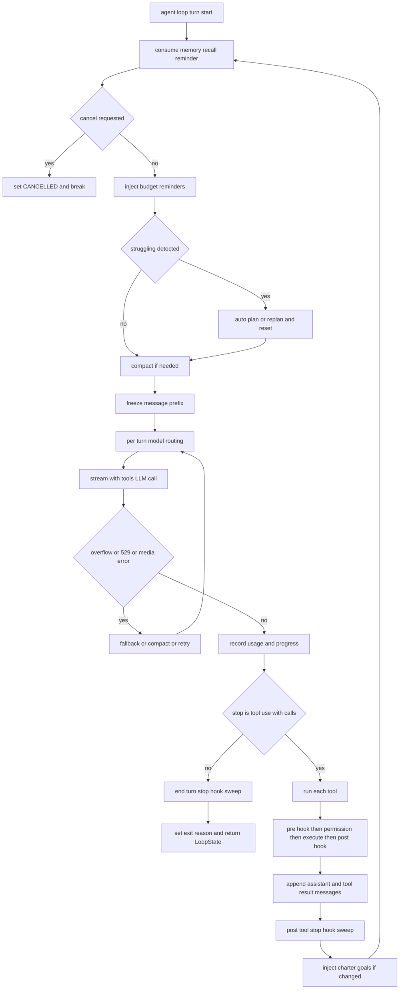
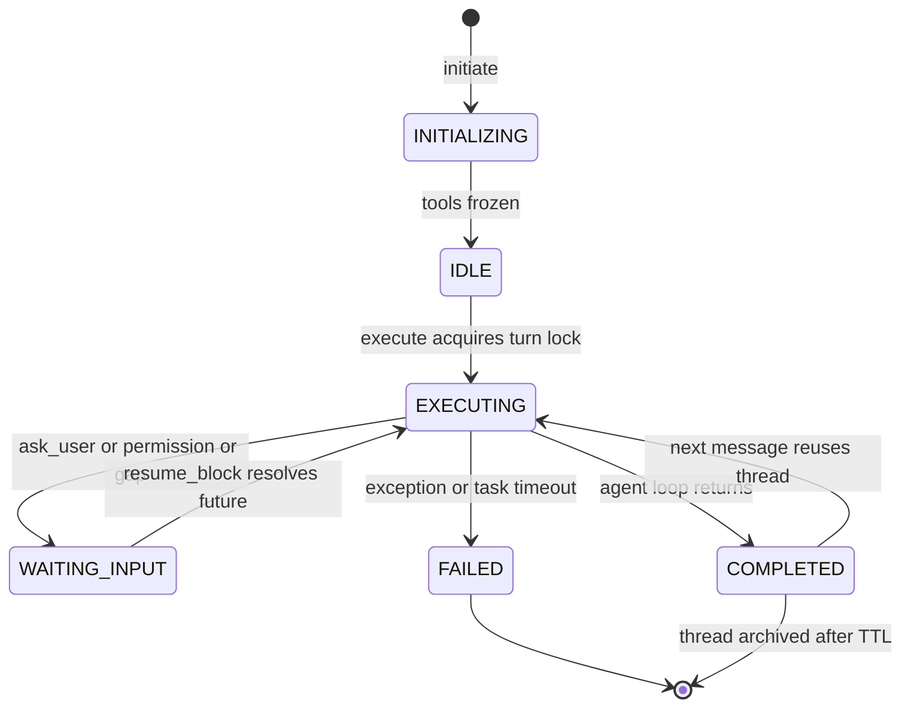

## engine_core — Agent Loop, Threading & Coordination

**Purpose:** This slice is the execution core of the engine: it routes every user message to one or more persistent per-task threads, runs the central agentic LLM loop (model → tool calls → results → model) inside that thread, and owns the concurrency, cancellation, interrupt, event-streaming, and pause/resume machinery that wraps that loop.

**Responsibilities (what this slice owns):**
- The single user-facing entry point (`Coordinator.handle_input`) — message intake, LLM triage of the input into a `Dispatch` of segments, routing those segments to threads, content ingestion gate, per-task timeout, result fan-out.
- The persistent agent runtime (`ExecutionThread`) — one-time tool registration, per-message orchestration, and the raw `agent_loop`.
- The agent turn lifecycle: streaming model output, parallel/serial tool execution, pre/post/stop hook sweeps, struggling detection, MAX_TOKENS recovery, token-budget continuations, model fallback, media-error recovery, reactive compaction handoff.
- Concurrency primitives: per-thread turn lock, planner↔sub-agent mutual exclusion gates, cooperative cancellation tokens, the process-wide SIGINT/HTTP interrupt dispatcher (`InterruptSource`).
- The pause/resume path (ask_user / permission prompts / denial escalation) via `Coordinator.await_block_input` + `resume_block` and `pending_inputs`.
- Charter planning integration (`planner.py`), cached capability search (`search.py`), event type definitions + emitter (`events.py`), execution telemetry, crash-recovery checkpoints (`resume_state.py`, `loop_state.py`).

**Internal components / layers** — a three-layer architecture (documented at `thread.py:3120-3134`):
- **Layer 0 — Coordinator (`coordinator.py`)**: the hub. `handle_input` is the only door in; `build_dispatch` sends the input to `ThreadRouter.dispatch`, which segments it in one light-model call and gives each segment a verdict against the thread index. Executable segments (`continue`, `open`, `recall`) are coalesced one-per-thread and run on persistent `ExecutionThread`s, each under a per-task `asyncio.wait_for` timeout (600s); more than one turn fans out through `asyncio.gather`, so a single input can drive several threads at once. `claimed`/`contested` segments are handed back to the caller unexecuted and `status` is answered by the coordinator itself (`say`). Owns the `EventEmitter`, `pending_inputs` registry, and per-turn contextvars (`craft_gate_var`, `citations_gate_var`, `source_registry_var`, …).
- **Layer 1 — `ExecutionThread.initiate()`**: called once per thread. Registers all engine tools (`ask_user`, `spawn_sub_agent`, `request_replan`, `gap_resolution`, `request_plan`, `report_checkpoint`, `list_content`, `search_content`, `create_skill`, `tool_search`), merges platform tools sorted for a deterministic cache prefix, provisions AD tools within a token budget (overflow → deferred stubs via `tool_search`), then **freezes the tool set** (`tools_frozen = True`) — frozen tools are one of the prompt-cache-prefix-stability mechanisms owned by [Context & Compaction](#sec-42-engine-core-context-compaction-md). Tool/Block definitions themselves are detailed in [Sub-Agents, Tools & Blocks](#sec-46-engine-core-agents-tools-blocks-md).
- **Layer 2 — `ExecutionThread.execute()`**: per message. Acquires `turn_lock` (30s), installs a `UsageAccumulator`, fires `SessionStart` + `UserPromptSubmit` hooks (see [Hooks](#sec-44-engine-core-hooks-md)), then `execute_turn`.
- **Layer 2b — `execute_turn()`**: refreshes consciousness/connected-services, builds the structured system prompt (split at `DYNAMIC_BOUNDARY` into stable+volatile — prompt-cache-prefix stability is canonical in [Context & Compaction](#sec-42-engine-core-context-compaction-md)). CONNECTED SERVICES sits on the volatile side of that boundary, so a server connected mid-session reaches the model without invalidating the cached prefix; under each service entry the server's own `instructions` from the MCP initialize handshake (see [Asset Directory & Channels](#sec-56-asset-directory-channel-md)) are rendered indented and labelled `notes from {server_name}`, marking them as that server's words, untrusted third-party data rather than operator instruction. Then consumes the speculative memory-recall prefetch (see [Memory](#sec-54-memory-md)) within a 0.1s window, assembles `<system-reminder>` enrichment, loads conversation history (SQLite preferred, WM fallback), runs `agent_loop`, persists results.
- **Layer 3 — `agent_loop()`**: the raw LLM loop; drives `StreamingToolExecutor`, handles every recovery/exit path, returns a `LoopState`.
- **Per-tool — `run_single_tool()`**: cancellation check → pre-tool hooks → permission check → `execute_tool` (registry dispatch) → post-tool hooks → `ToolResultBuilder` (size cap + disk spill) → trace + events + WM.

**Key files:**

| File | LOC | Role |
|------|-----|------|
| `thread.py` | 6366 | `ExecutionThread` — central agent loop, tool registration, `agent_loop`, `run_single_tool`, all recovery paths |
| `coordinator.py` | 1285 | `Coordinator` — message intake, triage and routing, event emitter ownership, pause/resume, thread lifecycle |
| `events.py` | 1138 | ~60 event dataclasses + `EventEmitter` (buffered, error-isolated, concurrent dispatch) |
| `search.py` | 391 | `Search` — TTL-cached (15 min) unified hybrid search over episodic/knowledge/social/AD/UD |
| `resume_state.py` | 386 | `ResumeState` + `ResumeStateManager` — SQLite checkpoints (TTL) + content store |
| `planner.py` | 360 | Charter creation via planning sub-agent; `parse_charter_response`, ref validation |
| `trajectory.py` | 282 | Fire-and-forget WM→`lc_queue` trajectory flush, feedback recording |
| `thread_router.py` | 242 | `ThreadRouter` — light-model triage of one input into a `Dispatch` of verdicted segments |
| `loop_state.py` | 219 | `LoopState` + `StrugglingState` — the loop's mutable state container, serializable |
| `execution_trace.py` | 212 | `ExecutionTrace`/`NodeTrace` per-call trace dataclasses |
| `dispatch_parser.py` | 187 | `parse_dispatch`/`single_segment` — validates a triage response into a `Dispatch`; never raises |
| `cancellation.py` | 152 | `CancellationToken`, child/bubble/combined tokens, `AbortReason`, `InterruptBehavior` |
| `interrupt_source.py` | 136 | `InterruptSource` singleton — fans interrupts (SIGINT/HTTP) to active executors |

**Key types / classes:** `Coordinator`, `ExecutionThread`, `LoopState` (all mutable loop state, serialize/deserialize for crash recovery), `StrugglingState` (consecutive errors ≥3, 12 turns no checkpoint, 8 turns no text, 3 repeated tool sigs), `ThreadRouter`, `Dispatch`/`DispatchSegment`, `ResumeState`/`ResumeStateManager`, `CancellationToken`, `AbortReason`/`InterruptBehavior`, `InterruptSource`, `EventEmitter` + `Event` union, `ExecutionTrace`/`NodeTrace`, `QueryChainTracking`, `LoopExitReason`/`ThreadState`, `Charter`.

**The agent turn lifecycle** (one iteration of `agent_loop`):
1. **Recall consume**: peek the memory-prefetch task; if settled, inject a `<system-reminder>` recall message + new source blocks.
2. **Circuit-breaker reset**: `compactor.reset_for_new_user_message`; `chain.tick_turn()`.
3. **Cancellation check**: if `cancel_requested`, append tombstone tool results, set `CANCELLED`, break.
4. **Budget reminders**: inject USD + token-budget running-count reminders.
5. **Struggling detection**: `state.struggle.check()` → emit `StrugglingDetected`, auto-call `request_replan`/`request_plan`, inject a note, reset counters.
6. **Compaction**: `compactor.compact_if_needed(...)` — may rewrite `messages`; Pre/PostCompact hook contexts appended (compaction strategy is canonical in [Context & Compaction](#sec-42-engine-core-context-compaction-md)).
7. **Freeze prefix**: `messages_for_api = list(messages)` so mid-turn mutations don't invalidate prompt cache.
8. **Per-turn model routing**: `pick_model(TaskContext, ...)` selects a model per turn (cached in `adapter_cache`); routing/catalog logic lives in [Herald](#sec-52-herald-md).
9. **LLM streaming call**: `adapter.stream_with_tools(...)` — **this is the LLM call**, dispatched through herald (see [Herald](#sec-52-herald-md)). Events: text (→ craft parser → citation parser → `TextDelta`), tool_call (→ `StreamingToolExecutor`), thinking, stop, usage. A `<craft wait="true">` halts the turn here.
10. **Overflow/error recovery** (wraps the stream): model fallback on repeated 529s (strip thinking blocks, swap adapter); media-error recovery (strip + retry ≤2); 529-with-retry-after sleep; persistent-retry heartbeats; reactive compaction tiers on context overflow.
11. **Usage accounting**: `state.record_turn_usage`; emit `TokenBudgetProgress`; USD hard-stop check.
12. **No-tool-call exit branch**: MAX_TOKENS recovery (escalate `max_output_tokens` once, then ≤3 continuations); token-budget end-of-turn check → continue (nudge) or complete; post-turn signal capture (LLM summarizes → `signal_store`); **Stop-hook sweep** `after_end_turn` (hook lifecycle is canonical in [Hooks](#sec-44-engine-core-hooks-md)).
13. **Tool execution**: drain `turn_executor.results()`, `cap_turn_tool_results`, fork a background `ToolUseSummary`, append assistant + tool_result messages. Tool/Block fold semantics and sub-agent registries are owned by [Sub-Agents, Tools & Blocks](#sec-46-engine-core-agents-tools-blocks-md).
14. **Where tools run — `run_single_tool`**: cancellation → pre-tool hooks (see [Hooks](#sec-44-engine-core-hooks-md)) → permission (`check_permission` over deny+store+session rules; new "Always" rules persisted; denial escalation; the permission pipeline itself is canonical in [Sandbox](#sec-50-sandbox-md)) → `execute_tool` → file-read hashing for restoration → post-tool hooks → PostToolUseFailure hook → source registration → `ToolResultBuilder` + size cap + disk spill → trace + events + WM (working-memory semantics in [Memory](#sec-54-memory-md)).
15. **Post-tool stop-hook sweep** `after_tool_use` (see [Hooks](#sec-44-engine-core-hooks-md)); update `StrugglingState`.
16. **Charter injection**: if replan produced a `new_charter`, swap `self.charter`, inject mission goals via `<system-reminder>` (never rebuild the system prompt or add tools — preserves the cache prefix, see [Context & Compaction](#sec-42-engine-core-context-compaction-md)).
17. **Loop** until end_turn/refusal/max_tokens/cancel/budget/hook-prevent, or for-else sets `MAX_TURNS` (cap 200).

**Concurrency & cancellation model:**
- **One turn per thread**: `turn_lock` (30s acquire timeout) serializes `execute()` on the same thread; different threads run concurrently; one `handle_input` can still fan out across several threads (dispatch segments) via `asyncio.gather`.
- **Per-task timeout**: `asyncio.wait_for(..., 600s)`; on timeout sets `thread.cancel_requested` and reports the dead turn through `report_failure`, which emits `ThreadLifecycle(status="failed")` — the same path a raised exception takes, since downstream both mean the thread produced no result.
- **Cooperative cancellation**: `CancellationToken` (idempotent). `create_child_token` propagates parent→child only; `create_bubble_token` also propagates child→parent except `SIBLING_ERROR` (sibling errors cancel only siblings). `CombinedCancellationToken` merges parent+sibling+timeout.
- **Interrupts**: `InterruptSource` is a process singleton holding a `WeakSet` of active executors. `trigger()` cancels only tools that declared `InterruptBehavior.CANCEL`. SIGINT binding is opt-in (CLI/TUI; server uses HTTP).
- **Planner ↔ sub-agent exclusion**: `planner_gate` + `sub_agents_done` events; `request_plan` cancels running sub-agents, waits up to 10s (skipping the wait if called from inside a sub-agent to avoid self-deadlock).
- **Pause/resume is lock-free**: `await_block_input` registers a future in `pending_inputs` and awaits it (72h timeout) while holding the turn lock; `resume_block` resolves it out-of-band — never re-enters `thread.execute()`.

**Public API / entry points:** `Coordinator.handle_input(...)` (the primary entry, `server.py:1065`); `resume_block(...)`; `on(callback)`/`replay(callback)`; `set_thread_pinned`, `thread_index`, `store_content`, `shutdown`, `set_router`. `ExecutionThread.initiate()`/`.execute()`/`.session_end()`. `get_interrupt_source().install()/.trigger()`.

**Inbound dependencies:** `bootstrap.py` (constructs Coordinator, wires router, installs InterruptSource), `server.py` (handle_input, resume_block, emitter.on/replay), `api_models.py`, `bg_tasks`, `asset_directory`.

**Outbound dependencies:** **herald** (stream_with_tools, create_llm, catalog, pick_model, OverloadTracker, UsageAccumulator, media recovery — see [Herald](#sec-52-herald-md)), **memory** (WorkingMemoryBackend wrapped by `EmittingMemory`, ConsciousnessManager, conversation_store, ingestion_store — see [Memory](#sec-54-memory-md)), **compaction** (CompactionOrchestrator, ContextCollapseManager — see [Context & Compaction](#sec-42-engine-core-context-compaction-md)), **sub_agent/fork_subagent** (see [Sub-Agents, Tools & Blocks](#sec-46-engine-core-agents-tools-blocks-md)), **sandbox** (permissions, StreamingToolExecutor — see [Sandbox](#sec-50-sandbox-md)), **utility_directory** (ToolRegistry/ToolDef), **asset_directory** (Assets), **hooks** (see [Hooks](#sec-44-engine-core-hooks-md)), **learning_centre/raven** (SignalStore, lc_queue, AgentStepEvent — see [Learning/Security/Raven](#sec-58-learning-security-raven-md)).

**Data & state:** *In-memory:* `threads`/`active_threads`, `thread_index` (routing), `pending_inputs`, `background_tasks`; per-thread `charter`, `scratchpad`, `session_rules`/`deny_rules`, `denial_tracker`, `compactor`, `LoopState` (transient). *SQLite* (table catalog & TTLs canonical in [Data Model](#sec-20-data-model-md)): `resume_state`, `conversations`/messages, `thread_index`, `lc_queue`, `learning_signals`, AD/UD tables, ingestion store. *Per-thread results dir (`$SEPTEMBER_HOME/results`, not system temp):* `results_dir` for spilled tool results. *Contextvars:* routing/gate state per turn.

**Invariants / contracts / gotchas:**
- **Cache-prefix stability is sacred** (loop-side obligations only — the invariant and its mechanisms are canonical in [Context & Compaction](#sec-42-engine-core-context-compaction-md)): the loop must register tools once and freeze them, snapshot `messages_for_api = list(messages)` before the API call so mid-turn mutations don't invalidate the prefix, and inject charter/replan changes via `<system-reminder>` rather than rebuilding the system prompt or adding tools mid-session.
- **One waiter per pause**: ask_user, permission prompts, denial escalation funnel through `await_block_input`, registering exactly one future keyed by `block_id`. `resume_block` resolves it lock-free; double-submit is idempotent.
- **Sibling-error containment**: `create_bubble_token` excludes `SIBLING_ERROR` from upward propagation.
- **Stop-hook retry is capped at one** per turn cycle via `stop_hook_active`.
- **Struggle is one-shot per loop** (`struggle_triggered` not reset by `reset()`).
- **Prompt-cache preservation on 529** (loop-side recovery): a 529 with a small retry-after retries the *same* model to preserve the cached prefix (see [Context & Compaction](#sec-42-engine-core-context-compaction-md)); fallback to another model (via [Herald](#sec-52-herald-md)) happens only after repeated 529s, and strips `ThinkingBlock`s (key-bound signatures 400 on a different model).
- **Token-budget delta reset after compaction**: both the turn snapshot and `budget_tracker.reset_delta_origin()` must reset.
- **Wait-craft ends the turn durably**: an authored `<craft wait="true">` halts streaming, discards in-flight tools, forces end-of-turn so the user's answer is a fresh turn (no parked future to lose across a restart).
- **Sub-agent tool isolation**: `PARENT_STATE_TOOLS` (spawn_*, ask_user) stripped from sub-agent registries (sub-agent spawn/fork & Block fold are canonical in [Sub-Agents, Tools & Blocks](#sec-46-engine-core-agents-tools-blocks-md)).
- **TTL coupling**: `RESUME_STATE_TTL_ACTIVE` is 3h and `RESUME_STATE_TTL_INPUT` 72h (`resume_state.py:23-24`); the pause path waits on the same 72h via `USER_INPUT_TIMEOUT_SECONDS` (`thread.py:261`), so a parked ask_user and its checkpoint expire together.
- **Triage degrades toward a new thread, never toward the wrong one**: a model-supplied id resolves by exact match, then by unique suffix (`f024` → `thread-f024`); ambiguous, unknown or non-string ids resolve to `None`, and a `continue`/`recall` that lost its target is downgraded to `open` rather than dropped. A non-verbatim extract is replaced by the full input, and a router that fails every attempt on both adapters (3 × 8s each, primary then alternative) returns one `open` segment carrying the whole input.
- **Every live thread stays reachable by triage**: the thread index gives the 12 most recent threads a full card (`FULL_CARD_LIMIT`) and everything older a one-line stub. A hard cutoff would make old threads invisible, and invisible reads as `open` — a second thread for work that already has one, silently.
- **Never continue into a claimed thread**: `enforce_pins` downgrades any executable segment aimed at a pinned thread to `claimed`, so the rule holds in code and not only in the triage prompt. Pinning is set through `Coordinator.set_thread_pinned`.

**Refactoring seams / boundary observations:**
- **`thread.py` is overgrown (6366 LOC) and is the obvious extraction target.** Clean seams exist: `agent_loop` (turn driver), `run_single_tool` (per-tool pipeline), and the tool-registration block (~1204-2923, `register_ask_user_tool` through `register_tool_search`) are nearly self-contained. The loop body's many `nonlocal` closures hint at a `TurnRunner` class.
- **Recovery logic is dense and tightly interleaved** inside the overflow-retry loop — a candidate for a `RecoveryStrategy` pipeline keyed off exception type.
- **Contextvar coupling** between coordinator and thread (per-turn config) is a deliberate seam (avoids parameter sprawl) but a hidden coupling — a `TurnConfig` object would be cleaner.
- **Planner/search/trajectory are already well-isolated** library modules — the cleanest boundaries in the slice.
- **Coordinator's `handle_input` mixes many concerns** — extractable into resolve_thread → ingest → run → finalize.
- **Tight coupling to compaction**: the loop reaches into `CompactionOrchestrator` (see [Context & Compaction](#sec-42-engine-core-context-compaction-md)) with a broad interface; a narrower `Compactor` protocol would harden the boundary.
- Two private-attribute reach-ins (`thread.cancel_requested`, `getattr(self.conversation_store, "db", None)`) are fragile seams.
