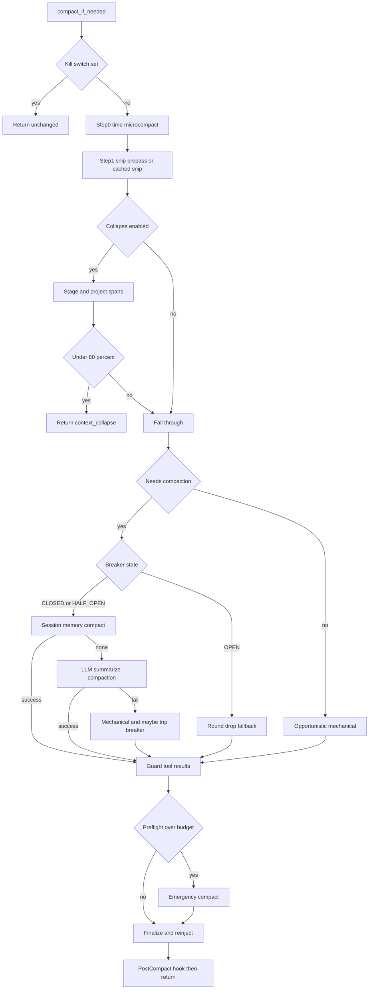
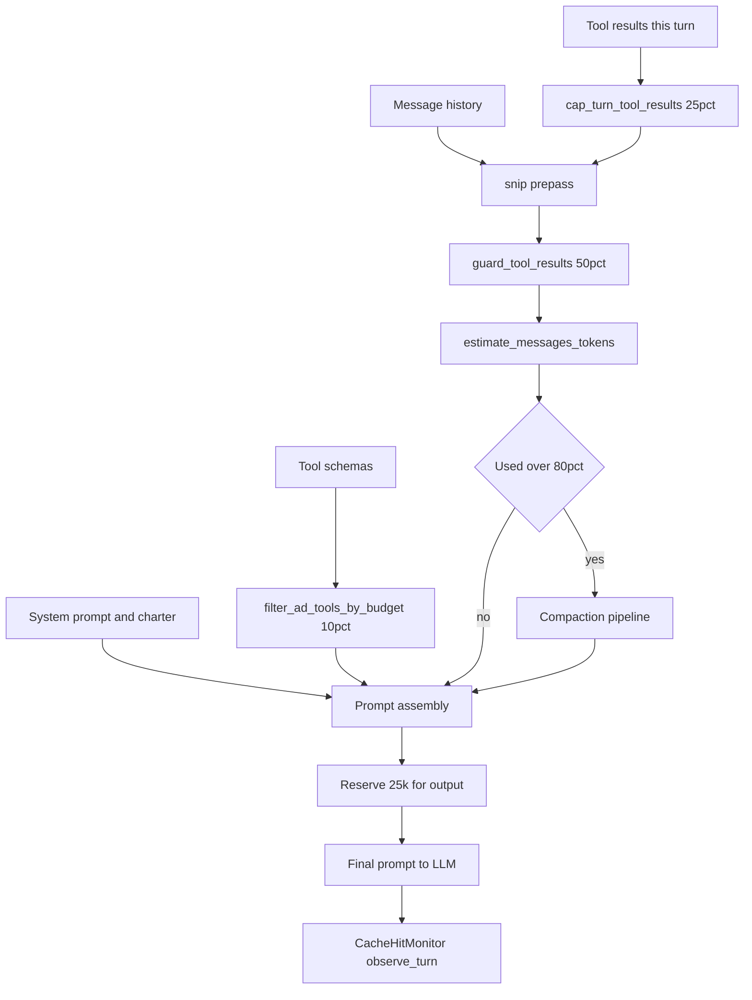

## engine_core — Context Engineering, Compaction & Prompt Caching

**Purpose:** This slice owns all context-window management for the agent loop — estimating token usage, surgically pruning redundant tool output, summarizing/dropping old history under graduated pressure, and keeping the Anthropic prompt-cache prefix stable while monitoring its health. Called exclusively by the agent loop (see [Agent Loop & Threading](#sec-40-engine-core-loop-md)).

**Responsibilities (what this slice owns):**
- Token estimation for messages, tool results, and structured system prompts (`estimate_tokens`, `estimate_tokens_dense`, `estimate_messages_tokens`, `estimate_system_tokens`).
- Per-result, per-turn, sub-agent, search-result, and AD-tool-schema capping (`cap_tool_result`, `cap_turn_tool_results`, `cap_sub_agent_result`, `cap_search_results`, `filter_ad_tools_by_budget`).
- The full compaction pipeline and its circuit breaker (`CompactionOrchestrator`).
- Four distinct pressure-relief mechanisms: **snip pre-pass**, **microcompaction**, **context collapse**, and **cached snip** (server-side cache-edit deletion).
- Tool_use/tool_result pairing repair and tombstone generation to keep the API contract valid after drops.
- Prompt-cache-break detection and cache-hit-ratio monitoring.
- Post-compaction cache invalidation across engine subsystems.
- The per-turn token *output* budget loop (`check_token_budget` / `BudgetTracker`), distinct from the context-window budget.

**Internal components / layers:**

*Context assembly & estimation* — `context_engineering.py` is the primitive layer. Token counts use two ratios: `estimate_tokens` (chars/4 × 1.2 safety margin, for English) and `estimate_tokens_dense` (chars/2 × 1.2, for code/JSON tool results). `estimate_messages_tokens` (`context_engineering.py:397`) routes `ToolResultBlock` content through the dense estimator and everything else through the text estimator. `block_content_text` (`:368`) flattens the `str | list[ContentBlock]` union of `ToolResultBlock.content` into a flat string view, where `ImageBlock` contributes 0 and `PersistedBlock` (the disk-spill stub produced by the event→block fold, see [Sub-Agents/Tools/Blocks](#sec-46-engine-core-agents-tools-blocks-md)) contributes its summary.

*Capping (assembly-time guardrails)* — applied as tool output enters context, before any compaction: `cap_tool_result` (`:447`, head+tail preservation when an error tail is detected via `has_important_tail`), `cap_turn_tool_results` (`:476`, caps aggregate parallel-tool output at 25% of window, trims largest first, only `COMPACTABLE_TOOLS`, never errors), `filter_ad_tools_by_budget` (`:582`, splits tools into loaded full-schema vs deferred name-only at 10% of window, lowest-relevance deferred first).

*Compaction vs microcompaction vs context collapse vs cached snip* — four mechanisms, increasing in cost and aggression:
- **Snip pre-pass** (`snip_prepass`, `:939`) — zero-cost, zero-LLM, every turn. Replaces *provably redundant* tool results with stubs using four strategies: duplicate file reads (`find_duplicate_reads`), reads superseded by a later write+reread (`find_superseded_reads`), grep/glob results whose target files were all later read (`find_search_then_read`), and stale read-only results in the oldest 50% of messages (`find_stale_reads`). Only touches `SNIPPABLE_TOOLS`; never write results.
- **Microcompaction** (`time_based_microcompact.py`) — time/idle-driven, not token-driven. Clears `ToolResultBlock` content for `COMPACTABLE_TOOLS` older than `keep_recent` (default 5), replacing them with `STALENESS_MARKER` ("[Old tool result content cleared]"). `TIME_BASED` fires when the gap since the last assistant timestamp exceeds `gap_threshold_minutes` (default 60); `FORCED` fires unconditionally as reactive Tier 0.
- **Context collapse** (`context_collapse.py`) — mechanical, incremental, *no LLM*. Scores every message via `importance_scoring.py`, stages spans of consecutive low-importance messages through three usage bands (0.75/0.85/0.95), and commits staged spans into one mechanical summary message at ≥0.95 usage or on 413. When enabled it *owns the threshold ladder* and short-circuits the rest of the pipeline.
- **Full compaction** — the expensive LLM path: `compact_messages_with_summary` (`:1889`) sends the cached prefix + `COMPACT_PROMPT` and asks the model to summarize; `compact_messages` (`:1098`) is the mechanical gut+drop fallback; `emergency_compact` (`:1159`) keeps first + last N rounds and guts everything.
- **Cached snip** (`cached_snip.py`) — an alternative to mutating snip that preserves the cache. Instead of rewriting tool_result content (which breaks the prefix), it queues `tool_use_id`s for server-side deletion via the Anthropic `cache_reference` + `cache_edits` beta API, leaving in-memory messages byte-identical.

*Prompt-cache-break detection* (`prompt_cache_break_detection.py`) — two-phase. `record_prompt_state` (pre-call) dual-hashes the system prompt (with and without cache_control scope/TTL) plus per-tool schemas; `check_response_for_cache_break` (post-call) classifies a >50% drop in `cache_read_input_tokens` as EXPECTED (announced via `notify_cache_deletion`), CLIENT_CONTENT, CLIENT_SCOPE, CLIENT_TOOLS, or SERVER_TTL.

*Cache-hit monitoring* (`cache_hit_monitor.py`) — lightweight operational alerting, one instance per agent-loop call, gated on `settings.cache_hit_monitor_enabled` (default true). `agent_loop` calls `observe_turn` right after `record_turn_usage` on every turn; it fires `RATIO_LOW` (ratio < 0.5 after turn 2) and `PREFIX_UNSTABLE` (cache_read drop > 10% AND > 2000 tokens) with cause attribution (model change / tool change / TTL expiry). Each alert is logged and emitted as a `CacheHitRatioAlert` event.

**Key files:**

| File | LOC | Role |
|---|---|---|
| `context_engineering.py` | 1946 | Primitive token estimation, capping, snip pre-pass, mechanical/emergency compaction, LLM summarization, pairing repair, tombstones |
| `compaction_orchestrator.py` | 1945 | `CompactionOrchestrator` — proactive & reactive pipelines, circuit breaker, post-compact re-injection/restoration |
| `context_collapse.py` | 737 | `ContextCollapseManager` — mechanical span staging/commit/projection, SQLite persistence |
| `time_based_microcompact.py` | 397 | Time-based & forced microcompact — staleness-marker tool_result clearing |
| `microcompact_config.py` | 135 | `MicrocompactConfig` + `COMPACTABLE_TOOLS` set (SQLite-loaded) |
| `cached_snip.py` | 456 | Cache-aware snip via `cache_reference`/`cache_edits` server-side deletion |
| `importance_scoring.py` | 203 | Pure `score_message_importance` for context collapse |
| `token_budget.py` | 171 | `BudgetTracker` + `check_token_budget` (per-turn output budget loop) |
| `post_compact_cleanup.py` | 141 | `run_post_compact_cleanup` — single source of truth for cache resets |
| `prompt_cache_break_detection.py` | 220 | Pre/post-call cache-break classification + pending-deletion seam |
| `cache_hit_monitor.py` | 215 | Per-invocation cache-ratio/prefix-instability alerting |

**Key types / classes / dataclasses:**

| Name | File | What it is |
|---|---|---|
| `CompactionOrchestrator` | compaction_orchestrator.py:418 | Central coordinator; stored on Thread, persists circuit-breaker state & history across turns |
| `CompactionConfig` | compaction_orchestrator.py:103 | SQLite-persisted thresholds (min/max tokens, breaker tunables) |
| `CompactionResult` / `ReactiveCompactResult` | :170 / :187 | Return values of proactive / reactive paths |
| `CompactionRecord` | :155 | One compaction event for history |
| `CircuitState` (Enum) | :63 | CLOSED / OPEN / HALF_OPEN breaker state machine |
| `FileReadRecord` / `PostCompactAttachment` | :199 / :208 | TOCTOU-safe file restoration metadata |
| `ContentReplacementState` | context_engineering.py:56 | Caches tool-result stub decisions for cache-stable replacements; "frozen" once seen-but-unreplaced |
| `ContextCollapseManager` | context_collapse.py:342 | Owns staged/committed collapses for one session |
| `StagedSpan` / `CommittedCollapse` | context_collapse.py:90 / :107 | Frozen span records (fingerprinted by ts/role/preview/length) |
| `MicrocompactConfig` | microcompact_config.py:51 | Frozen config: enabled, gap_threshold_minutes, keep_recent |
| `TriggerMode` / `TimeBasedTrigger` / `MicrocompactResult` | time_based_microcompact.py:67 / :80 / :99 | Microcompact eligibility + result |
| `CachedSnipState` / `PinnedCacheEdit` | cached_snip.py:117 / :103 | Per-provider cache-edit state (pending/pinned/deleted/header_latched) |
| `BudgetTracker` / `ContinueDecision` / `StopDecision` | token_budget.py:32 / :83 / :106 | Per-turn output-budget loop state & decisions |
| `PromptState` / `CacheBreakType` / `CacheBreakResult` | prompt_cache_break_detection.py:84 / :100 / :110 | Cache-break detection snapshot & classification |
| `CacheHitMonitor` / `CacheAlert` / `CacheAlertType` | cache_hit_monitor.py:66 / :47 / :41 | Cache-ratio monitoring |

**The compaction pipeline** (proactive `compact_if_needed`, `compaction_orchestrator.py:705`):

1. **Kill switch** — return the messages unchanged if `DISABLE_COMPACT`/`DISABLE_AUTO_COMPACT` is set (`:760-761`).
2. **Step 0 — time-based microcompact** (`:763`). If the idle gap exceeds threshold, clear stale tool_result content (keep most-recent N). Because this rewrites the prefix, it calls `adapter.reset_snip_state()` (cache now cold) and emits `MicrocompactEvent`.
3. **Step 1 — snip pre-pass** (`:792`). Either the legacy mutating `snip_prepass` OR, when `FEATURE_CACHED_SNIP_PREPASS` is on + adapter supports it + main-thread + model supported, the cache-aware path: `snip_prepass_get_deletes` computes IDs and `adapter.queue_snip_cache_edits` queues server-side deletions *without mutating messages*. Must run before collapse so collapse's scoring sees post-snip token counts.
4. **Context-collapse pre-pass** (`:826`). If `collapse_manager.enabled`: `evaluate_and_stage` → `project_messages` → `save_state`. If projection drops it below `needs_compaction` (80%), **return early** with strategy `context_collapse`. Otherwise fall through (all-high-risk backstop).
5. **PreCompact hook** (`:895`) — fires only when over threshold; can veto (`prevent_continuation` → no-op return with `strategy="skipped_by_hook"`).
6. **Step 2 — threshold compaction** at `needs_compaction` = ≥80% of window (`:933`):
   - Breaker **OPEN** → skip LLM, use `drop_oldest_rounds` mechanical fallback, emit `CompactionCircuitBreakerSkip`.
   - Breaker **CLOSED/HALF_OPEN** → try `try_session_memory_compact` (Working Memory summary, no LLM) first; if WM has no useful content, run `compact_messages_with_summary` (the LLM path). LLM success resets the breaker / zeroes `consecutive_failures`; failure increments failures, reverts a probe to OPEN, trips the breaker at `MAX_CONSECUTIVE_FAILURES` (3), and falls back to mechanical `compact_messages`.
   - Below threshold → opportunistic mechanical `compact_messages`.
7. **Context-shrink reset** (`:1030`) — if mechanical freed ≥30% of tokens, reset breaker failures (the overload condition is gone).
8. **Step 3 — tool-result aggregate guard** (`guard_tool_results`, `:1038`) — caps tool results at 50% of window, oldest first, replacing content with stubs; uses `ContentReplacementState` for cache-stable byte-identical re-application; drops oldest round if still over.
9. **Step 4 — preflight budget check** (`:1061`) — `post_tokens + sys_tokens + tools_tokens + RESERVE_FLOOR (25k)`; if ≥ window, run `emergency_compact` (keep first + last 5 rounds, gut everything, repair pairing).
10. **Finalize** (`finalize_compaction`, called at `:1098`, defined at `:1576`) — append `COMPACTION_BOUNDARY_CONTENT` marker with `compact_meta` comment; re-inject charter/mission + WM checkpoints/events; restore most-recently-read files from disk (TOCTOU-checked, `POST_COMPACT_MAX_FILES=5`, token-budgeted); re-announce discovered tools; re-inject matched skills; `run_post_compact_cleanup`.
11. **PostCompact hook** (`:1109`) — fires after any compaction; `additional_contexts` flow back via `CompactionResult.hook_contexts`.

**Reactive pipeline** (`reactive_compact`, `:1136`, on API 413 overflow): Tier −1 = context-collapse drain (`commit_all_staged` + project, cheapest) → Tier 0 = forced microcompact + `compact_messages(preserve_recent=10)` → Tier 1 = `guard_tool_results` → Tier 2+ = `emergency_compact`. Returns `made_progress=False` so the caller escalates rather than retrying identical messages.

**Token budgeting & importance scoring:**
- *Context-window budget* is fixed-ratio: compaction at `COMPACTION_THRESHOLD=0.80`, `RESERVE_FLOOR=25k` always free for output, tool results ≤50% (`TOOL_RESULTS_BUDGET_RATIO`), per-turn parallel tool output ≤25% (`PER_TURN_TOOL_RESULTS_CAP`), AD tool schemas ≤10% (`AD_TOOL_SCHEMA_CAP`), `PRESERVE_RECENT=15` messages always verbatim, per-result hard cap `TOOL_RESULT_CAP=8k`.
- *Output budget* (`token_budget.py`, separate concern): `check_token_budget` decides continue vs stop based on `COMPLETION_THRESHOLD=0.9` and a diminishing-returns rule (`continuation_count ≥ 3` AND two consecutive deltas < `DIMINISHING_THRESHOLD=500`). Sub-agents and missing budgets short-circuit to stop. `reset_delta_origin` zeroes the delta baseline after a compaction boundary to avoid a false negative-delta diminishing trigger.
- *Importance scoring* (`importance_scoring.py`) drives only context collapse. Pure deterministic function: user (non-tool-result) messages pinned to 1.0; tool classes scored Edit/Write 0.70 > assistant-text 0.55 > Read 0.40 > Search 0.25; short (<100 char) tool results × 0.7; error-keyword content × 1.3; recency bonus up to 0.25. Collapse bands: risk < 0.30 stages under USAGE_MID, < 0.60 under USAGE_HIGH, anything at ≥0.95 usage.

**Prompt caching strategy:**
- **Stability over churn.** Mutating any tool_result shifts the prefix hash and busts the server KV cache, so the slice goes to lengths to avoid mutation. `ContentReplacementState` (context_engineering.py:56) caches each stub's exact text and re-applies it byte-for-byte; once a result is seen-but-not-replaced it's *frozen* and can never be replaced later (changing a decision mid-session would shift the prefix).
- **Cache-stable replacements** gated by `FEATURE_CACHE_STABLE_REPLACEMENTS` (default true), used inside `guard_tool_results`.
- **Cached snip** (`cached_snip.py`) is the cleanest cache-preserving path: server-side `cache_edits` delete tool results while client messages stay identical. `CACHE_EDITING_BETA_HEADER` is *latched* once sent and never dropped (even on reset) to avoid busting the cache. `apply_cache_edits_to_messages` adds `cache_reference` to tool_results strictly before the last `cache_control` marker, re-pins prior edits, and inserts new deletes after tool_results in the last user message.
- **Cache-safe summarization** (`summarize_old_messages`, `:1702`) sends the parent conversation's *exact cached prefix* (system + tools + history) with `skip_cache_write=True` so only the compaction prompt is uncached. PTL (prompt-too-long) retry drops oldest rounds up to 3× on overflow.
- **Break detection & monitoring** are the observability layer: `notify_cache_deletion` (called by microcompact) announces an expected drop so `check_response_for_cache_break` classifies it EXPECTED; `CacheHitMonitor.suppress_next_drop` does the same for `PREFIX_UNSTABLE` alerts, and `agent_loop` calls it after proactive compaction, after a microcompact (`CompactionResult.microcompacted`), and after a reactive tier that made progress.

**Public API / entry points** (called by other engine_core code):
- `CompactionOrchestrator.compact_if_needed(...)`, `.reactive_compact(...)`, `.reset_for_new_user_message(...)`, `.record_file_read(...)`, `.record_matched_skills(...)`, `.update_context(...)`, `.reset()`, `.manual_reset(...)`.
- From `context_engineering.py`: `estimate_messages_tokens`, `needs_compaction`, `cap_turn_tool_results`, `cap_sub_agent_result`, `cap_search_results`, `filter_ad_tools_by_budget`, `generate_tombstone_results`, `repair_tool_use_result_pairing`, `drop_oldest_rounds`.
- `token_budget.create_budget_tracker`, `check_token_budget`, `pct_of_budget`.
- `cache_hit_monitor.CacheHitMonitor().observe_turn(...)` / `.suppress_next_drop()`, called by `thread.agent_loop`; `prompt_cache_break_detection.notify_cache_deletion`, called by `time_based_microcompact`. The rest of `prompt_cache_break_detection` (`record_prompt_state`, `check_response_for_cache_break`) has no caller in `src/`.
- `microcompact_config.MicrocompactConfig.load`, `CompactionConfig.load`, `ContextCollapseManager.restore_state`.

**Inbound dependencies** (who calls in): `src/engine_core/thread.py` (`ExecutionThread`) is the sole live caller. `ensure_compactor` constructs the orchestrator and a `ContextCollapseManager`; `agent_loop` calls `reset_for_new_user_message`, `compact_if_needed`, `reactive_compact`, `record_file_read`, `record_matched_skills`, and uses `cap_turn_tool_results`, `filter_ad_tools_by_budget`, `generate_tombstone_results`, `check_token_budget`. (These call sites are deliberately left un-anchored: `thread.py` is the largest file in the engine and moves every session, so line numbers for nine scattered call sites would be wrong within a week; grep for the method name instead.) `src/config.py` reads the feature/settings flags; `src/engine_core/events.py` defines the emitted event types. `cached_snip.snip_prepass_get_deletes` reuses `context_engineering`'s private `find_*` strategy functions.

**Outbound dependencies** (what it calls):
- **herald** — `src.herald.types` (Message, TextBlock, ToolUseBlock, ToolResultBlock, ImageBlock, PersistedBlock, SystemPromptBlock, Usage) throughout; `adapter.generate_with_tools` for the summarization LLM call; `src.herald.retry.is_context_overflow`; `src.herald.token_budget_parser.get_budget_continuation_message`; `src.engine_core.fork_subagent.build_fork_messages`.
- **memory** — `WorkingMemoryBackend.get_context_summary` (session-memory compaction) and `read_by_type` (checkpoint/event re-injection); see [Memory](#sec-54-memory-md) for Working Memory semantics.
- **infra** — `SqlitePool` for `CompactionConfig`, `MicrocompactConfig`, and context-collapse snapshot/commit tables.
- **engine_core internals** — `events` (emitter), `hooks`/`lifecycle_hooks` (Pre/PostCompact), `schema` (Charter, FOREGROUND_QUERY_SOURCES), filesystem (`open()` for file restoration).

**Data & state:**
- *Persisted (SQLite):* `compaction_config` (migration 009) and `microcompact_config` (migration 011) key/value tables; `context_collapse_snapshot` (last-wins per thread) + `context_collapse_commits` (append-only, migration 012). For the full migration/table catalog and storage conventions see [Data Model](#sec-20-data-model-md).
- *In-memory session state on orchestrator:* `consecutive_failures`, `circuit_state`, `tripped_at`, `total_trips/probes/probe_successes`, `history` (CompactionRecord list), `file_read_state` (path→FileReadRecord), `last_matched_skills`, `last_summarized_msg_index`, `replacement_state_cache`.
- *Module-level (process-wide) state:* `prompt_cache_break_detection.pending_deletions` (set) — an intentional singleton for a single-process agent.
- *Per-provider state:* `CachedSnipState` lives on the LLM provider instance (not module-level), reset on compaction but `header_latched` preserved.

**Invariants / contracts / gotchas:**
- **Timestamp preservation** is load-bearing: every message-rebuilding routine MUST carry `msg.timestamp` forward, or the time-based microcompact trigger goes blind.
- **System prompt, tool schemas, and charter are never in the messages list** and never compacted — handled separately (context_engineering.py:1109).
- **`PRESERVE_RECENT=15`** messages are always kept verbatim; collapse additionally never touches the last 15 and hard-refuses pure user-intent messages (scorer pins them to 1.0).
- **Tool_use/tool_result pairing must be whole** before any API call. `repair_tool_use_result_pairing`, `adjust_keep_index`, `shrink_span_to_whole_pairs`, and `generate_tombstone_results` all exist to prevent the API-400 from orphaned pairs; `group_by_api_round` keeps parallel tool calls in one group so emergency/round drops never split an assistant response from its results.
- **Cache prefix stability is invariant:** `ContentReplacementState.is_frozen` guarantees a tool result seen-but-unreplaced is never replaced later; cached-snip never mutates messages; `CACHE_EDITING_BETA_HEADER` is latched permanently per session.
- **Circuit breaker:** trips after 3 consecutive LLM-compaction failures, HALF_OPEN probe after 300s cooldown, shrink-reset if mechanical frees ≥30%.
- **Reactive-attempt counter survives stop-hook retries** — `overflow_attempt` is the overflow retry-loop variable (`thread.py:4896`), and the stop-hook blocking-error branch injects its reminder and issues a `continue` against that same loop (`thread.py:5688`–`5713`) rather than restarting it, so the counter advances across stop-hook retries instead of resetting. Resetting it would cause a compact→413→hook-block death spiral.
- **Two "budget" concepts** that look similar but are unrelated: context-window budget (this slice's compaction thresholds) vs per-turn output budget (`token_budget.py`).
- `COMPACTABLE_TOOLS` differs between modules: `context_engineering.py:213` uses lowercase/snake names (`read_file`, `bash`), while `microcompact_config.py:36` uses TitleCase (`Read`, `Bash`) — the two sets target different tool-naming conventions and are not interchangeable.

**Refactoring seams / boundary observations:**
- **Clean seams:** `run_post_compact_cleanup` is a single, well-documented source of truth for cache invalidation with every dependency optional and try/except-wrapped. `importance_scoring.score_message_importance` is a pure function with no I/O. `token_budget.py` is fully self-contained.
- **Tight coupling / smells:** `cached_snip.snip_prepass_get_deletes` imports five **private** `find_*`/`build_tool_index` functions from `context_engineering`. This slice reaches into provider internals by attribute name — `compaction_orchestrator.py:777` hasattr-probes then calls `adapter.reset_snip_state()`; `post_compact_cleanup.py:125` flips `llm_provider.latched_thinking` — duck-typed coupling to herald's `Provider` shape (one more instance of the herald↔engine_core boundary leak indexed in [Boundaries & Refactoring](#sec-80-boundaries-refactoring-md)). `CompactionOrchestrator` is a ~1,500-line god-object mixing circuit-breaker state machine, strategy dispatch, post-compact re-injection, file restoration, and skill/tool re-announcement — the last four are extraction candidates. `context_engineering.py` is a flat ~1,900-line grab-bag (estimation + capping + snip + compaction + pairing-repair) that could split along its existing section comments.
