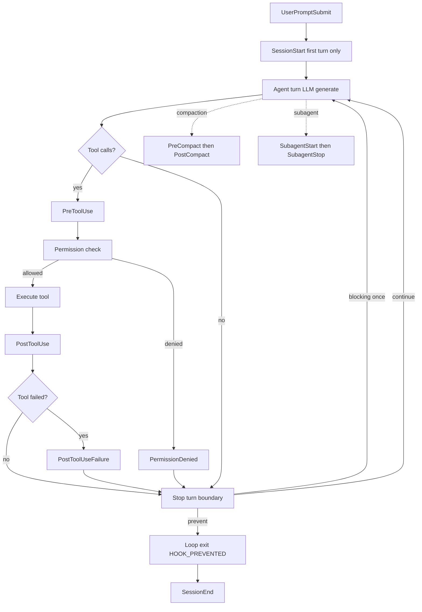
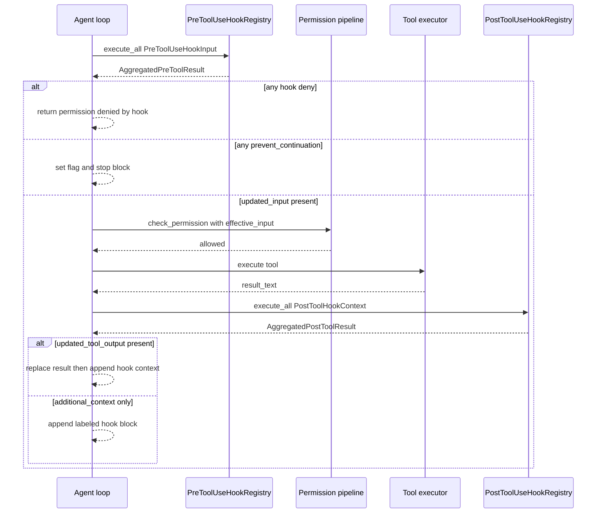

## engine_core — Hooks Subsystem

**Purpose:** A lifecycle/extensibility layer that lets external code (settings files, plugins, session-registered callables, webhooks, and LLM/sub-agent side-queries) intercept, modify, observe, block, or veto the agent at 25 named lifecycle points — most importantly around every tool call (`PreToolUse`/`PostToolUse`) and every turn boundary (`Stop`). Dispatch call sites live in the agent loop (see [Agent Loop & Threading](#sec-40-engine-core-loop-md)) and compaction (see [Context & Compaction](#sec-42-engine-core-context-compaction-md)) — this subsystem owns only the vocabulary, registries, and hook implementations.

**Responsibilities (what this slice owns):**
- The canonical `HookEvent` enum (25 events) and the wire `hook_event_name` vocabulary (`hooks.py:42-96`).
- Matcher-pattern grammar and evaluation: wildcard / exact / pipe-OR / regex / condition forms (`hooks.py:131-197`).
- Three bespoke per-event registries with event-specific aggregation rules: pre-tool, post-tool, stop.
- A generic registry + per-event bundle for the other 19 lifecycle events with registered input types (`GenericHookRegistry` in `generic_hooks.py`, keyed off `EVENT_INPUT_TYPES` in `lifecycle_hooks.py`); the remaining 3 (SessionStart/SessionEnd via their own hook lists, PermissionRequest enum-only) are handled outside the generic bundle. (3 bespoke + 19 generic + 3 outside = 25.)
- Hook *implementations* across four transports: Python callable, subprocess command, HTTP webhook, and LLM/SubAgent side-query.
- Settings discovery/loading from 4 files + plugins + session, with source-prefixed names and priority ordering (`hook_settings.py`).
- It does NOT own: the agent loop control flow, the permission pipeline (see [Sandbox](#sec-50-sandbox-md)), or the dispatch call sites — those live in `thread.py`, `sub_agent.py`, `compaction_orchestrator.py`, which *consume* this subsystem.

**Hook taxonomy** (every event point in `HookEvent`; capability = what the result can do):

| Event | Fires when | Can do |
|---|---|---|
| **PreToolUse** | Before a tool call, *before* the permission pipeline (see [Sandbox](#sec-50-sandbox-md)) runs (`Thread.run_single_tool`) | **block** (deny), **modify** (updated_input), **allow**, **inject** (additional_context), exit loop (prevent_continuation), return error-as-result |
| **PostToolUse** | After tool result is ready, before model sees it (`Thread.run_single_tool`) | **modify** (updated_tool_output), **inject**, exit loop, observe |
| **PostToolUseFailure** | After PostToolUse when the result indicates failure | inject `additional_context`; observe (auto-retry) |
| **PermissionDenied** | After permission pipeline denies a call (`Thread.run_single_tool`) | inject `additional_context` explaining denial |
| **SessionStart** | Once, on first `execute()` (`Thread.execute`) | observe / side-effect |
| **SessionEnd** | On `session_end()` teardown (`Thread.session_end`) | observe / side-effect |
| **Stop** | After every agent turn (`run_stop_hooks`) | **block continuation** (prevent_continuation→HOOK_PREVENTED), **inject+retry once** (blocking_error→system-reminder), observe |
| **SubagentStart** | At `SubAgent.run_loop()` entry (`SubAgent.run_loop`) | **veto spawn** (prevent_continuation), **inject** context prepended to task brief |
| **SubagentStop** | After sub-agent finishes (`SubAgent.run_loop`) | observe |
| **PreCompact** | Before context compaction (`CompactionOrchestrator.compact_if_needed`) | **skip compaction** (prevent_continuation), inject post-compact context |
| **PostCompact** | After compaction (`CompactionOrchestrator.fire_post_compact_hook`) | inject context, **replace summary** (updated_payload) |
| **UserPromptSubmit** | User turn starting (`Thread.execute`) | **veto turn** (prevent_continuation→[blocked by hook]), **rewrite** prompt |
| **PermissionRequest, Setup, StopFailure, Notification, TeammateIdle, TaskCreated/Completed, ConfigChange, CwdChanged, FileChanged, InstructionsLoaded, WorktreeCreate/Remove** | enum value + frozen input + lazy registry exist, but **no dispatch call site** — forward-declared seams | observe / inject (when wired) |

Note: many events are loadable from settings and register, but **nothing fires them** yet — they are forward-declared seams.

**Internal components / layers:**
- **Vocabulary layer** — `hooks.py`: `HookEvent`, `HookMatcher`, `matches_tool()`, `TOOL_LIFECYCLE_EVENTS`.
- **Bespoke registries** — `PreToolUseHookRegistry`, `PostToolUseHookRegistry`, `StopHookRegistry`: each aggregates with event-specific rules.
- **Generic registry layer** — `GenericHookRegistry[InputT]` + `LifecycleHookBundle`: one lazily-created registry per generic event.
- **Hook implementations (4 transports)** — Callable / Command (subprocess) / Http (webhook) / Prompt+Agent (LLM side-query).
- **Executor primitives** — `hook_executors.py`: `run_command_hook`, `build_hook_env`, `post_json` (curl).
- **Config/loader layer** — `hook_settings.py`: `HookSettingsManager`, path discovery, matcher-filter wrappers.
- **Async-task tracker** — `async_hook_registry.py`: `AsyncHookRegistry` (orphan, not instantiated).
- **Sync vs async:** Everything is `async`/`await` on the single agent event loop. Command hooks spawn real subprocesses via `asyncio.create_subprocess_exec` (never `shell=True`). All registries run their hooks concurrently via `asyncio.gather` with per-hook `asyncio.wait_for`.

**Key files:**

| File | LOC | Role |
|---|---|---|
| `hooks.py` | 209 | `HookEvent` enum (25), `HookMatcher`, matcher evaluation grammar |
| `hook_settings.py` | 572 | `HookSettingsManager`: load from files/plugins/session, build hook objects, priority |
| `hook_executors.py` | 329 | HTTP hook classes + shared `run_command_hook`/`build_hook_env`/`post_json` |
| `async_hook_registry.py` | 239 | `AsyncHookRegistry` for fire-and-forget async hooks (not wired in) |
| `pre_tool_hooks.py` | 455 | PreToolUse types, registry, Callable+Command impls, aggregation (deny>allow) |
| `post_tool_hooks.py` | 370 | PostToolUse types, registry, `updated_tool_output` last-wins |
| `stop_hooks.py` | 462 | Stop types, registry, Callable+Command+Prompt impls |
| `lifecycle_hooks.py` | 412 | 19 frozen input dataclasses, `EVENT_INPUT_TYPES`, `LifecycleHookBundle` |
| `generic_hooks.py` | 419 | `GenericHookRegistry[InputT]`, Callable+Command+Http generic impls |
| `agent_hooks.py` | 225 | `AgentPreToolUseHook`/`AgentPostToolUseHook` — SubAgent-backed verdicts |
| `prompt_hooks.py` | 160 | `PromptPreToolUseHook`/`PromptPostToolUseHook` — LLM side-query verdicts |

**Hook execution model (step by step):**
1. **Registration** — At `Thread.__init__`, three bespoke registries + one `LifecycleHookBundle` are created. A `HookSettingsManager` is constructed and `manager.load()` runs.
2. **Source discovery & priority** — `load()` reads 4 files in order *user > project > local > plugin*, then session hooks last. Priority controls *load order*, not dedup: **every** entry is registered; registry name carries a source prefix.
3. **Per-block parse** — `register_from_block` parses `event` (unknown → skipped), `matcher` (default `"*"`), and each `hooks[]` entry by `type`. `command` → Command*Hook; `http` → Http*Hook.
4. **Routing to a registry** — by event: PreToolUse → `MatchedPreToolHook` on `pre`; PostToolUse → `MatchedPostToolHook` on `post`; Stop → `stop`; everything else → `lifecycle_bundle.registry(event)`.
5. **Matching** — At fire time the wrapper calls `matches_tool(matcher, tool_name, tool_input)`. Five forms: wildcard; exact; pipe-OR `a|b|c`; regex; condition `bash(npm publish)` (name-match AND any string field contains substring).
6. **Inputs** — A frozen input dataclass. Command hooks get `json.dumps(asdict(input))` on stdin + env vars `HOOK_EVENT_NAME/TOOL_NAME/TOOL_USE_ID/SESSION_ID/CWD`. HTTP hooks POST the same JSON.
7. **Concurrent execution** — `registry.execute_all(input)` runs every hook as `asyncio.wait_for(hook.execute(input), timeout)` inside `asyncio.gather`. **Fail-open:** any `BaseException`/`TimeoutError` becomes an inherit/no-op; only `CancelledError` re-raises.
8. **Command-hook exit-code contract** — `0` = parse stdout JSON; `2` = the "active" verdict (deny for pre, prevent for post, blocking for stop); anything else = fail-open.
9. **Aggregation / decisions** — *Pre:* `denied` if ANY hook denies (deny beats allow, fail-secure); `updated_input` = last non-None; contexts accumulated in registration order. *Post:* `updated_tool_output` last-wins. *Stop:* `prevent_continuation` = any; `blocking_errors` list. *Generic:* `updated_payload` last-wins.
10. **Loop integration** (the dispatch call sites live in the agent loop, see [Agent Loop & Threading](#sec-40-engine-core-loop-md), and compaction, see [Context & Compaction](#sec-42-engine-core-context-compaction-md)) — Pre: `prevent`→stop block; `denied`→"Permission denied by hook"; `updated_input`→`effective_input`; then `check_permission`. Post: `updated_tool_output`→replaces result; contexts appended. Stop: `prevent`→`LoopExitReason.HOOK_PREVENTED`; `blocking_errors` (when not already `stop_hook_active`)→inject system-reminder and run exactly one more turn.

**Public API / entry points:** `thread.py` calls `self.pre_tool_hooks.execute_all(...)`, `self.post_tool_hooks.execute_all(...)`, `run_stop_hooks`; generic events via `self.lifecycle_hooks.registry(event).execute_all(input)`. Config via JSON settings files or programmatic `register_session_hook`/`register_function_hook`.

**Inbound dependencies:** `thread.py` (Pre/Post/Stop/SessionStart-End/UserPromptSubmit), `sub_agent.py` (SubagentStart veto / SubagentStop), `compaction_orchestrator.py` (PreCompact/PostCompact), `schema.py` (payload shapes).

**Outbound dependencies:** subprocesses (`create_subprocess_exec`), `curl` for HTTP, `herald.LLM` (see [Herald](#sec-52-herald-md)) for Prompt hooks, `engine_core.sub_agent.SubAgent` (see [Sub-Agents/Tools/Blocks](#sec-46-engine-core-agents-tools-blocks-md)) for Agent hooks. Effects on engine state: tool input, tool output, permission outcome, loop exit, user prompt text, compaction summary, sub-agent spawn.

**Data & state:** config sources `~/.config/intelligence-engine/settings.json` (user), `.intelligence-engine/settings.json` (project), `.intelligence-engine/settings.local.json` (local), plugins, session, built-in. Registries are in-memory on the Thread, not persisted. Loop-side flags `tool_hook_prevented`, `stop_hook_active`.

**Invariants / contracts / gotchas:**
- **Fail-open everywhere except deny.** Crash/timeout/non-{0,2} exit/non-2xx HTTP all → no-op inherit. The single fail-*secure* path is PreToolUse deny. **Security implication:** a misconfigured or unreachable guardrail hook never blocks the agent.
- **Determinism:** lists are re-ordered into registration-order snapshots so concurrency doesn't reshuffle injected text / first-deny.
- **No `shell=True`:** command hooks always go through `create_subprocess_exec`; but the loader builds the wrapper from user/plugin settings, so a settings file is arbitrary code execution by design.
- **Stop retry guard:** `blocking_error` retries exactly once; `stop_hook_active` suppresses re-trigger; the retry turn still consumes the 200-turn budget.
- **Dead code — explicit `allow` is inert.** `AggregatedPreToolResult.allowed` is computed and emitted in telemetry (passed inline as `allowed=pre_agg.allowed` into the `PreToolUseHookExecuted` event) but never consumed: `check_permission` runs unconditionally regardless of `decision="allow"`. (Refactoring seam in [Boundaries & Refactoring](#sec-80-boundaries-refactoring-md).)
- **`AsyncHookRegistry` is an orphan** — fully implemented + documented but never instantiated; the async/rewake feature is not live.
- **Many events are forward-declared** (enum + input + lazy registry exist, no fire site).

**Refactoring seams / boundary observations** (indexed in the boundary scorecard, see [Boundaries & Refactoring](#sec-80-boundaries-refactoring-md)):
- **Clean seams:** `hooks.py` is a pure vocabulary layer; the four-transport pattern is uniform across event families; Prompt/Agent hooks isolate heavy deps behind `TYPE_CHECKING`; `LifecycleHookBundle` is the single seam handed to subsystems.
- **Coupling / friction:** the loader hard-codes per-event branching duplicating routing logic; the decision-application logic lives entirely in `Thread.run_single_tool` so the registry's contract and the loop's behavior drift (the `allow` gap documented above); `extract_json_object`/`result_from_dict` helpers are duplicated/re-imported across modules; `AsyncHookRegistry` is a dangling seam — wire it or remove it.
