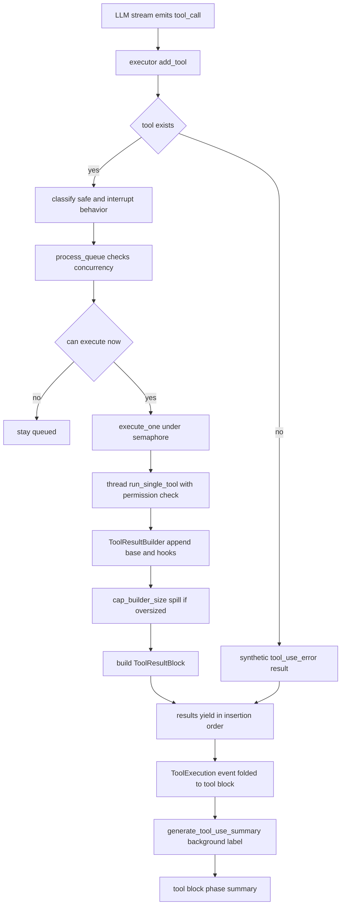
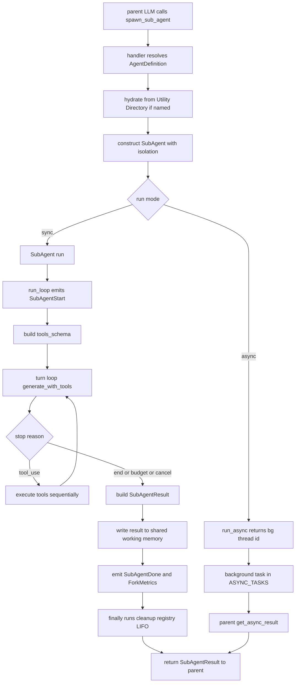

## engine_core — Sub-Agents, Tool Execution, Blocks & Stores

**Purpose:** This slice owns the runtime machinery for spawning isolated child agents (sub-agents/forks), executing tool calls with concurrency control and disk-spill, folding the engine's internal event stream into the v2 `Block` wire, and persisting conversations and ingested content to SQLite.

**In this chapter:** (a) **sub-agents / forks** — the isolated child-worker model, AgentType filtering, cache-sharing forks; (b) **streaming tool execution** — the pure scheduler, concurrency safety, sibling abort, result composition and disk-spill; (c) **Block serialization / FOLD** — the event→block fold *implementation* (`BlockSerializer`, the `FOLD` map, id-derivation mechanics, gates, per-thread buffers). The Block *contract* itself (the envelope, the 27-type vocabulary, the id-derivation rule, grouping) is canonical in [Block Wire Contract](#sec-25-block-contract-md); this chapter implements it; (d) **persistence stores** — conversation history, chunked ingested docs, on-disk agent eviction.

**Responsibilities (what this slice owns):**
- The `SubAgent` worker model: isolated message history, cancellation scope, token/USD/turn budgets, AgentType-based tool filtering, summarizer, idle watchdog, fork-mode prompt-cache sharing, and structured `SubAgentResult` return.
- Streaming tool execution: scheduling tools as they arrive, concurrency safety (safe-parallel vs exclusive-serial), sibling abort, interruptibility, ordered result harvesting.
- Tool-result composition (`ToolResultBuilder`), per-tool size caps with disk spill (`tool_result_storage`), short batch labels (`tool_use_summary`).
- The **block fold implementation**: the stateful event→block fold (`BlockSerializer`), per-instance id derivation, gate filtering, thread- and turn-scoped buffer/replay. (The `Block` envelope, its 27-type vocabulary, and the id-derivation *rule* are the contract, canonical in [Block Wire Contract](#sec-25-block-contract-md); this slice is where that contract is realized.)
- Output parsing: `<craft>` tags → craft blocks, `⟦cite:h⟧` markers → citation spans, the per-turn `SourceRegistry`.
- The Charter DAG schema + shared sub-agent type contracts (`schema.py`).
- Persistence: conversation history (`conversation_store`), chunked ingested docs (`ingestion_store`), on-disk agent metadata/transcript eviction (`agent_storage`).

**Internal components / layers:**
- **(a) Sub-agent spawning / forking / types.** `sub_agent.py`: `SubAgent.run()` drives `run_loop()` (capped at `effective_max_turns`, halved per chain depth) — an LLM turn loop that generates with tools, enforces budgets, executes tools, emits `SubAgentStart/Progress/Done/ForkMetrics`, fires SUBAGENT hooks, returns `SubAgentResult`. `run_async()` schedules a background task in `ASYNC_TASKS`, collected via `get_async_result()`. `fork_subagent.py` provides cache-sharing forks (prepend parent messages so the Anthropic cache prefix is reused; identical `FORK_PLACEHOLDER_RESULT` for all siblings). `agent_types.py`: `AgentType` (EXPLORE/PLAN/VERIFY/GENERAL), `filter_tools_for_agent()`, `ALL_AGENT_DISALLOWED_TOOLS`. `agent_summarizer.py` is an opt-in background timer that forks throwaway one-sentence summaries.
- **(b) Streaming tool execution.** `streaming_tool_executor.py` is a **pure scheduler** (thread.py provides `execute_fn`). `add_tool()` classifies concurrency safety and interrupt behavior; `process_queue()` starts eligible tools (safe parallel up to semaphore cap 10; an unsafe tool runs exclusively). Results yield in **insertion order**. Sibling abort: a command-execution tool that errors fires `sibling_cancel` to kill sibling subprocesses without aborting the parent turn. `tool_result_builder.py` composes base output + permission feedback / hook attachments / images / persisted hints into a `ToolResultBlock`. `tool_result_storage.py`'s `cap_builder_size()` spills oversized results to disk and replaces with a `PersistedBlock` (caps: Bash 100K, Read 30K, web_fetch 80K, default 50K chars). `tool_use_summary.py` fires a background light-model call to produce a ≤30-char batch label.
- **(c) Block fold + parsers + sourcing.** `blocks.py` is the serialization boundary — the place the [Block wire contract](#sec-25-block-contract-md) is realized. `BlockSerializer.fold()` maps each internal event via the `FOLD` table (57 entries) to one of the contract's block `type`s, stamps a phase/kind discriminator, and derives `Block.id` from the logical instance via `block_id()`. `Gates` + `passes_gates()` filter block types per stream. `ThreadBlockBuffers` is a per-thread ring buffer + monotonic seq. `craft_parser.py` turns top-level `<craft …>…</craft>` tags into `CraftAuthored` events (fenced/inline-code stays literal). `citation_parser.py` strips `⟦cite:h⟧` and emits citation spans. `sourcing.py`'s `SourceRegistry` mints per-turn handles (`m1`/`a1`/`w1`) and projects display-only `{kind, **data}` to the wire (engine-private `ref` never serializes). `schema.py` holds the Charter DAG (`Node`/`Edge`/`Charter`, `validate_dag`/`topological_sort`) plus shared sub-agent types.
- **(d) Persistence.** `ingestion_store.py` chunks documents (4000-char chunks, 400 overlap) into `ingestion_chunks` (24h TTL). `conversation_store.py` owns `conversations` (per-thread metadata) and `conversation_messages` (sequenced history), 24h TTL. Its history writes **fail loudly**: `save_message()` retries once and then raises `ConversationPersistenceError`, and `next_seq()` raises rather than returning 0, because a guessed sequence collides with `UNIQUE(thread_id, seq)` on every later write. The metadata writers (`save_metadata`, `save_thread_index`, `ensure_conversation`) still log and swallow, because the next turn rewrites them wholesale and a message hole has no such repair path. `agent_storage.py` evicts on-disk metadata/transcript sidecars.

**Key files:**

| File | LOC | Role |
|------|-----|------|
| `sub_agent.py` | 1353 | Core child-worker: isolated turn loop, budgets, cancellation, fork mode, hooks, async backgrounding |
| `fork_subagent.py` | 388 | Cache-sharing fork prefix builder, recursive-fork guard, sidechain JSONL |
| `agent_summarizer.py` | 204 | Opt-in background progress summarizer |
| `agent_types.py` | 208 | AgentType enum, tool filtering, disallowed-tools set, per-type defaults |
| `agent_storage.py` | 124 | mtime-based eviction of metadata/sidechain artifacts |
| `streaming_tool_executor.py` | 609 | Concurrency-controlled streaming tool scheduler + ordered results + sibling abort |
| `tool_result_builder.py` | 193 | Composable `ToolResultBlock` builder |
| `tool_result_storage.py` | 135 | Per-tool size-cap disk spill → `PersistedBlock` |
| `tool_use_summary.py` | 143 | Background ≤30-char tool-batch label generator |
| `blocks.py` | 805 | The v2 `Block` envelope, event→block fold, id rule, gates, thread- and turn-scoped buffer/replay |
| `craft_parser.py` | 400 | Streaming fence-aware `<craft>` → `CraftAuthored` parser |
| `citation_parser.py` | 125 | Streaming `⟦cite:h⟧` → citation-span parser |
| `sourcing.py` | 99 | Per-turn `SourceRegistry`, handle minting, display/ref split |
| `schema.py` | 659 | Charter DAG + shared sub-agent/result/config types |
| `ingestion_store.py` | 462 | Chunked-document store (`ingestion_chunks`), list/search retrieval |
| `conversation_store.py` | 419 | Conversation CRUD (`conversations`, `conversation_messages`); message writes and sequence reads raise `ConversationPersistenceError` |

**Key types / classes:** `SubAgent`, `SubAgentResult` (Pydantic), `AgentType`/`AgentTypeDefaults`, `AgentDefinition`, `BudgetConfig`/`ObservabilityConfig`/`ForkConfig`, `QueryChainTracking`, `StreamingToolExecutor`, `TrackedTool`/`ToolStatus`, `ToolResultBuilder`, `Block`, `BlockSerializer`, `Gates`/`passes_gates`, `ThreadBlockBuffers`, `CraftParser`, `CitationParser`, `SourceRegistry`/`SourceRecord`, `Charter`/`Node`/`Edge`, `IngestionStore`, `ConversationStore`.

**Sub-agent model:** Constructed with a minimum-viable signature; all isolation is opt-in via kwargs. The `spawn_sub_agent` tool handler registered by `thread.py:1386` (`register_spawn_sub_agent_tool`) resolves an `AgentDefinition` (inline blob or hydrated from the Utility Directory), then constructs and runs the `SubAgent`. **Isolation** each gets: (1) independent message history; (2) scoped child `CancellationToken` (parent-cancel propagates to child, never reverse); (3) token/USD/output/turn budgets; (4) `filter_tools_for_agent()`-restricted tool registry (always strips the recursion set); (5) optional fresh LLM adapter for `model_override`; (6) permission mode (EXPLORE/PLAN default READ_ONLY); (7) a cleanup registry run LIFO. **Depth is hard-capped at 1 level.** **Forking** prepends parent messages for cache reuse; `is_in_fork_child()` blocks recursive forks. **Results return** three ways: the `run()` return (`SubAgentResult`), a best-effort write to shared working memory under the parent `thread_id`, and emitted `SubAgentDone`/`SubAgentForkMetrics`. **MCP**: a sub-agent reaches remote MCP servers only through the AssetDirectory chokepoint, via the `ad:{server}.{action}` ToolDefs its parent provisioned (built in `asset_directory/assets.py`); there is no per-agent MCP bootstrap, because that second path skipped the vetted gate, the circuit breaker, sealed credentials and the execution log. `tools_schema` is rebuilt after the sidechain is opened so late-registered tools still reach the LLM.

**Tool execution flow:** Tool execution is *entered* from the parent agent loop (see [Agent Loop & Threading](#sec-40-engine-core-loop-md)): per turn that loop builds a `StreamingToolExecutor` with `execute_fn=self.run_single_tool` (`thread.py:make_executor`). As the LLM streams tool_call events, `add_tool()` classifies and queues. `process_queue()` starts eligible tools (safe parallel under semaphore cap 10; unsafe exclusive). `run_single_tool` does permission checks, emits `ToolExecution`, runs the handler, builds the result via `ToolResultBuilder`, and `cap_builder_size()` spills oversized output. Results harvest in insertion order. After the batch, `generate_tool_use_summary()` fires concurrently with the next turn to produce a short label folded into a `tool` block with `phase=summary`.

**The fold implementation:** The `Block` envelope (`{id, type, thread_id, ts, payload}`), its 27-type vocabulary, the framing, and the id-derivation *rule* are the wire contract — canonical in [Block Wire Contract](#sec-25-block-contract-md). This module is where that contract is *executed*. Internal events are never serialized directly; `BlockSerializer.fold()` looks each event class up in the `FOLD` table (57 entries collapsing onto 25 of the contract's 27 block types; `error` and `done` are synthesized at the stream boundary, never folded) and stamps a `phase`/`kind` discriminator. `block_id()` implements the contract's id rule as a per-`btype` switch: append types (`text`, `reasoning`, `voice`) → `{btype}:{turn_id}:{thread_id}`, falling back to `{btype}:{turn_id}` when the event carries no owning thread; `tool` → `tool:{tool_use_id}` (or `tool:{first_id}` for a `ToolUseSummary` batch); `sub_agent` → `sub_agent:{agent_id}`; `source` → `source_block_id(turn_id, handle)`; `craft` and `image`/`audio`/`video` → a pre-minted `block_id` when the event carries one (the coordinator's `await_block_input` for craft, `voice_parser` for media), else `craft:{turn_id}` / `{btype}:{turn_id}`. `turn_id()` reads `request_id_var`. Privacy: only the registry's display `data` reaches the wire; `ref` never serializes (see `SourceRegistry` below). `passes_gates()` filters at the per-thread sink; unknown types fail open (gating semantics canonical in [Block Wire Contract](#sec-25-block-contract-md)).

**Stores:** the full migration/table catalog is canonical in [Data Model](#sec-20-data-model-md); the behavior these stores rely on: `conversations` (migration 007): `thread_id` PK, `charter_json`, `scratchpad_json`, `turn_count`, `lc_watermark`, routing columns `summary`/`current_state`/`recent_turns`. `conversation_messages` (007): `seq`, `role`, `content_json`, `UNIQUE(thread_id, seq)`. That uniqueness constraint is why `ConversationStore` refuses to guess: `save_message()` retries once and then raises `ConversationPersistenceError` rather than leave a permanent hole in the history, and `next_seq()` raises on a read failure instead of returning 0, since a guessed sequence collides with an existing row and every later write collides too. `thread.py` acts on it — it logs `critical` when the sequence cannot be read and then fails the turn rather than reporting success over a history it could not write. The self-healing metadata writers keep the old log-and-swallow behavior because the next turn rewrites them wholesale. `ingestion_chunks` (012): chunked docs, 24h TTL. On-disk (no DB): metadata sidecars + sidechain transcripts (rotated at 10MB, two rotations max), swept by `agent_storage`.

**Public API / entry points:** `server.py` imports `Block, BlockSerializer, Gates, passes_gates, sse_frame`; folds the event stream to blocks at the `/execute` SSE boundary (the contract emitted there is canonical in [Block Wire Contract](#sec-25-block-contract-md)). `thread.py` drives `StreamingToolExecutor`, `ToolResultBuilder`, `cap_builder_size`, `generate_tool_use_summary`, `CraftParser`/`CitationParser`, `SourceRegistry`, and `spawn_sub_agent` — the tool-execution loop that builds and feeds the executor lives in [Agent Loop & Threading](#sec-40-engine-core-loop-md).

**Inbound & Outbound dependencies:** *Inbound:* `server.py` (block serialization), `thread.py`, coordinator, Utility Directory. *Outbound:* `herald` (LLM, types, catalog), `events` (60 event dataclasses + EventEmitter), `cancellation`, `token_budget`, `context_engineering` (`compact_messages`, see [Context & Compaction](#sec-42-engine-core-context-compaction-md)), `hooks` (see [Hooks](#sec-44-engine-core-hooks-md)), `sandbox.permissions` (see [Sandbox](#sec-50-sandbox-md)), `utility_directory.tool_runtime`, `asset_directory.assets` / `asset_directory.permissions_store`, `memory` (see [Memory](#sec-54-memory-md)), `infra`, `raven`.

**Invariants / contracts / gotchas:**
- **The 27-type vocabulary is enforced** at import in this module (`assert len(BLOCK_TYPES) == 27` in `blocks.py`). Adding a `FOLD` mapping without updating the vocabulary breaks import. The count itself is the contract's, canonical in [Block Wire Contract](#sec-25-block-contract-md).
- **`block_id()` must return instance-distinct ids** (the contract's id rule, see [Block Wire Contract](#sec-25-block-contract-md)), or "replace by id" reconciliation silently overwrites concurrent blocks — e.g. two sub-agents must key on `agent_id`.
- **1-level sub-agent depth** enforced redundantly (disallowed-tools filter, spawn gate, `is_in_fork_child()`).
- **Fork cache-sharing is fragile**: setting `max_output_tokens` on a cache-sharing fork can invalidate the shared prefix on legacy Anthropic models. All siblings must produce byte-identical prefixes up to the directive — fork's local instance of the engine-wide prompt-cache-prefix-stability invariant (see [Context & Compaction](#sec-42-engine-core-context-compaction-md)).
- **Feature flags are strings**: `FORK_SUBAGENT`, `AGENT_SUMMARIZATION`, `FEATURE_SELF_ORPHAN_DETECT` check `=="true"`; `FEATURE_TOOL_USE_SUMMARY` checks `!="false"` (default on).
- **`run_async` saves/restores permission mode** — the previous version mutated `self.permission_mode`, poisoning reuse.
- **Store failure handling is split, not uniform**: `IngestionStore` tolerates `db=None`, and corrupt JSON is skipped on read. `ConversationStore` is the exception — its message write (`save_message`), sequence read (`next_seq`) and pin write (`set_pinned`) all raise `ConversationPersistenceError`, because none of those has a repair path: a dropped message leaves a permanent hole in the sequence, a guessed seq collides forever against `UNIQUE(thread_id, seq)`, and a silently-dropped pin lets the reaper delete work the product layer claimed. Only its self-healing metadata writers log and swallow, since the next turn rewrites them wholesale.
- **Empty tool result content** is replaced with a marker to dodge a documented model stop-sequence bug.
- **Sibling abort does not abort the parent turn** — only kills sibling command subprocesses; user-rejection/permission-denial DO bubble to the parent.

**Refactoring seams / boundary observations:**
- `StreamingToolExecutor` is a clean pure-scheduler seam — all permission/tracing/emission lives in `thread.py`'s `execute_fn`. The right boundary; reusable and testable.
- `BlockSerializer` is the *single* fold seam; the id-derivation logic is the load-bearing complexity, correctly centralized in `block_id()`.
- The streaming text parsers share `longest_token_prefix_suffix` (citation imports it from craft) — a shared "streaming tokenizer" utility would remove the cross-import.
- `schema.py` does double duty (Charter DAG + all sub-agent result/config types) — splitting `sub_agent_types.py` out would reduce the import surface.
- `tool_result_storage` per-tool caps are a hardcoded dict keyed by tool-name variants — a per-`ToolDef` declared cap would remove the name-matching fragility.
- The fork-subagent sidechain transcript layer (rotation, FIFO counter, JSONL) is logically a separate persistence concern alongside `agent_storage.py`.
