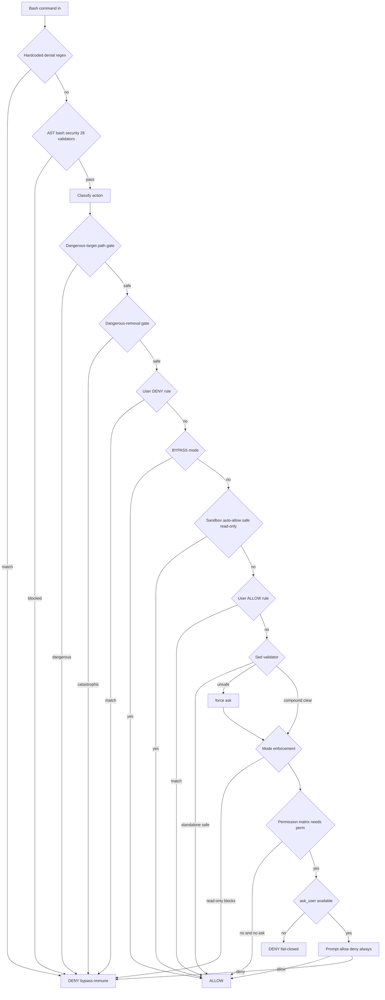
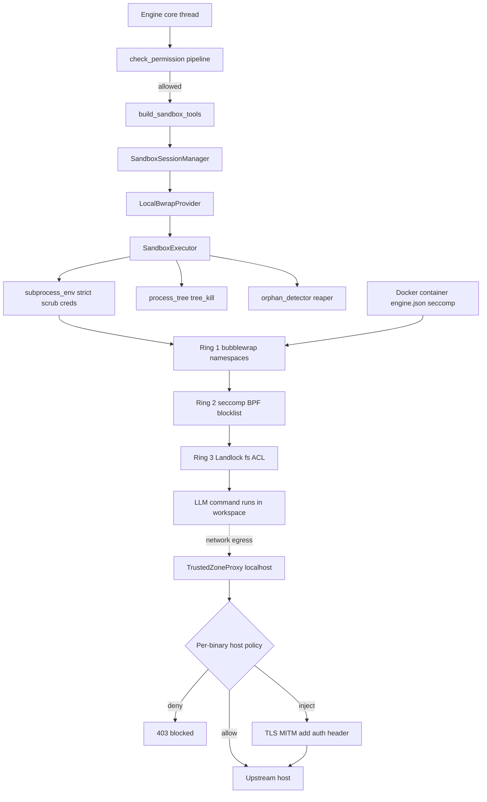

## sandbox — Secure Command & Tool Execution

**Purpose:** A defense-in-depth runtime that gates, classifies, and isolates every LLM-driven tool/command invocation — wrapping shell/code execution in OS-level containment (bubblewrap + seccomp + Landlock) behind a bypass-immune permission pipeline and a credential-injecting network egress proxy.

**Responsibilities (what this subsystem owns):**
- The permission decision for *every* tool call (allow / deny / ask), with hardcoded catastrophic denials that no rule, mode, or hook can override (`permissions.py:764`).
- AST-style bash security analysis — 26 validators catching injection, obfuscation, and parser-differential attacks regex can't see (`bash_security.py`).
- Shell command classification into SEARCH/READ/WRITE/DESTRUCTIVE (`command_classifier.py`) and read-only allowlisting (`readonly_allowlist.py`).
- Dangerous-path / dangerous-removal / sed-write detection and path-extraction from bash.
- The actual isolated execution: bubblewrap namespaces, seccomp-BPF, Landlock, background/PTY process management, filesystem bridge, env scrubbing.
- Network egress control: a localhost HTTP CONNECT proxy with per-binary policy and TLS-MITM credential injection.
- Permission-rule persistence, shadow-detection, process-tree teardown and orphan reaping.

**Defense layers** (in execution order; the first six are *decision-time*, the last two are *runtime containment*):

1. **Hardcoded catastrophic denials** — `HARDCODED_DENIALS` regexes (`permissions.py:159`): `rm -rf /`, `curl|sh`, `.ssh/authorized_keys`, force-push to main, `DROP TABLE`. Bypass-immune. *Defends:* worst-case one-shot destruction / RCE / credential theft.
2. **AST bash security analysis** (`analyze_bash_security`) — 26 validators. *Defends:* command substitution (`$()`, backticks, `<()`), heredoc abuse, ANSI-C/locale flag obfuscation, IFS injection, Unicode homoglyphs/BiDi overrides, control chars, carriage-return parser differentials, the shell-quote single-quote backslash bug, `/proc/*/environ` credential leaks, Zsh builtins. Compound commands split and each validated. Bypass-immune.
3. **Bypass-immune dangerous-target path gate** (`check_path_safety`) — runs on PLATFORM `file_path` and on every path `extract_written_paths()` pulls from a bash command. *Defends:* writes to shell config (`.bashrc`, `.zshrc`, `.mcp.json`, `.claude.json`), protected dirs (`.git`, `.claude`), Windows path-evasion (8.3 names, ADS `:`, UNC, WebDAV, DOS device names), null bytes, infinite-output device files. Symlink-resilient (raw + realpath). Cannot be overridden.
4. **Bypass-immune dangerous-removal gate** (`check_dangerous_removal`) — path-based, not flag-based. Walks every compound segment, extracts `rm/rmdir/unlink` targets (honoring POSIX `--`), dual-checks raw + realpath. *Defends:* `rm` of `/`, `~`, root children, `/*` wildcards, Windows drive roots — even when an allow rule/user approval would let it through. Defeats approval-fatigue.
5. **User DENY rules** → **bypass mode short-circuit** → **sandbox auto-allow** (`is_sandbox_auto_allowed`) → **user ALLOW rules** → **sed validator** (`check_sed_constraints`) → **path validation** (`validate_path`) → **mode enforcement** → **permission matrix** → **user prompt**.
6. **subprocess_env(mode="strict")** at every spawn site — scrubs AWS/GCP/Azure/OIDC creds from the child env (the strict-mode contract is canonical in [Security & Deployment](#sec-70-security-deployment-md)).
7. **Three runtime containment rings** — bubblewrap namespace isolation, seccomp-BPF syscall blocklist, and Landlock filesystem ACL self-restrict the spawned process; build details are below under *OS-level sandboxing*, and the two-ring trust model + end-to-end defense ladder that frames them is canonical in [Security & Deployment](#sec-70-security-deployment-md).
8. **Trusted-zone proxy** — when enabled, sandbox keeps localhost network and `HTTP(S)_PROXY` routes egress through a per-binary/per-host policy engine (`allow`/`deny`/`inject_credentials`); credentials are TLS-MITM-injected and never logged.

**Internal components / layers:**
- **Permission model** — `permissions.py` (pipeline, matrix, modes, denial tracking), `permission_store.py` (JSON persistence, `Tool(content)` rule format), `sandbox_auto_allow.py` (code-defined SEPTEMBERAI safe commands), `shadow_detection.py` (warns when a tool-wide deny/ask makes a specific allow unreachable), `readonly_allowlist.py` (per-command/per-flag proof a command is read-only).
- **Bash command security / parsing** — `bash_security.py` (26 validators + misparsing-priority runner), `command_classifier.py` (+ compound splitter), `command_path_extractor.py`, `bash_paths.py` (`extract_written_paths`), `dangerous_removal.py`, `sed_validation.py`, `sed_edit_parser.py`, `command_semantics.py`.
- **Path safety** — `path_safety.py` (canonical `DANGEROUS_FILES`/`DANGEROUS_DIRS`, `check_path_safety`, `PathSafetyResult`).
- **OS sandboxing** — `executor.py` (bwrap orchestration, safe-bin allowlist, process sessions, watchdog, fs bridge, `run_isolated`), `seccomp.py` (BPF builder), `landlock.py` (ctypes wrapper generator).
- **Network proxy** — `proxy.py` (CONNECT proxy + policy eval), `proxy_tls.py` (ephemeral ECDSA CA + per-host certs), `process_identity.py` (attributes each connection to the calling binary).
- **Process tracking / cleanup** — `process_tree.py` (recursive tree-kill), `orphan_detector.py`, `cleanup_registry.py`.
- **Providers / tools / policy** — `provider.py` (`ExecBackend`/`SandboxProvider` isolation seam, `LocalBwrapProvider`, `SandboxSessionManager`), `tools.py` (`build_sandbox_tools`), `policy.py` (`SandboxPolicy` YAML).

**Key files:**

| File | LOC | Role |
|---|---|---|
| `bash_security.py` | 1653 | 26 AST-style bash validators; injection/obfuscation/parser-differential defense |
| `executor.py` | 1599 | bwrap+seccomp+Landlock orchestration, safe-bin allowlist, process sessions, fs bridge, `run_isolated` |
| `permissions.py` | 1433 | The permission pipeline (`check_permission`), matrix, modes, `validate_path`, denial tracking |
| `readonly_allowlist.py` | 1710 | Per-command/per-flag read-only proof for READ_ONLY mode (~60 command configs) |
| `command_classifier.py` | 480 | SEARCH/READ/WRITE/DESTRUCTIVE classifier, compound splitter, Zsh threat patterns |
| `sed_validation.py` | 409 | Two-level sed deny/allow validator |
| `landlock.py` | 345 | Landlock ABI detection + ctypes wrapper generator |
| `permission_store.py` | 357 | Rule persistence, `Tool(content)` parse/format, CRUD |
| `proxy.py` | 399 | HTTP CONNECT egress proxy, per-binary policy, credential injection |
| `path_safety.py` | 346 | Canonical dangerous-path constants + `check_path_safety` gate |
| `provider.py` | 353 | Isolation seam: `ExecBackend`, `LocalBwrapProvider`, `SandboxSessionManager` |
| `bash_paths.py` | 316 | `extract_written_paths`, tokenizer, sed-subcommand finder |
| `seccomp.py` | 286 | seccomp-BPF blocklist compiler (x86_64 + aarch64) |
| `tools.py` | 351 | `build_sandbox_tools` — the 8 engine-registered sandbox ToolDefs |
| `policy.py` | 308 | `SandboxPolicy` YAML loader, restrict-only merge |
| `dangerous_removal.py` | 262 | The 7 catastrophic `rm` shapes, dual raw+resolved check |
| `sed_edit_parser.py` | 174 | `sed -i` → file-edit attribution, BRE→ERE |
| `shadow_detection.py` | 162 | Unreachable-rule (deny/ask shadow) detection |
| `process_tree.py` | 138 | `/proc` ppid map, bottom-up `tree_kill` |
| `proxy_tls.py` | 144 | Ephemeral CA + per-host cert generation (ECDSA P-256) |
| `sandbox_auto_allow.py` | 177 | Code-defined safe-command allowlist |
| `orphan_detector.py` | 119 | Periodic orphan-process scanner |
| `command_path_extractor.py` | 98 | argv path extraction with POSIX `--` handling |
| `command_semantics.py` | 90 | Exit-code interpretation (grep exit 1 ≠ failure) |
| `cleanup_registry.py` | 70 | Global async cleanup callback registry |
| `process_identity.py` | 192 | Socket → PID → binary name via `/proc/net/tcp` + `/proc/<pid>/{fd,exe}` |

**Key types / classes:**

| Name | File | What it is |
|---|---|---|
| `check_permission` | permissions.py:764 | The async entry point — the whole allow/deny/ask pipeline |
| `PermissionResult` | permissions.py:423 | Decision: allowed, reason, source, action, new_rule/persist, feedback, sed_edit_info |
| `ToolSource`/`ToolAction`/`PermissionMode`/`PermissionBehavior` | permissions.py | Enums: where a tool runs / what it does / DEFAULT·READ_ONLY·DONT_ASK·ACCEPT_EDITS·BYPASS / allow·deny·ask |
| `PERMISSION_MATRIX` | permissions.py:384 | `(source, action) → requires_permission` lookup |
| `DenialTracker`/`DenialResult` | permissions.py:470 | Stops infinite retry loops (3 consecutive / 20 total) |
| `SecurityResult`/`ValidationContext` | bash_security.py:29 | A validator verdict (blocked, check_id 1–26, behavior) + quote-aware command variants |
| `PathSafetyResult` | path_safety.py:106 | `is_dangerous`, `reason` (prefixed `path-evasion:`/`dangerous-target:`), `classifier_approvable` |
| `SandboxExecutor`/`SandboxResult`/`SafeBinProfile`/`ProcessSession` | executor.py | The isolated executor, result, safe-bin constraints, a tracked process |
| `SeccompProfile` | seccomp.py:155 | `{nr: errno}` blocklist + kill-on-unknown flag |
| `LandlockProfile`/`LandlockRule` | landlock.py | Filesystem ACL ruleset compiled to a ctypes wrapper |
| `SandboxPolicy`/`BinaryPolicy`/`ProxyPolicy` | policy.py | YAML-declared policy objects |
| `ExecBackend`/`SandboxProvider`/`SandboxSessionManager` | provider.py | The isolation seam + ephemeral session lifecycle |
| `TrustedZoneProxy`/`EphemeralCA` | proxy.py, proxy_tls.py | Egress proxy + MITM CA |

**The permission model:** Decisions flow through `check_permission()` in a fixed pipeline (steps 1 → 7). The **bypass-immune** tier runs first: hardcoded denials (1), AST bash analysis (1.5), dangerous-target path gate (1.6), dangerous-removal gate (1.7) — none can be overridden by any rule, mode, hook, or user approval. Then **user rules** in DENY > ALLOW > ASK priority. **BYPASS mode** auto-allows everything that survived the immune gates (headless mode). **Sandbox auto-allow** clears safe read-only commands but only for simple non-compound commands. The **sed validator** runs denylist-before-allowlist. **Mode enforcement**: READ_ONLY denies non-read actions unless `is_command_read_only` rescues them. The **matrix** decides whether the `(source, action)` pair needs a prompt. **Fail-closed** points: no `ask_user_fn` and no hook (the hook system is documented in [Hooks](#sec-44-engine-core-hooks-md)) → deny; ask_user exception → deny; DONT_ASK mode → deny; unknown matrix entry defaults to requiring permission. The store persists only USER rules; HardDeny/SEPTEMBERAI are code-defined; ENGINE rules are session-only.

**OS-level sandboxing:** On Linux with a fully functional bwrap (verified by a fork-inside-namespace probe), `build_cmd` wraps the command in three rings: **bubblewrap** (fresh namespaces; ro-bind `/usr,/lib,/bin`; rw-bind only per-session `/workspace`; `--die-with-parent`; `--unshare-net` unless approved); **seccomp-BPF** (blocklist BPF passed by inheritable fd; `clone` deliberately *not* blocked or every fork dies); **Landlock** (generated ctypes wrapper self-restricts before `execvp`). Each layer degrades gracefully if unavailable. All entry points are **fail-closed**: refuse to run unsandboxed rather than fall back to the host kernel. How these three rings sit inside the broader two-ring trust model, container hardening, and end-to-end defense ladder is canonical in [Security & Deployment](#sec-70-security-deployment-md).

**Network egress:** Default is **no network** (`--unshare-net`); a network-requiring binary triggers a per-task permission callback. When the proxy is enabled, the sandbox keeps localhost access and `HTTP(S)_PROXY` routes all egress to `TrustedZoneProxy` on 127.0.0.1, which attributes each accepted connection to its calling binary (`process_identity.py`: socket → inode → PID → `/proc/<pid>/exe`) and evaluates first-match policy rules (binary glob × host glob → allow/deny/inject_credentials, default deny), and on `inject_credentials` adds an `Authorization` header — credential values never logged. `proxy_tls.py` mints an ephemeral in-memory ECDSA P-256 CA and per-host certs for the MITM.

**Public API / entry points:** `thread.py` and `sub_agent.py` (the agent loop — see [Agent Loop & Threading](#sec-40-engine-core-loop-md)) → `check_permission(...)` before every tool call. `bootstrap.py` (server bootstrap — see [Server/Bootstrap/Auth](#sec-30-integration-server-md)) → `LocalBwrapProvider` + `SandboxSessionManager`, then `build_sandbox_tools(manager)` registers bash/python/read_file/write_file/file_edit/list_directory/search_files/process into the shared `ToolRegistry` (tool/block registration — see [Sub-Agents/Tools/Blocks](#sec-46-engine-core-agents-tools-blocks-md)); `register_cleanup("sandbox", manager.shutdown)`; orphan scanner started/stopped at bootstrap.

**Inbound & Outbound dependencies:** *Inbound:* engine_core (thread, sub_agent, coordinator, streaming_tool_executor, agent_types, agent_mcp — see [Agent Loop & Threading](#sec-40-engine-core-loop-md)), bootstrap (see [Server/Bootstrap/Auth](#sec-30-integration-server-md)), `utility_directory.tool_runtime` (see [Utility/Utils/Infra](#sec-60-utility-utils-infra-md)). *Outbound:* `subprocess_env` (env scrubbing — contract canonical in [Security & Deployment](#sec-70-security-deployment-md)), `tool_runtime` (`ToolDef`), system binaries `bwrap`/`bash`/`python3`, `/proc`, `cryptography` (proxy TLS), `yaml`.

**Data & state:** Permission store JSON (`permissions.json` allow/deny/ask in `Tool(content)` format); code-defined constants (`HARDCODED_DENIALS`, `PERMISSION_MATRIX`, `DANGEROUS_FILES`/`DANGEROUS_DIRS`); configs (`default-policy.yaml`, `seccomp/engine.json`); runtime ephemeral `$SEPTEMBER_HOME/workspaces/workspace-<id>`, in-memory `ProcessSession` dicts (30-min TTL), proxy audit log, ephemeral CA. Feature flags via env: `FEATURE_TREE_KILL`, `FEATURE_BACKGROUND_WATCHDOG`, `FEATURE_SED_VALIDATION`, `FEATURE_DANGEROUS_REMOVAL`, `FEATURE_SANDBOX_AUTO_ALLOW`, `FEATURE_WINDOWS_PATH_EVASION`, `FEATURE_ORPHAN_CLEANUP`, `IE_FEATURE_DONT_ASK`.

**Invariants / contracts / gotchas:**
- **Fail-closed is the spine.** No approval channel → deny; bwrap unavailable → refuse to execute (never run on host kernel); `build_cmd` raises rather than return an unwrapped command; network with no callback → deny; proxy default action `deny`; unknown matrix entry → requires permission.
- **Bypass-immune ordering is load-bearing.** Steps 1–1.7 run *before* user rules and cannot be overridden by allow rules, any `PermissionMode` (including BYPASS), hooks, or user approval. `path_safety` reason prefixes (`path-evasion:` = never-approvable; `dangerous-target:` = future-classifier-approvable) are a stable consumer contract.
- **Symlink/canonicalization defense is dual-check everywhere** (raw + realpath), catching `/tmp`→`/private/tmp` and `ln -s /etc ~/foo`.
- **Parser-differential evasion is explicitly modeled** (validators 22/24/25/26) — CR, `\;`, the single-quote backslash bug, quoted-newline+`#` are token-desync exploits.
- **POSIX `--` must be honored** in path extraction or `rm -- -/../.claude/settings.local.json` bypasses validation.
- **sed is special**: deliberately absent from safe-bins and write-patterns; its sole gate is the step-4.5 validator. Adding a sed safe-bin entry silently bypasses it.
- **seccomp must never block `clone`** or every fork inside the sandbox dies with EPERM.
- **DenialTracker** forces a user prompt after 3 consecutive / 20 total denials so the LLM can't loop.
- **Policy merge is restrict-only** — custom policies can never expand access.

**Refactoring seams / boundary observations:** (these seams are scored and indexed in [Boundaries & Refactoring](#sec-80-boundaries-refactoring-md))
- **The isolation seam (`provider.py`) is clean and intentional** — engine code depends only on `ExecBackend`/`SandboxProvider`; swapping `LocalBwrapProvider` for Firecracker/Fly/E2B needs zero engine-core changes (`pause`/`resume` no-op hooks already present).
- **`permissions.py` is a 1433-line god-module** orchestrating ~10 sibling modules; the numbered pipeline is the natural extraction boundary (each step a strategy object), which would let the bypass-immune tier be unit-tested in isolation.
- **Two parallel path-danger systems coexist** (`path_safety.check_path_safety` vs `permissions.validate_path`) — `permissions.py` re-exports the constants "for backward compatibility"; collapse to one source of truth.
- **Safe-bin/policy duplication** across `DEFAULT_SAFE_BINS` (executor), `hardcoded_default` (policy), and `default-policy.yaml` — three near-identical tables that can drift.
- **`SandboxExecutor` (1599 LOC) mixes four concerns** — command-building, process-session lifecycle, the filesystem bridge, and `run_isolated` — independently splittable.
- **`process_identity`/`process_tree` are Linux-only by design** (production always runs on Linux): both read `/proc`, so on a non-Linux dev host process-tree cleanup finds no descendants and the proxy cannot attribute a caller — every connection reads as an unknown binary, so only `binary: "*"` rules match there. On Linux both resolve fully and per-binary rules apply.
