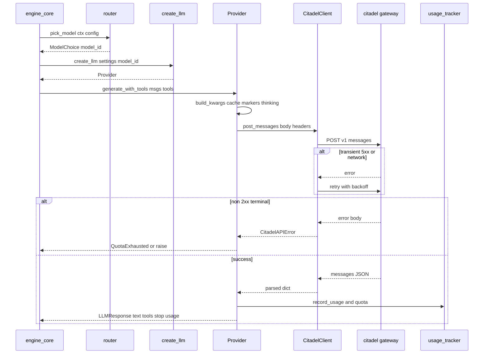
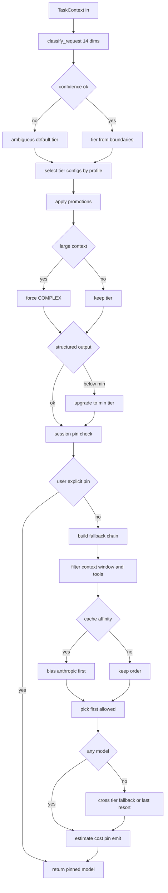

## herald — LLM Provider Gateway & Router

**Purpose:** Herald is the engine's model-access layer — a provider-neutral LLM gateway that translates internal message/tool types into the Anthropic-Messages wire shape, POSTs them over raw httpx to the **citadel** gateway (which fans out to the real upstream provider), and normalizes responses, usage, retries, media, and routing back to the agent loop. Invoked by the agent loop (see [Agent Loop & Threading](#sec-40-engine-core-loop-md)). (engine_core imports herald 103 times.)

**Responsibilities (what this subsystem owns):**
- The provider-neutral type lingua franca (`Message`, `ToolDef`, `LLMResponse`, `StreamEvent`, `SystemPromptBlock`, content blocks) — `types.py`.
- The `LLM` Protocol that all of engine_core programs against — `base.py`.
- The single concrete `Provider` that speaks Anthropic-Messages to citadel, plus wire (de)serialization, tool-name sanitization, prompt-cache breakpoint placement, thinking latching, and cache-edit (snip) injection — `provider.py`.
- Raw HTTP/SSE transport to citadel with transport- and 5xx-retry — `transport.py`.
- Task-aware model routing/scoring/session-pinning/fallback chains, plus an engine-local ring buffer of recent routing decisions by provider (the diversity guardrail's input) — `router.py`, `provider_mix.py`.
- Client-side model catalog + cost estimation + tier resolution — `catalog.py`, dynamically refreshed from citadel — `catalog_sync.py`.
- Error classification, context-overflow detection, and 529 overload tracking — `retry.py`; plus an engine-local quota cooldown that pauses background LLM calls after a terminal citadel quota/budget error — `quota_cooldown.py`.
- Per-request usage accumulation + quota-snapshot capture — `usage_tracker.py`.
- Cache hit/miss tracking + boundary enforcement — `cache.py`.
- Media handling: oversize-image resize/compress + media-error strip-and-retry — `image_resize.py`, `media_recovery.py`.
- Deterministic canned LLM for conformance boot mode — `conformance.py`. BYO upstream plugin loading + gateway config schema — `plugin_loader.py`, `config_schema.py`.

**Internal components / layers:**
- **Provider abstraction** (`base.py` + `provider.py`): `LLM` is a `runtime_checkable` Protocol with four async methods. One production implementation `Provider` (`provider.py`), plus `CannedLLM` (`conformance.py`) behind a flag. `Provider` holds one `CitadelClient`, a fixed model id, and per-session caches.
- **Router** (`router.py`): `pick_model` is the model-selection brain — 14-dimension weighted keyword scoring, profile/tier-config selection, time-windowed promotions, structured-output/large-context overrides, session pinning + three-strike escalation, capability filtering, cache-affinity bias, cross-tier fallback. The agent loop drives it on the main turn and on the sub-agent branch (see [Agent Loop & Threading](#sec-40-engine-core-loop-md)); see the Routing-logic section below. An optional provider-diversity guardrail (`config_schema.DiversityConfig`, ships off) reads `provider_mix.py` — an engine-local ring buffer of recent routing decisions by provider — to answer "what fraction of recent routing decisions went to provider X" and steer away from a monoculture.
- **Transport** (`transport.py`): `CitadelClient` — one persistent `httpx.AsyncClient` to `settings.cdt_url`, bearer + `x-api-key` + `anthropic-version: 2023-06-01`. `post_messages` (non-streaming) and `stream_messages` (SSE). Errors → `CitadelAPIError`.
- **Retry logic** (`retry.py` + transport-level): two layers. (a) transport retries httpx transient failures + retryable 5xx (excludes 529) with `TRANSIENT_MAX_RETRIES=2`. (b) `retry.py`'s `OverloadTracker` owns 429/529 semantics for the agent loop.
- **Model catalog + sync**: the catalog is 100% citadel-synced — no static seed. `catalog_sync` pulls citadel's `/v1/models` into the runtime overlay (empty until the first successful pull; an accelerated retry — 10s→30s→60s — self-heals a degraded boot, then the normal 5-min cadence applies). Launch-time model defaults live in `defaults.py` (`MODEL_DEFAULTS` + `resolve_model`, the one resolution helper); boot-time `model_validation.py` checks every resolved id against the synced catalog (fatal when synced, warn-only when degraded).
- **Usage tracking** (`usage_tracker.py`): contextvar-scoped `UsageAccumulator`; no-ops unless a tracker is active.
- **Conformance** (`conformance.py`): `CannedLLM` returns a fixed completion (`CANNED_TEXT="conformance ok"`), no network.
- **Caching** (`cache.py` + provider logic): `CacheTracker` persists daily cache-hit aggregates to SQLite; the prompt-cache `cache_control` breakpoint placement lives in `provider.py`.
- **Media handling** + **plugin loading** (importlib BYO upstream adapters type-checked against `LLM`).

**Key files:**

| File | LOC | Role |
|------|-----|------|
| `router.py` | 1694 | Task-aware `pick_model` — 14-dim scoring, session pinning, fallback chains, provider-diversity guardrail |
| `provider.py` | 890 | The single concrete `Provider`; wire (de)serialization, cache markers, thinking, snip, citadel error mapping |
| `image_resize.py` | 622 | Multi-strategy image resize/compress to fit API limits |
| `media_recovery.py` | 405 | Media error classify, pre-send validate, strip-and-retry |
| `types.py` | 367 | Provider-neutral dataclasses (the engine-wide lingua franca) |
| `catalog.py` | 336 | Static model catalog, tiers, cost estimation, tier resolution |
| `config_schema.py` | 319 | Pydantic `GatewayConfig`/`RoutingConfig`/scoring weights/`DiversityConfig` |
| `catalog_sync.py` | 274 | Dynamic catalog overlay polled from citadel `/v1/models` |
| `transport.py` | 271 | `CitadelClient` raw httpx + SSE; `CitadelAPIError` |
| `retry.py` | 189 | Error classification + `OverloadTracker` (429/529) |
| `__init__.py` | 124 | `create_llm` factory + re-exports |
| `conformance.py` | 123 | `CannedLLM` deterministic no-network provider |
| `usage_tracker.py` | 117 | Contextvar usage/quota accumulator + on-usage hooks |
| `provider_mix.py` | 110 | Engine-local ring buffer of recent routing decisions by provider — read by the diversity guardrail |
| `cache.py` | 100 | `CacheTracker` hit-rate/efficiency + boundary enforcement |
| `base.py` | 84 | `LLM` Protocol (4 async methods) |
| `token_budget_parser.py` | 82 | Parse `+500k`/`use 2m tokens` shorthand |
| `quota_cooldown.py` | 74 | Engine-local cooldown that pauses background LLM calls after a terminal citadel quota/budget error |
| `plugin_loader.py` | 58 | importlib loader for BYO upstream adapters |
| `herald_api.py` | 40 | Module-level `init`/`get_config_obj`/`get_cache_tracker` |

**Key types / classes:**

| Name | File | What it is |
|------|------|-----------|
| `LLM` | base.py:32 | `runtime_checkable` Protocol — the only interface engine_core programs against |
| `Provider` | provider.py:222 | Single concrete LLM; Anthropic-Messages over `CitadelClient` |
| `CannedLLM` | conformance.py:56 | Deterministic no-network drop-in behind `conformance_mode` |
| `Message` / `ContentBlock` | types.py:144 / :100 | role+content; union of Text/ToolUse/ToolResult/Thinking/Image/Persisted blocks |
| `ToolDef` / `ToolCall` | types.py:226 / :278 | Tool schema in / model tool call out |
| `LLMResponse` / `StreamEvent` | types.py:297 / :312 | text+tool_calls+stop+usage / one streaming chunk |
| `SystemPromptBlock` | types.py:335 | One system section with `cache_scope` + `ttl` |
| `CitadelClient` / `CitadelAPIError` | transport.py:110 / :75 | httpx transport / non-2xx error carrying parsed body |
| `CitadelQuotaExhausted`/`CitadelBudgetExhausted`/`CitadelSubscriptionSuspended` | provider.py:59/81/105 | Terminal citadel errors mapped from 429/402/403 |
| `TaskContext` / `ModelChoice` | router.py:278 / :294 | Routing input / decision output |
| `SessionStore` / `SessionEntry` | router.py:337 / :319 | Per-session model pinning + escalation |
| `OverloadTracker` / `FallbackTriggeredError` | retry.py:117 / :96 | 529 tracking + fallback trigger |
| `ModelDef` / `ModelCost` / `ModelTier` | catalog.py:33 / :25 / :224 | Catalog entry / pricing / tier enum |
| `UsageAccumulator` | usage_tracker.py:30 | Contextvar-scoped usage totals + quota snapshot |
| `CacheTracker` / `CacheBoundaryViolation` | cache.py:14 / :99 | Cache stats + system-block scope enforcement |

**Provider abstraction:** A "provider" is any object satisfying the `LLM` Protocol: `generate`, `stream`, `generate_with_tools`, `stream_with_tools`. Engine code constructs providers only via `create_llm` (`__init__.py:66`). There is **only one production provider** — the multi-provider story (OpenAI/Gemini) is delegated *server-side* to citadel: the engine always speaks the Anthropic Messages wire shape, and citadel decides the real upstream from `model_id`. Outbound `to_wire_messages`/`blocks_to_wire`/`to_wire_tools` translate to Anthropic JSON, sanitize tool names (`ad:gmail.send_message` → `ad_gmail_send_message`), and place cache_control. Inbound, tool names reverse-mapped; `PersistedBlock` becomes an XML `<persisted-output>` hint.

**Routing logic:** The main agent loop routes per turn — `agent_loop` calls `pick_model(ctx, gateway_config, settings)` at `thread.py:5019`, inside the `# Per-turn model routing` block (`thread.py:4956`), caching one adapter per chosen model in `adapter_cache`. Routing is skipped only when `adapter_override` is set, which an explicit `options.model` override does (`thread.py:4340`, flipping `use_router` to False at `thread.py:4378`). The sub-agent spawn path also calls `pick_model` (`thread.py:1528`). `pick_model(ctx, config, settings)` runs deterministically (<1ms): (1) `classify_request` scores the prompt across 14 dimensions, maps to a tier, gates on sigmoid confidence; (2) `select_tier_configs` picks the profile's tier map (eco/auto/premium/agentic); (3) promotions, large-context-force-COMPLEX, structured-output overrides; (4) session pinning / three-strike escalation; (5) the tier's `[primary] + fallback` chain filtered by context window and tool support, cache-affinity-biased toward Anthropic models. The **catalog** is the client-side model-metadata store; **catalog_sync** pulls citadel `/v1/models` at boot into a runtime overlay — the sole source, with no static seed, re-polled every 5 min; on citadel-unreachable the overlay is empty and the accelerated first-sync retry self-heals it.

**Request lifecycle (engine_core wants a tool-enabled completion):**
1. `agent_loop` calls `pick_model` for the turn, then gets that model's `Provider` from `create_llm(settings, model_id)` (cached in `adapter_cache`); an explicit `options.model` override bypasses routing.
2. Caller invokes `provider.generate_with_tools(messages, system, tools, super_thinking, max_output_tokens)`.
3. `build_kwargs` serializes to Anthropic JSON, places the message-level cache marker, one cache_control on last system block and last tool, injects pending cache-edit (snip) deletions.
4. `apply_thinking` latches/sets thinking budget; `apply_betas` folds the `betas` into the `anthropic-beta` header.
5. `CitadelClient.post_messages` POSTs `/v1/messages`. Transient/retryable-5xx → backoff retry (≤2), excluding 429/529; non-2xx → `CitadelAPIError`.
6. `Provider` maps QUOTA/BUDGET/SUBSCRIPTION codes to terminal exceptions; other errors propagate to the loop's `OverloadTracker`.
7. Response blocks parsed into `text` + `ToolCall`s (names reverse-mapped), `stop_reason` mapped, `usage` extracted.
8. `observe_usage_for_cache_break` resets snip state if cache broke; `record_usage` accumulates; `record_quota_snapshot` captures the quota panel.
9. Returns `LLMResponse`. (Streaming mirrors via `stream_with_tools`/`stream_messages`.)

**Media handling:** `image_resize.maybe_resize_image` runs a strategy ladder (pass-through → format-native compression → JPEG quality ladder 80→20 → dimension resize LANCZOS → aggressive 1000px → raw fallback). `media_recovery.is_media_error` classifies an exception into `MediaErrorInfo`; `validate_images`/`normalize_media_for_api` proactively check before the call; `strip_problematic_media` walks messages backward replacing offending blocks with text placeholders so the caller can retry. All operate on frozen dataclasses.

**Caching & usage:** `CacheTracker` records per-day/per-model cache stats (`gw_cache_state` SQLite table), computes daily `hit_rate`, fires `CacheEvent`, and `enforce_boundaries` raises `CacheBoundaryViolation` if a large stable system block lacks a `cache_scope`. The actual wire prompt-cache breakpoints are placed in `provider.py`. `usage_tracker` tracks token usage in a contextvar-scoped `UsageAccumulator` plus the latest quota snapshot. **Citadel quota boundary:** herald does **not** own quota/entitlement enforcement — that lives in **citadel**. Citadel rejects with stable codes (`QUOTA_EXCEEDED` 429, `BUDGET_EXCEEDED` 402, `SUBSCRIPTION_SUSPENDED` 403); herald maps those into terminal exceptions and records the quota snapshot. On a terminal quota or budget error `provider.py` also arms `quota_cooldown` — a process-local cooldown horizon set from the citadel-reported reset window — so background consumers skip doomed calls until the window resets: `thread.py`'s backgrounded fan-out gate and `learning_centre/scheduler.py`'s batch gate both check `quota_cooldown.cooldown_active()` before issuing LLM calls, while foreground turns never consult it. (There is no `src/herald/policy.py` or `quota.py` — quota/policy was fully delegated to citadel.)

**Public API / entry points:** `create_llm(settings, model_id=None) -> LLM` (the primary factory). The `LLM` Protocol's four methods. `router.pick_model`. `herald_api.init`/`get_config_obj`/`get_cache_tracker`. Catalog helpers (`get_model`, `resolve_model_for_tier`, `estimate_cost`, `ModelTier`). Usage surface (`record_usage`, `record_quota_snapshot`, `add_on_usage_hook`).

**Inbound & Outbound dependencies:** *Inbound:* engine_core (thread, sub_agent, prompt_hooks, stop_hooks — 103 imports), bootstrap, services/away_summary. `provider.py` reaches into `src.engine_core.cached_snip` (herald's own layering inversion; canonical framing in [Boundaries & Refactoring](#sec-80-boundaries-refactoring-md), detailed under Refactoring seams below). *Outbound:* citadel gateway over HTTPS (`settings.cdt_url`+`cdt_key`) via httpx — the only external network dependency; PIL/Pillow (optional); `src.config.Settings`, `src.raven` (telemetry), `src.infra.sqlite_pool`. **citadel** for quota/entitlement/budget.

**Data & state:** process `runtime_overlay` (the only model catalog — citadel-synced, empty pre-sync) + `MODEL_DEFAULTS` launch block in `defaults.py`; transient contextvar `UsageAccumulator`; persisted `gw_cache_state`; module-level singleton `SessionStore` (in-memory pinning with TTL); per-provider session state (tool schema cache, reverse name map, thinking latch, snip state); background catalog-sync poll (5-min steady, accelerated pre-first-sync).

**Invariants / contracts / gotchas:**
- **Single wire shape:** engine always emits Anthropic Messages; provider diversity is citadel's concern. `ModelDef.provider` is informational only.
- **Retry ownership split:** transport retries httpx-transient + retryable 5xx but deliberately excludes 429/529; the loop's `OverloadTracker` owns those.
- **Idempotency / streaming:** `post_messages` is non-streaming so a retry can't duplicate output. `stream_messages` only retries before the first event is yielded — once output starts, a mid-stream drop bubbles up rather than replaying.
- **Cache prefix stability:** thinking is latched on for the session once enabled; the cache-edit beta header is latched — toggling either mid-session busts the prompt-cache prefix (the prefix-stability invariant is canonical in [Context & Compaction](#sec-42-engine-core-context-compaction-md); herald places the actual wire breakpoints). Exactly one message-level + one system + one tool marker (within Anthropic's 4-breakpoint cap).
- **Tool-name sanitization must round-trip:** history `ToolUseBlock`s must be re-sanitized on resend or Anthropic 400s; inbound names are reverse-mapped.
- **Citadel quota is terminal, not retryable:** surfaces to the user as upgrade/raise-budget/contact-admin.
- **Usage recording is contextvar-scoped:** silent no-op when no `UsageAccumulator` is set — forgetting to set the tracker loses telemetry.
- **Catalog degradation:** citadel unreachable → boots with an empty catalog (no static seed); cost estimates return `None` and context windows fall back to 200k until the accelerated first-sync retry lands, then routing has full metadata. Model validation is warn-only while degraded.

**Refactoring seams / boundary observations:**
- **Large selection subsystem, single provider:** `router.py` is a heavy subsystem (14-dim scoring, session pinning, cross-tier fallback, provider-diversity) that the agent loop drives on every turn via `pick_model`; because the engine emits a single Anthropic-Messages wire shape, all of that selection resolves to one concrete `Provider` pointed at citadel. `find_allowed_model` returns the cheapest AVAILABLE+HEALTHY model from the candidate chain via `rank_chain_by_cost`; `fallback_across_tiers` walks the tier ladder downward under a `min_tier_floor` quality floor (HERALD-SEL-04) with context-window, tools, vision, and min-tier chain filters.
- **Inward coupling:** `provider.py` imports `src.engine_core.cached_snip` — a lower layer depending on a higher layer. This is herald's local instance of the layering inversion; the system-wide framing is canonical in [Boundaries & Refactoring](#sec-80-boundaries-refactoring-md).
- **Multi-provider abstraction is aspirational:** `base.py`/`types.py`/`config_schema.py` describe OpenAI/Gemini providers that don't exist in-tree; the plugin loader is the intended extension seam, but the only real adapters are `Provider` and `CannedLLM`.
