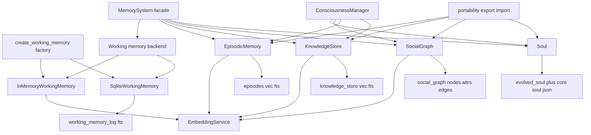
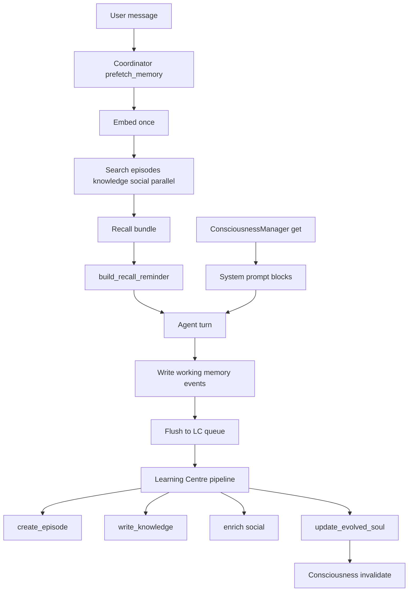

## memory & services — Agent Memory System

**Purpose:** Provides the engine's complete memory stack — ephemeral per-task working memory plus durable, vector-searchable long-term stores (episodes, facts/knowledge, social graph, evolved personality) behind a single `MemorySystem` facade, with a session-scoped identity bundle (consciousness/soul), export/import portability, and an LLM "while you were away" recap service.

**Responsibilities (what this owns):**
- The temporal event log of a task (working memory) in two interchangeable backends (in-process dict, SQLite).
- Four durable long-term stores (table-level storage backing — vec/fts companion pattern — catalogued in [Data Model](#sec-20-data-model-md)): episodic memory (KDV episodes), knowledge store (facts/knowledge/processes), social graph (people, attributes, edges), evolved soul (per-user adaptive traits).
- The embedding service (citadel-routed `text-embedding-3-small`, 1536-dim) and similarity/scoring primitives.
- Consciousness: building/caching the identity bundle (Core Soul + Evolved Soul + user persona) and prompt-section caching.
- Deterministic working-memory → context formatting; memory maintenance (confidence decay, episode archival); portability (versioned JSON export/import with secret pre-scan).
- `services/away_summary.py`: an LLM recap of what happened while the user was away.

**Memory taxonomy** (the core):

| Memory type | What it holds | Lifecycle / retention |
|---|---|---|
| **Working memory** (`working_memory.py`, `inmemory_working_memory.py`, `sqlite_working_memory.py`) | Temporal event log of a task: `LogEntry` rows typed by `EntryType` (message:user/assistant, tool:call/result, input:request/response, action:user, checkpoint, system:event). Real events — **not summaries**. Scoped by `thread_id` + `session_id`. | **Ephemeral.** In-memory: TTL-reaped at 24h. SQLite: write-through per write for crash safety, still 24h TTL. Flushes to the Learning Centre queue after each turn; LC distills durable knowledge. |
| **In-memory vs SQLite WM** | Same `WorkingMemoryBackend` Protocol, chosen by `USE_INMEMORY_WM`. In-memory does hybrid search in-process; SQLite uses FTS5. | SQLite (default) requires the WM log table (catalogued in [Data Model](#sec-20-data-model-md)); hard-fails at boot if DB unavailable and flag unset. |
| **Episodic memory** (`episodic_memory.py`) | "What happened" — KDV episodes: **Key** (retrieval anchor), **Description** (relevance-match text), **Value** (raw detail fetched on demand after a K+D match). | **Tiered durable.** `episode` tier (<30 days): Value uncompressed. `archive` tier (≥30 days): Value gzip-compressed, `value` nulled. Both stay searchable via K+D. Never hard-deleted. |
| **Knowledge store** (`knowledge_store.py`) | Three types: **fact** (user-stated, confidence 1.0), **knowledge** (system-inferred), **process** (learned workflows). | **Durable, bitemporal, never hard-deleted.** Bitemporal: `valid_from`/`valid_until` vs `recorded_at`/`superseded_at`. Inferences ×0.95 decay per maintenance if unreinforced 30 days; <0.2 superseded. Facts never decay. |
| **Social graph** (`social_graph.py`) | People in the user's world. User is the `is_primary=1` node. Person nodes have unbounded key-value attributes. Edges connect two people with three perspectives: `user_perspective`, `engine_inference`, `observed_dynamics`, plus merged `contexts`. | **Durable.** Upsert; `find_or_create_person` does exact match then fuzzy (≥0.85) once graph has ≥5 nodes. |
| **Consciousness** (`consciousness.py`) | **Session-scoped identity bundle** (not memory): `ConsciousnessContext` = Core Soul + evolved traits + user persona + recent episodes + active knowledge. Injected into the LLM system prompt. | **In-memory cache only**, keyed `_single_user`. Rebuilt lazily; invalidated by data writers (LC pipeline, import, compact). Owns prompt-section caching by `SectionStability` (STABLE/DYNAMIC/VOLATILE). |
| **Soul** (`soul.py`) | **Core Soul**: immutable engine character, same for all users, catalog-loaded at boot, JSON. **Evolved Soul**: per-user adaptive traits using an *epigenetic* model — traits start `signal` and become `expressed` when confidence ≥0.7 AND evidence_count ≥3. | Core Soul: process cache, immutable. Evolved Soul: durable SQLite, upsert by `trait`. Only `expressed` traits surface to callers. |

**Internal components / layers:**
- **Factory pattern** (`memory_factory.py`): `WorkingMemoryBackend` is a `@runtime_checkable` Protocol; `create_working_memory()` returns `InMemoryWorkingMemory` (flag) or `SqliteWorkingMemory` (default).
- **Embeddings (vector)** (`embeddings.py`): `EmbeddingService` (async, process singleton), similarity math, hybrid scoring. Used by every long-term store.
- **Working-memory backends + formatting**: two backends sharing the Protocol; both delegate `get_context_summary` to `format_context_summary` in `wm_formatting.py` (deterministic, no LLM).
- **Facade** (`memory_system.py`): `MemorySystem` — thin delegation over all components; reads on `None` components return empty, writes raise `RuntimeError`.
- **Consciousness** + **Portability** (export/import of durable stores).

**Key files:**

| File | LOC | Role |
|---|---|---|
| `social_graph.py` | 511 | People/attributes/edges store; 50/50 hybrid search; upsert + fuzzy person resolution |
| `consciousness.py` | 411 | Session identity bundle + prompt-section cache lifecycle |
| `embeddings.py` | 391 | `EmbeddingService`, cosine/keyword/hybrid/recency scoring |
| `knowledge_store.py` | 386 | Facts/knowledge/processes; confidence + bitemporal model; decay |
| `portability.py` | 386 | Versioned JSON export/import with secret pre-scan |
| `memory_system.py` | 356 | Unified facade over all memory components |
| `episodic_memory.py` | 265 | KDV episodes, tiered gzip archival, hybrid search |
| `wm_formatting.py` | 213 | Deterministic WM → token-budgeted context summary |
| `sqlite_working_memory.py` | 186 | SQLite write-through WM backend (FTS search) |
| `inmemory_working_memory.py` | 144 | Dict-based ephemeral WM backend (TTL reaping) |
| `soul.py` | 143 | Core Soul cache + Evolved Soul (epigenetic traits) |
| `memory_factory.py` | 79 | `WorkingMemoryBackend` Protocol + backend factory |
| `working_memory.py` | 34 | `LogEntry` dataclass + `EntryType` enum |
| `services/away_summary.py` | 118 | LLM "while you were away" recap |

**Key types / classes:** `MemorySystem` (facade), `WorkingMemoryBackend` (Protocol), `LogEntry`/`EntryType`, `InMemoryWorkingMemory`/`SqliteWorkingMemory`, `EpisodicMemory`, `KnowledgeStore`, `SocialGraph`, `Soul`, `EmbeddingService`, `ConsciousnessContext`/`ConsciousnessManager`, `SectionStability`.

**How memory is written:** Writes are *asymmetric in time*:
- **During a turn (synchronous):** engine appends events to **working memory** — `write_working_memory`/`write_working_memory_batch`. SQLite commits per write; in-memory appends. `bridge_correction` writes a user correction under the `corrections` scope.
- **After a turn (asynchronous, Learning Centre):** every durable store is **written by the learning pipeline** (see [Learning/Security/Raven](#sec-58-learning-security-raven-md)), never by the synchronous turn. WM flushes to the LC queue; `learning_centre/pipeline.py` distills durable memory — `create_episode`, `write_knowledge_fact`/`write_knowledge_inference`, social node/edge enrichment, evolved-soul updates. Each long-term write fans out across the base table and its vec/fts companions (the companion-table mechanism is catalogued in [Data Model](#sec-20-data-model-md)). LC wraps each write with a secret scanner.
- **Identity writes:** `Soul.update_evolved_soul` upserts traits and auto-computes `expressed`/`signal`; triggers `ConsciousnessManager.invalidate()`.
- **Maintenance (batch):** `run_maintenance_batch` = confidence decay → episode archival → correction cleanup.

**How memory is read / retrieved:**
- **Prefetch (parallel, top of turn):** `Coordinator.prefetch_memory` embeds the user message once, then fans out to episodic/knowledge/social search in parallel via `engine_core/search.py`, passing the shared `query_embedding`. The Thread does a bounded "settle and consume" wait; on settle folds recall into the user message via `build_recall_reminder`.
- **Hybrid scoring:** each store runs sqlite-vec semantic search blended with FTS5/BM25 keyword fallback and a keyword-only fallback for rows without embeddings. Weights: episodic & knowledge **30% keyword / 70% semantic**; social **50/50**. Results get a `recency_boost` (exp decay, half-life 30d, clamped [0.5,1.0]).
- **Working memory → context:** `get_context_summary` → `format_context_summary` deterministically buckets entries (Current State / Task Activity / Tool Operations / Files Touched / Errors / Decisions & Checkpoints / Session Events), pairs tool:call with tool:result, enforces per-section (8000 char) + token budgets.
- **Identity → context:** `render_core()` (stable, cacheable) vs `render_context()` (recent episodes + active knowledge, per-turn); `render_identity_delta` emits only changed identity.

**embeddings:** `EmbeddingService` routes through citadel's OpenAI-compatible `/v1/embeddings` using `text-embedding-3-small`, **1536 dims**. `CDT_KEY` authenticates both inference and embeddings. `embed()` is async, **never returns `[]`**: on any failure returns a zero vector of `dim`; degraded mode detectable via `.is_real`. Vectors are serialized via `serialize_f32` and queried with `vec_distance_cosine` against the per-store `vec0` companion tables (their `FLOAT[1536]` schema lives in [Data Model](#sec-20-data-model-md)). Process-level singleton keyed on (url, key, model, dim).

**social_graph, consciousness, soul (distinctive concepts):**
- **social_graph** models the user's *people world* as a graph: nodes (people, user = primary) with unbounded attributes, edges carrying three *perspectives* + a set-merged `contexts`. Grounds "who is X / how do they relate."
- **consciousness** is the engine's *self* injected into every system prompt — a cached bundle separating immutable identity (Core Soul), learned personality (Evolved Soul), and the user's persona, kept distinct from task state. Owns the prompt-section cache so stable identity can be `scope=global, ttl=1h` for cross-turn caching.
- **soul** is the *character* layer: Core Soul (shared, immutable) and Evolved Soul (per-user traits that "express" only after enough confident evidence — an epigenetic gate against premature personality drift).

**portability:** `export_memory(db)` bulk-reads all durable stores into a versioned (1.0.0) JSON bundle (archive Values decompressed, full bitemporal fields, social refs). **Not exported:** working memory, Core Soul, embeddings (regenerated on import). `import_memory` validates version, runs `scan_bundle` (full secret pre-scan over every scannable string including social attribute *keys*) so the bundle is rejected atomically before any DB write/embedding spend, then replays through the real write methods. Called from `server.py`.

**services/away_summary:** `generate_away_summary(llm, summary, last_user_message=...)` produces a 1–3 sentence recap. The engine has no chat transcript, so it feeds structured `ReconnectSummary`/`SessionStats` (state, idle seconds, tool calls, errors). Capped at `MAX_RECAP_TOKENS=180`, soft timeout 10s — returns `None` on empty/timeout/error (caller falls back to deterministic `ReconnectSummary.format_recap()`).

**Public API / entry points:** Constructed in `bootstrap.py` (`MemorySystem`, `ConsciousnessManager`). Reads via `Coordinator.prefetch_memory` → `Search`; Thread consumes via `build_recall_reminder`; `ConsciousnessManager.get()/build_prompt_blocks()` feed the system prompt. Writes via `learning_centre/pipeline.py`. Services/portability via `server.py`.

**Inbound & Outbound dependencies:** *Inbound:* bootstrap (construction), coordinator + thread + search (read), learning_centre/pipeline (write), server (away_summary, export/import). *Outbound:* `src/infra/sqlite_pool` (SqlitePool, serialize/deserialize_f32, vec_available); `src/herald` (EmbeddingService → citadel; record_embedding_usage; SystemPromptBlock/Message/LLM for away_summary); `src/security/write_guard.guard_content` (portability scan); `src/utils/activity_manager.ReconnectSummary`.

**Data & state (persisted where):** All durable tables (the `episodes`/`knowledge_store`/`social_graph_*`/`evolved_soul` base tables plus their `_vec`+`_fts` companions, and `working_memory_log`+`working_memory_fts`), the migration files (001 and 010), the vec0 `FLOAT[1536]` companion pattern, the partial/UNIQUE indices, and the WM TTLs are catalogued in the canonical schema chapter (see [Data Model](#sec-20-data-model-md)) — this chapter treats them as a black box and owns only the *behavior* over them. In-memory state: WM dict, EmbeddingService singleton, Core Soul caches, Consciousness caches.

**Invariants / contracts / gotchas:**
- `EmbeddingService.embed()` **never returns `[]`** — always a `dim`-length vector; zero vectors in degraded mode score ~0, silently degrading recall to keyword-only. Check `.is_real`.
- A zero vector *is* truthy (non-empty list), so degraded-mode rows still occupy `_vec` tables.
- `MemorySystem`: reads on `None` return empty; **writes raise `RuntimeError`**. It does not own component lifecycle.
- Nothing is hard-deleted in knowledge store (supersede via `superseded_at`); searches must filter `superseded_at IS NULL`. Facts never decay.
- Episode `Value` is excluded from search results — call `get_episode_value()` after a K+D match.
- Evolved Soul traits visible only when `expressed`; `get_evolved_soul` (expressed) vs `get_evolved_soul_full` (all) is load-bearing.
- Core Soul has two sources that must stay in sync (packaged `core_soul.json` fallback vs catalog volume override); `soul.py` and `consciousness.py` each keep their own cache.
- Consciousness cache is in-memory only; must `invalidate()` after any identity/persona write or post-compact.
- `find_or_create_person` only fuzzy-matches at ≥5 nodes / ≥0.85 score — below that, near-duplicate people can be created.
- `enrich_social_graph_node` embeds attribute **keys** too — secrets-as-keys must be scanned (portability handles this).

**Refactoring seams / boundary observations:**
- `WorkingMemoryBackend` Protocol is a clean swap seam; the two backends duplicate `read_by_type`/`read_messages`/`get_context_summary` — candidate for a shared mixin.
- FTS helpers live in `episodic_memory.py` and are imported into `knowledge_store.py` — a leaky boundary; they belong in a shared `search_util`.
- Hybrid-search structure (semantic → FTS → keyword → recency) is near-identical across stores — strong candidate for a shared `hybrid_search` template.
- The facade is intentionally logic-free delegation but has grown 30+ methods — could split per-store if it keeps growing.
- Consciousness conflates identity-bundle building and prompt-section cache lifecycle — separable.
- `Coordinator.prefetch_memory` talks to `engine_core/search.py`, not the `MemorySystem` facade — the read path bypasses the facade while the write path (LC) goes through it; an asymmetry worth noting.
