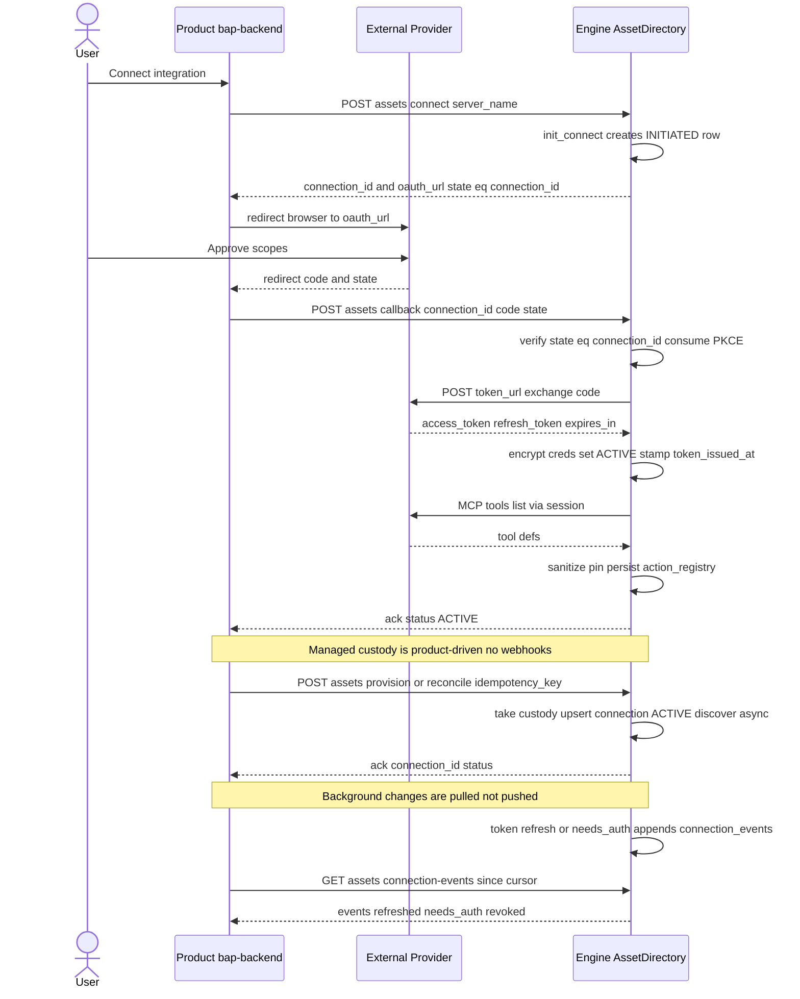
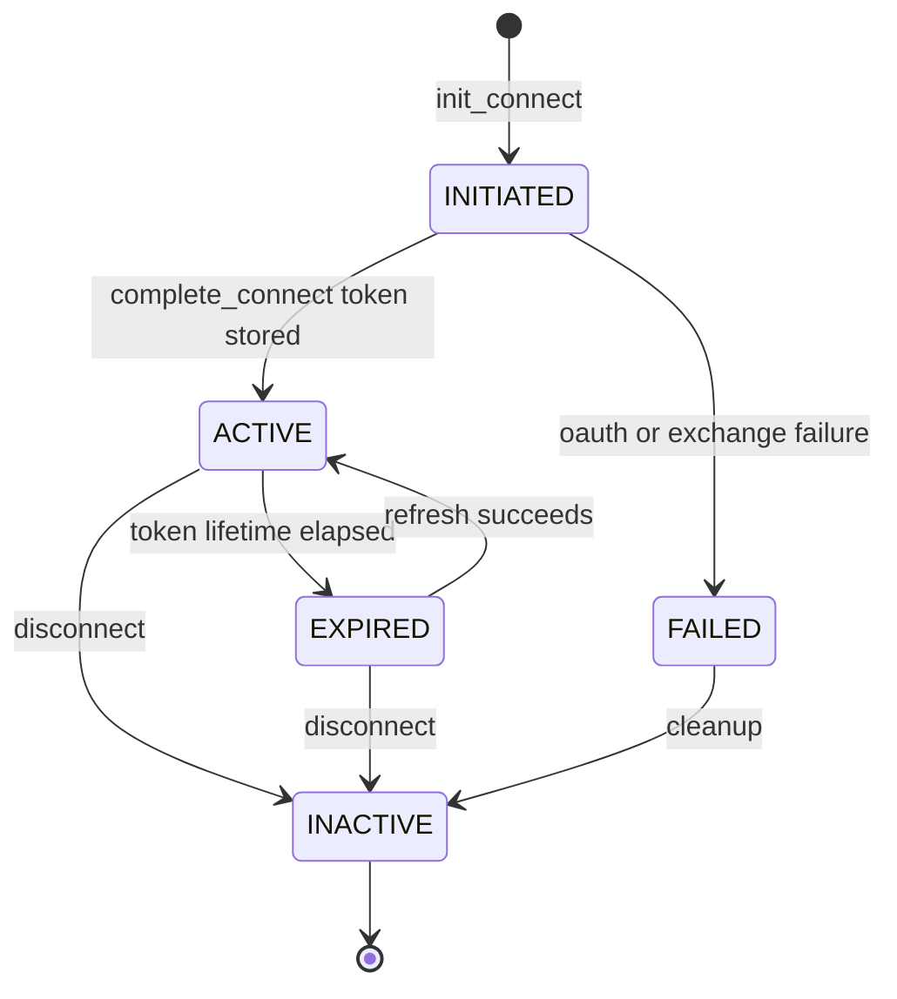

## asset_directory & channel — External Connectors, MCP, OAuth & Channels

**Purpose:**
- **`asset_directory`** is the engine's gateway to external services: it runs the OAuth/connection lifecycle (the `authorization_code` grant with PKCE, `api_key`, and `client_credentials`; self-brokered OAuth discovery + Dynamic Client Registration for a bare MCP URL with no supplied `oauth_config`; and the browserless Cross-App Access grant chain for enterprise managed authorization), vaults credentials, talks MCP (JSON-RPC 2.0) to remote servers, discovers tools, gates them per-tool, and executes agent-initiated actions through a hardened 11-step path. Threads call `ad.execute(connection_id, action_name, params)` and never see a credential. The engine is the **executor**; the product (**bap-backend**) is the **control plane** that drives the connector lifecycle synchronously over the SDK's `/assets/*` API and reads the ack each call returns. There are **no webhooks** and no engine→product push.
- **`channel`** is the engine's live-data plane: a "channel" is one pinned **read-only** query against an already-connected asset, polled server-side, SWR-cached, deduped, and fanned out to craft UIs over SSE — a cache + demand-gate in front of the same `AssetDirectory.execute` the agent loop uses.

**asset_directory — Internal components / layers:**
- **Connection manager + states (`connection_manager.py`, `states.py`)** — `ConnectionManager` owns the `connections` table lifecycle: `init_connect` (creates an `INITIATED` row + 21-char nanoid `connection_id`, stamping `provenance`/`account_ref`/`label`/`account_label`), `complete_connect` (validates the transition → `ACTIVE`, encrypts creds, stamps `token_issued_at`), `disconnect` (→ `INACTIVE`). Every status change is gated by `validate_transition()`. Builds OAuth authorize URLs; when the provider requires PKCE it generates a verifier/challenge and **persists the verifier** (Fernet-encrypted, keyed by `state == connection_id`) to the `oauth_pkce` table — so it survives a restart and any worker handling the callback can find it (a 15-minute inline sweep clears abandoned flows). `states.py` also carries the `AuthMethod` enum (`none`/`provider_managed`/`oauth`/`api_key`/`client_credentials`) and the provenance rank table.
- **Auth discovery + DCR (`discovery.py`)** — self-brokers OAuth for a bare MCP URL when the caller supplies no `oauth_config`. `discover_oauth_config` probes the server unauthenticated, follows the 401's `WWW-Authenticate` `resource_metadata` pointer (or the RFC 9728 well-known locations) to the Protected Resource Metadata, reads the named authorization server's metadata (RFC 8414, OIDC-discovery fallback), and resolves a client identity most-specific-first: a supplied pre-registered `client_id`, then CIMD (SEP-991, when a `cimd_url` is configured **and** the AS advertises `client_id_metadata_document_supported`), then RFC 7591 Dynamic Client Registration. The emitted config always sets `pkce: true` (RFC 7636) and the canonical `resource` indicator (RFC 8707). Every fetched byte is untrusted, so the shared primitives are HTTPS-only (plain HTTP only for loopback), never follow redirects, cap bodies at 64 KiB, require the PRM `resource` and AS `issuer` to round-trip, and reject link-local IP literals (the instance-metadata SSRF target). The facade self-brokers only when the caller passes `auto_auth` **and** the `server_registry` row is `vetted` **and** a `redirect_uri` exists (`OAUTH_REDIRECT_BASE_URL` or `oauth_config.redirect_uri`); an unvetted server returns `pending_review` ("the engine will not self-broker OAuth for it", cleared via `POST /assets/servers/{server_name}/vet`), and a `DiscoveryError` degrades fail-closed to "needs auth, no URL".
- **Cross-App Access (`xaa.py`, SEP-990)** — mints an MCP access token with no browser consent screen by chaining two grants through the enterprise IdP: `perform_cross_app_access` exchanges the user's OIDC `id_token` for an ID-JAG at the IdP (RFC 8693 token exchange), then exchanges the ID-JAG for the access token at the MCP server's authorization server (RFC 7523 JWT bearer). It reuses discovery's hardened PRM/AS primitives (size caps, HTTPS-only, issuer/resource guards, no redirects) but drops the `authorization_endpoint` requirement since the flow never touches a browser. Reachable from the managed control plane: `POST /assets/provision` with an `xaa` config (`idp_token_endpoint`, `id_token`, `idp_client_id`, `client_id`, `client_secret`) self-mints the credential, then takes custody exactly like any other provisioned connection; the discovered AS coordinates (token endpoint, revocation endpoint, auth methods, resource) ride back in `oauth_refresh` so refresh and RFC 7009 revocation work without the IdP, and the `id_token` itself is never persisted.
- **Credential store** — `CredentialStore` wraps **MultiFernet** (AES-128-CBC + HMAC-SHA256). First key encrypts; remaining keys decrypt → zero-downtime rotation. `rotate(db)` re-encrypts `credentials` + `refresh_token`. A failed decrypt raises `CredentialCorrupted` (reconnect-required signal).
- **MCP client (`mcp_client.py`)** — `HttpMCPTransport` POSTs JSON-RPC over httpx Streamable HTTP, handles SSE, tracks `mcp-session-id`. An SSE body is framed per the SSE grammar by `iter_sse_frames` (an event ends at a blank line, repeated `data:` fields join with a newline, a `:` line is a comment) and `parse_sse` then selects the frame whose id matches the request that was sent, so a progress notification arriving after the result can never be returned in its place; notifications carry no id and are never eligible, and a stream that cannot be framed back into a response raises `MCPFramingError` instead of guessing. That error classifies as transport, so the session is rebuilt, and as ambiguous, so the call is retried only for read-only actions. `MCPSession` drives JSON-RPC 2.0: `initialize` (protocolVersion **2025-11-25**), `tools_list`, `tools_call`, `ping`. The handshake's `capabilities` are stored and read back through `supports()`, so a server that declared capabilities without `tools` is never asked for a list, and the handshake's `instructions` (the server's own call-ordering, scope and rate-limit guidance) are captured on the session. `tools_list` follows `nextCursor` to the end rather than exposing only page one, and raises rather than returning a partial catalogue once `MAX_TOOL_PAGES` (50) is exhausted. After the handshake every request carries the negotiated **`MCP-Protocol-Version`** header (mandatory in the 2025-11-25 revision so servers and load balancers can route by version). Only HTTP/SSE transports — the engine never spawns subprocess (stdio) MCP servers.
- **Permissions store (`permissions_store.py`)** — per-tool per-asset policy in the `connection_permissions` table. Each `(connection_id, action_name)` row carries a 3-state `behavior` (**allow** / **ask** / **deny**), a per-tool **`enabled`** on/off switch, and a managed **`locked`** flag; `action_name='*'` is a connection-wide default. With no matching row the default is **derived** from the action's MCP `readOnlyHint` (read-only → `allow`, mutating/unknown → `ask`, **never `deny` by default**). A non-managed setter may *tighten* but may not *loosen* (or unlock, or flip `enabled` on) a `locked` row; only `set_by='managed'` may create one.
- **Assets (`assets.py`)** — the per-thread tool provisioner and the runtime permission gate. `build_tool` wraps `ad.execute` in a `ToolDef` (`ad:{server}.{action}`), reads `annotations.readOnlyHint`, resolves the DB-backed behavior once (cached, 15 min) and freezes it into the handler closure: `allow` executes immediately; `ask` calls `on_approval_needed(server, action, params, connection_id)` first — **fail-closed** (no approval channel wired → reject, never silent-execute); `deny` refuses. A per-tool `enabled=false` removes the action from the built set entirely (distinct from `deny`, which exposes the tool but blocks it at call time). Telemetry callbacks (`on_action`, `on_status`, `on_asset_required`) feed the single `asset` stream block.
- **Registry client (`registry_client.py`, dormant)** — fetches September's own first-party hosted-server listing from `SEPTEMBER_REGISTRY_URL`. **Dormant by design:** when the URL is unset every call returns `[]` with no network hop, and nothing is ever written to `server_registry`. This is the `septemberai` **SOURCE** tier — the third-party connector catalog and its OAuth brokering live in the **product**, not the engine; the engine stores only *connected* assets.
- **Refresh scheduler** — sleep-first background loop (30 min); re-discovers tools under a semaphore (max 10), tombstones stale `action_registry` rows, and piggybacks the append-only log-retention sweep on the same cadence.
- **Retention (`retention.py`)** — a throttled `RetentionSweeper` over the two append-only logs (`execution_log`, `connection_events`): it issues the DELETE at most once per `every_n` writes (or when stale), so steady-state overhead is not one DELETE per insert. Both the table and the timestamp column are allowlisted (never a caller string) to keep the interpolated SQL injection-safe.
- **Circuit breaker** — per `server:connection` key; CLOSED→OPEN at 5 failures; OPEN blocks until 60s cooldown then a single HALF_OPEN probe.
- **Execution logger** — non-blocking INSERT into `execution_log`, fire-and-forget, with its own throttled retention sweep.
- **Result rendering (`result_transform.py`)** — `render_asset_result` turns an `execute()` payload into the string the model reads: text comes through as text, structured output as JSON (not Python `repr`), and a binary block as a short type+size descriptor rather than its inlined base64. A failed call leads with its error, and the rendered text is bounded middle-out at 100k characters (≈25k tokens) with an explicit truncation notice, so a bulk export can never silently consume the context window. The `assets.py` tool handler calls it on every asset result.
- **Failure classification (`failure_classification.py`)** — `classify_mcp_failure` maps a raised MCP-call exception to a `Failure(kind, retry, rebuild)` by what actually happened and whether the request could already have run server-side, so `execute_with_retry` retries the safe cases, rebuilds the session on a transport/session fault, routes a 401 to reauth, and surfaces a JSON-RPC error as a typed non-retryable outcome. An ambiguous (possibly-executed) failure is retried only for read-only actions — a non-idempotent call is never silently re-run — and a bare HTTP 404 counts as session-expiry only when the body carries JSON-RPC `-32001`.
- **Facade (`asset_directory.py`)** — `AssetDirectory` is the public API: reads, the connection lifecycle (`init_connect`/`complete_connect`/`disconnect`/`pause`/`resume`), the 11-step `execute`, action discovery, token refresh (reactive + proactive + `client_credentials` re-mint), managed `provision`/`reconcile`, custom-server `register`, the trust gate (`list_pending_servers`/`set_vetted`), `status_snapshot`, the per-tool permission surface, and the `connection_events` log. Caches MCP sessions LRU by `connection_id`, bounded at `MAX_CACHED_SESSIONS` (64) because each warm session pins an HTTP client and its connection pool: eviction closes the victim and skips any session with a call in flight, so a live request is never cut off to make room. A cached session also carries the fingerprint of the config it was built from (server URL + credential delivery), and one whose fingerprint no longer matches the registry row is closed and rebuilt at lookup rather than left presenting the credential to the endpoint the server used to point at.

**Product ⇄ engine — the control-plane boundary (no webhooks):** The product (**bap-backend**) is the control plane; the engine is the executor. bap-backend drives the connector lifecycle by **calling the engine's `/assets/*` HTTP API** (the SDK `sept.engine.assets.*`) and reading the mutation **ack** each call returns (`connection_id`, `server_name`, `status`, `provenance`, `enabled`, `applied_at`, `etag`). There is no webhook route, no engine→product push, and no credential-sync wire — every mutation is a request the product makes and the engine acknowledges synchronously.
- **Managed custody** is handed over via `provision` (idempotent on `idempotency_key` — a re-provision returns the same `connection_id`) or the whole desired set via `reconcile` (converges, and disconnects any managed connection absent from the desired set only once every entry applied); the engine takes credential custody and token refresh from there. An entry that raises is isolated into the returned `failed` list rather than aborting the pass, and its presence withholds the drop sweep entirely: "absent from desired" only means "surplus" once the desired set was actually realized, so the product retries instead of the engine revoking live connections over an unrelated failure.
- **Background changes are pulled, not pushed.** A token refresh, a `needs_auth` (failed refresh), or a revoke/pause/resume appends a row to the durable **`connection_events`** log; the product reads them with `GET /assets/connection-events?since=` — the out-of-run complement to the in-run `asset` block `kind:status`.
- The **`ref_id → connection_id`** rename is carried verbatim on the `/assets/*` API and the `connections` table (full rename ownership in [System Context](#sec-10-system-context-md)); deploy this engine and bap-backend in lockstep.

**Connection lifecycle (OAuth connect path):** State machine: `INITIATED → {ACTIVE, FAILED}`; `ACTIVE → {EXPIRED, INACTIVE}`; `EXPIRED → {ACTIVE, INACTIVE}`; `FAILED → {INACTIVE}`; `INACTIVE` terminal.
1. **Connect** — `POST /assets/connect` → `init_connect` creates an `INITIATED` row + `connection_id`. OAuth servers return `oauth_url` with `state=connection_id` (+PKCE verifier persisted to `oauth_pkce`). `api_key` connectors store the supplied key (encrypted) and go **ACTIVE** immediately; `client_credentials` mints the M2M token inside `complete_connect` and goes **ACTIVE** — neither uses a browser redirect.
2. **Provider redirect → callback** — `GET /assets/oauth/callback?code&state` or `POST /assets/callback` invoke `complete_connect`.
3. **CSRF + token exchange** — `complete_connect` verifies `oauth_state == connection_id` (raises `OAuthStateMismatch`), consumes the single-use PKCE verifier, then `exchange_oauth_code` POSTs `grant_type=authorization_code` (+ `code_verifier`).
4. **Credential storage** — token + scopes + `expires_at` → `complete_connect` validates `INITIATED → ACTIVE`, MultiFernet-encrypts, stamps `token_issued_at`. State now **ACTIVE**.
5. **Asset records (discovery)** — `discover_actions` calls MCP `tools/list`, upserts each tool into `action_registry` (sanitized, pinned, capped).
6. **Refresh** — on `execute`, reactive refresh if expired (→ `AuthExpired`) and proactive at **80%** of token lifetime via a per-connection-locked background refresh. The periodic scheduler re-discovers every 30 min. A **failed** refresh appends a `needs_auth` `connection_events` row (with a reauth URL when one can be built) rather than pushing anywhere.

**MCP integration:** `ensure_session` lazily creates one `MCPSession` per `connection_id`. **Discovery** applies trust-boundary controls (the remote MCP server is untrusted — every server-controlled field is a prompt-injection vector; this is the outer ring of the engine's two-ring trust model, see [Security & Deployment](#sec-70-security-deployment-md)): `safe_action_name` (≤128 chars charset), `sanitize_description` (strip HTML, cap 1024), schema cap 64 KiB, and **action pinning** (SHA-256 of the canonical schema vs `server_registry.action_pins` — mismatch skips the action). Discovery is also where the server's own `instructions` from the initialize handshake are persisted: `discover_actions` is the one path that both opens a session and owns a `server_registry` write, so it stores them on the registry row after the same `sanitize_description` treatment every other server-controlled string gets, capped at `MAX_INSTRUCTIONS_LEN` (2048). **Exposure**: `assets.py` `build_tool` wraps `ad.execute` in a `ToolDef` (`ad:{server}.{action}`), reads `annotations.readOnlyHint`, and applies the **DB-backed per-tool behavior gate** (`allow`/`ask`/`deny` + `enabled`; see the permissions store above), resolved at build time. **Execution**: `tools_call` inside `execute_with_retry` (`MAX_EXECUTE_ATTEMPTS` = 3; the first attempt is immediate, and the 2nd and 3rd wait a full-jitter draw from `[0, base]` over `RETRY_BACKOFF_SECONDS` = `(1.0, 3.0)`, because a fixed ladder made every connection failing against the same server retry in lockstep and hit it with a synchronized burst). What happens after a failure is `classify_mcp_failure`'s decision rather than the exception class: any failure it marks `rebuild` (transport, session-expiry, framing and connect faults alike) replaces the session, and since the replacement is a fresh connection that attempt retries immediately with no backoff to wait out; an AMBIGUOUS failure on a non-read-only action raises `ServerUnavailable` instead of re-running a call that may already have executed server-side.

**Streaming (the `asset` block):** the whole asset domain rides **one** block type, `asset`, discriminated by `payload.kind` (the same one-block-per-domain pattern as `sub_agent`/`compaction`). Four folded events set the kind: `AssetRequiredEvent → required`, `AssetActionEvent → action`, `PermissionRequestEvent → permission_request`, `AssetStatusEvent → status`. It rides a dedicated **`assets`** gate (default **on**). The block vocabulary is **27** types (the fold + gate live in `engine_core/blocks.py`; the wire envelope is canonical in [Block Wire Contract](#sec-25-block-contract-md)).

**channel subsystem:** A **channel** is one pinned read-only query `(server_name, connection_id, op, args)`; its `channel_id` is `"chan_" + sha256(canonical(...))`, so crafts pinning the same tuple dedup onto one channel.
- **`Channel`** wraps a spec with latest `snapshot`, monotonic `rev`, a 64-entry rev buffer for `?after=` reconnect, `subscribers` ref-count, per-listener push callbacks. `poll_once` calls `assets.execute(...)` under a `poll_lock`, skips emitting if unchanged, fails soft. The **only** network hop is `AssetDirectory.execute`.
- **`ChannelManager`** lazy-creates a `Channel` on first `subscribe`, dedups by `channel_id`, ref-counts, all-or-nothing subscribe with rollback. `attach_stream`/`detach_stream` manage per-consumer fan-out queues (drop-oldest at 256). A grace-window GC (30s) drops a session whose last stream disconnected; at ref-count 0 the channel is stopped (protects asset quota; max 256 channels). `action()` is the write path.
- **Read-only gating** — `ensure_channelable` enforces a **two-layer** gate: (a) require MCP `annotations.readOnlyHint == True` (untrusted hint from the outer trust ring, see [Security & Deployment](#sec-70-security-deployment-md)), AND (b) `is_channelable_op` cross-checks against an engine-side write-verb denylist. So `get_post`/`read_archive` pass; `update_task`/`task_create` are rejected.
- **Relation to the engine** — the live-data/communication surface for rendered **crafts**: `/channel/subscribe`, `/channel/{session_id}/stream` (SSE), `/channel/action`, all `x-engine-key`-authed.

**Key files:**

| File | LOC | Role |
|---|---|---|
| `asset_directory/asset_directory.py` | 3419 | Facade — reads, connection lifecycle, 11-step `execute`, discovery, refresh, provision/reconcile (incl. XAA mint), permissions, trust gate, connection-events |
| `asset_directory/discovery.py` | 657 | Self-brokered OAuth discovery (RFC 9728 PRM / RFC 8414 AS) + RFC 7591 DCR for bare MCP URLs |
| `asset_directory/mcp_client.py` | 474 | JSON-RPC 2.0 `MCPSession` + `HttpMCPTransport` (MCP 2025-11-25) |
| `asset_directory/assets.py` | 419 | Per-thread tool provisioning + runtime allow/ask/deny gate, `ToolDef` builder |
| `asset_directory/xaa.py` | 342 | Cross-App Access minting (SEP-990): RFC 8693 → RFC 7523 grant chain, no browser |
| `asset_directory/connection_manager.py` | 286 | Connection CRUD + state transitions, OAuth-URL/PKCE (`oauth_pkce`), health cache |
| `asset_directory/permissions_store.py` | 250 | Per-tool `connection_permissions` (behavior/enabled/locked) resolution + writes |
| `asset_directory/errors.py` | 215 | AD error taxonomy |
| `asset_directory/result_transform.py` | 155 | Renders an `execute()` payload to model-facing text (binary summarized, bounded) |
| `asset_directory/states.py` | 155 | `ConnectionStatus`/`VALID_TRANSITIONS`, `AuthMethod`, provenance rank |
| `asset_directory/registry_client.py` | 151 | Dormant September hosted-server registry client (`septemberai` tier) |
| `asset_directory/failure_classification.py` | 149 | Classifies MCP call failures into retry/rebuild/reauth decisions |
| `asset_directory/refresh_scheduler.py` | 139 | Periodic tools/list refresh + stale-action tombstoning + log sweep |
| `asset_directory/credential_store.py` | 118 | MultiFernet encrypt/decrypt + key rotation |
| `asset_directory/circuit_breaker.py` | 110 | Per server:connection in-memory breaker |
| `asset_directory/retention.py` | 106 | Throttled retention sweeper for `execution_log` + `connection_events` |
| `asset_directory/execution_logger.py` | 84 | Non-blocking execution_log audit writer + retention |
| `channel/manager.py` | 352 | `ChannelManager` — subscribe/dedup/ref-count/fan-out/GC, read-only gate, write path |
| `channel/channel.py` | 150 | `Channel` — poll loop, rev buffer, snapshot, fan-out |
| `channel/readonly.py` | 126 | Two-layer read-only op gate |
| `channel/spec.py` | 51 | `ChannelSpec` + `canonical()` identity hashing |
| `channel/errors.py` | 35 | `ChannelError` taxonomy |

**Key types / classes:** `AssetDirectory` (facade), `ConnectionManager`, `CredentialStore`, `MCPSession`/`MCPTransport`/`HttpMCPTransport`, `CircuitBreaker`/`CircuitState`, `ConnectionStatus`/`AuthMethod`, `Assets`, `ExecutionLogger`, `ActionRefreshScheduler`, `RetentionSweeper`, `RegistryClient`/`RegistryServerEntry`, `permissions_store` (behavior/enabled resolution + `PermissionLocked`), `ADError` taxonomy (incl. `TokenExchangeFailed`/`XaaError`/`MCPFramingError`), `discover_oauth_config`/`DiscoveryError` (self-brokered OAuth + DCR), `perform_cross_app_access` (XAA minting), `classify_mcp_failure`/`Failure`, `render_asset_result`, `ChannelManager`/`Session`/`Connection`, `Channel`, `ChannelSpec`, `ChannelError` taxonomy.

**Public API / entry points:** `/assets/*` (all `x-engine-key`-authed, see [Server/Bootstrap/Auth](#sec-30-integration-server-md)):
- **Reads** — `GET servers`, `GET servers/pending` (trust-gate queue), `GET connections`, `GET connections/{id}`, `GET connections/{id}/status`, `GET connections/{id}/actions`, `GET connections/{id}/permissions`, `GET registry` (dormant), `GET executions`, `GET connection-events?since=`.
- **Connect / lifecycle** — `POST connect`, `POST callback`, `GET oauth/callback` (browser redirect, state echo is the CSRF check), `DELETE connections/{id}` (disconnect + best-effort RFC 7009 revoke), `POST connections/{id}/pause`, `POST connections/{id}/resume`, `POST connections/{id}/actions/refresh`.
- **Managed control plane** — `POST provision` (accepts an `xaa` config for browserless Cross-App Access minting), `POST reconcile`, `POST register` (`auto_auth` self-brokers OAuth via discovery/DCR; because its `server_name` is derived from the caller's display name, it first looks the endpoint up in `server_registry` with `find_server_by_url` and reuses the registration already serving it instead of minting a twin row whose vetting, permissions and connections would drift apart), `POST servers/{name}/vet` (open/close the trust gate), `POST permissions/apply`.
- **Permissions** — `PUT connections/{id}/permissions` (bulk grid save), `POST connections/{id}/permissions/resolve`, `GET`/`PUT`/`DELETE connections/{id}/permissions/{action}`.
- **No inbound webhook route** — the engine is only ever *called* by the product; the former credential-sync webhook is gone.

Agent path: threads call `Assets.build_tool(s)` → `ToolDef.handler` → `AssetDirectory.execute`. Channels: `/channel/subscribe`, `/channel/{session_id}/stream`, `/channel/action`. Boot: `bootstrap.py` constructs the AD stack (CredentialStore, CircuitBreaker, ConnectionManager, ExecutionLogger, AssetDirectory), the dormant `RegistryClient`, and the `ChannelManager` — no keypair, no subscribe, no catalog seed.

**Inbound & Outbound dependencies:** *Inbound:* server `/assets/*` routes (the product/bap-backend control plane), bootstrap, the agent loop via `assets.py`, search/context enrichment, channels into `AssetDirectory.execute`. *Outbound:* `infra.sqlite_pool` (persistence), `infra.bg_tasks`; httpx (OAuth token exchange, MCP, RFC 7009 revocation, registry fetch, OAuth discovery/DCR metadata probes, XAA token-exchange + jwt-bearer minting); cryptography (Fernet/MultiFernet); jsonschema; `utility_directory.tool_runtime.ToolDef`; external OAuth providers + remote MCP servers.

**Data & state:** (these tables and their schema-level facts are catalogued in [Data Model](#sec-20-data-model-md)) `connections` (`connection_id` PK, encrypted `credentials` + `refresh_token` BLOBs, `token_issued_at`, `provenance`/`provenance_rank`/`account_ref`/`owner_ref`/`label`/`account_label`/`enabled`/`idempotency_key`). **Credentials encrypted** at rest (MultiFernet); threads never receive them. `server_registry` (connector config, `server_url` bound to the name once registered, the vet audit trail `vetted`/`vetted_at`/`vetted_by`/`vet_decision`/`vet_reason` (trust gate: enforced at tool exposure, at `execute()`, and on auto-brokered OAuth; set via `POST /assets/servers/{server_name}/vet`, with the `GET /assets/servers/pending` queue predicate canonical in [Server/Bootstrap/Auth](#sec-30-integration-server-md)), `instructions` (the server's own handshake guidance, sanitized and capped), `action_pins`, `provenance` precedence — a lower-authority write can never downgrade a higher-authority row). `action_registry` (cached tool defs, tombstoned). `connection_permissions` (per-tool behavior/enabled/locked). `execution_log` + `connection_events` (append-only, throttled retention). `oauth_pkce` (Fernet-encrypted PKCE verifiers, keyed by `state == connection_id`). In-memory: the LRU MCP session cache (bounded at `MAX_CACHED_SESSIONS` = 64, config-fingerprinted so a repointed server is rebuilt rather than reused), refresh/session locks, circuit-breaker map, health map. Channel state is fully in-memory. A server can hold **several ACTIVE connections at once** across `(provenance, account_ref)`.

**Invariants / contracts / gotchas:**
- **Credential security:** plaintext credentials never leave the process or reach a thread; at rest they are MultiFernet BLOBs; on disconnect the tokens are best-effort revoked (RFC 7009) *before* the local status flip, but revocation never blocks disconnect. A failed decrypt is a hard `CredentialCorrupted`.
- **Endpoint binding:** a `server_name` already on file is bound to its `server_url`. `connect`, `register`, `provision` and `reconcile` all run `assert_server_url_unchanged` and reject a re-registration pointing somewhere else with `InvalidParams("server_url")`, rather than letting an upsert on the name silently repoint every existing connection (credentials included) at a new endpoint with no fresh consent and no trace. A new endpoint needs its own name.
- **Prompt-injection trust boundary:** every MCP-server-controlled string is capped/sanitized at discovery; action pinning rejects schema drift.
- **Circuit breaker:** keyed `server:connection`; `make_key` refuses blank parts; 429/rate-limit excluded from tripping.
- **Permissions:** default is derived from `readOnlyHint` (read-only → allow, else ask, **never deny**); `enabled=false` removes a tool from the built set entirely (not the same as `deny`); a `locked` row can only be loosened/unlocked by a `managed` setter; an `ask` with no approval channel is **rejected** (fail-closed).
- **Idempotency:** `provision`/`reconcile` are idempotent on `idempotency_key` (a re-provision returns the same `connection_id`). `reconcile` returns `{applied, acks, failed}`: an entry that raises lands in `failed` and the pass carries on. Its drop sweep over ACTIVE managed connections absent from the desired set runs only when `failed` is empty, it is serialized against itself and against `provision` by a shared `reconcile_lock` so neither sweeps away what the other just created, and a watermark read off the DB clock excludes connections created after the pass began.
- **OAuth CSRF:** `complete_connect` requires `oauth_state == connection_id`; the browser-redirect callback **must** forward `oauth_state=state` or the connection stalls in `INITIATED`. The PKCE verifier is single-use and now persisted in `oauth_pkce` (survives a restart / any worker).
- **The `connection_id` rename** is a coordinated breaking change — deploy this engine and bap-backend together (full rename ownership lives in [System Context](#sec-10-system-context-md)). Residual mixed vocabulary: error messages still say "Asset not found" while params are `connection_id`.
- **Channels:** read-only gate is two-layer (a server can lie about the hint); poll floor + max-channels cap protect quota; channels never bypass `execute`; `poll_once` is lock-serialized; rev buffer bounded at 64 (a gap forces a full re-snapshot).

**Refactoring seams / boundary observations:**
- **`asset_directory.py` is a ~3.4k-line god-module** — facade + 11-step execute + refresh + provision/reconcile + permission surface + connection-events all live in one class. The clean sub-boundaries (execute, refresh, managed-control-plane, permissions) are candidates for extraction.
- **Private-attribute reach-through:** `refresh_scheduler` and `channel/*` reach into `AssetDirectory` internals (`self.ad.db`, `self.ad.discover_actions`). A small public surface would firm the boundary.
- **Duplicated `server_registry` upsert SQL** in several places (`upsert_server_config`, the `/assets/connect` route, `register_custom_server`, `apply_managed_entry`) with subtly different provenance/`WHERE` clauses — collapse to a single provenance-guarded helper.
- **`states.py` vs reality:** `FAILED`/`EXPIRED` are modeled but rarely persisted (expiry handled in-band by refresh) — drive the state machine or trim it.
- **Two parallel poll loops** (`ActionRefreshScheduler` and per-`Channel` `poll_loop`) are near-identical — a shared "sleep-first fail-soft loop" primitive would remove the copy. Channel state is entirely in-memory, so a restart drops all live channels.
