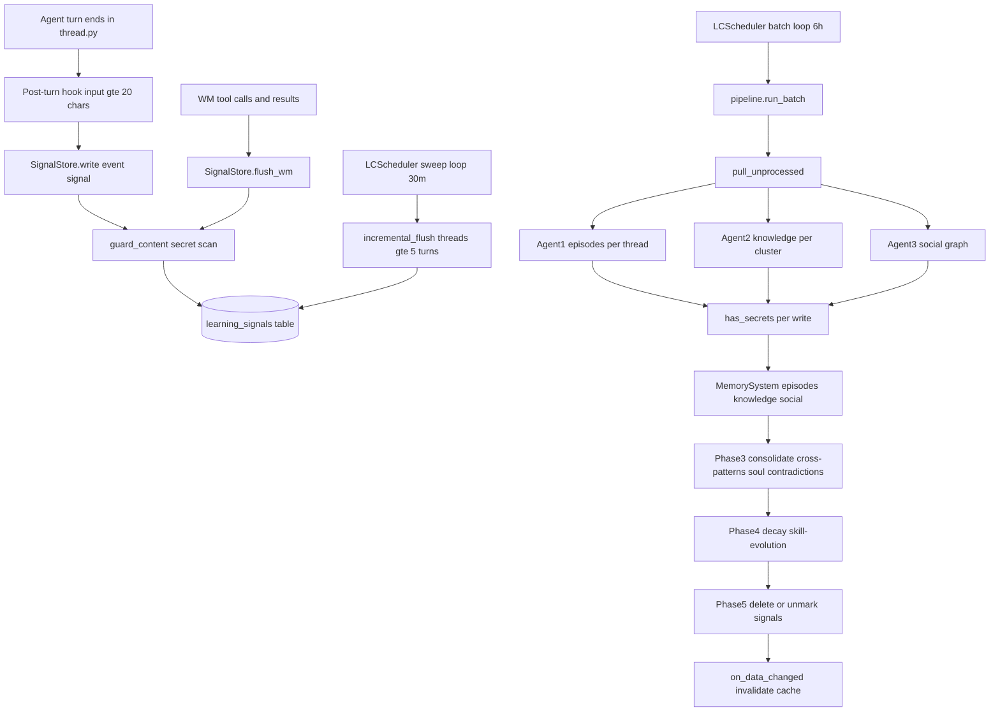
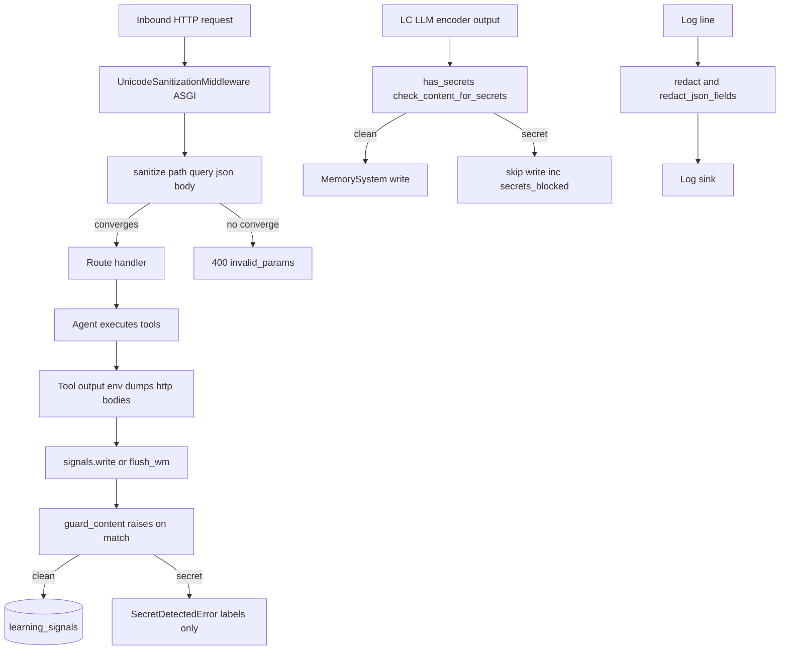
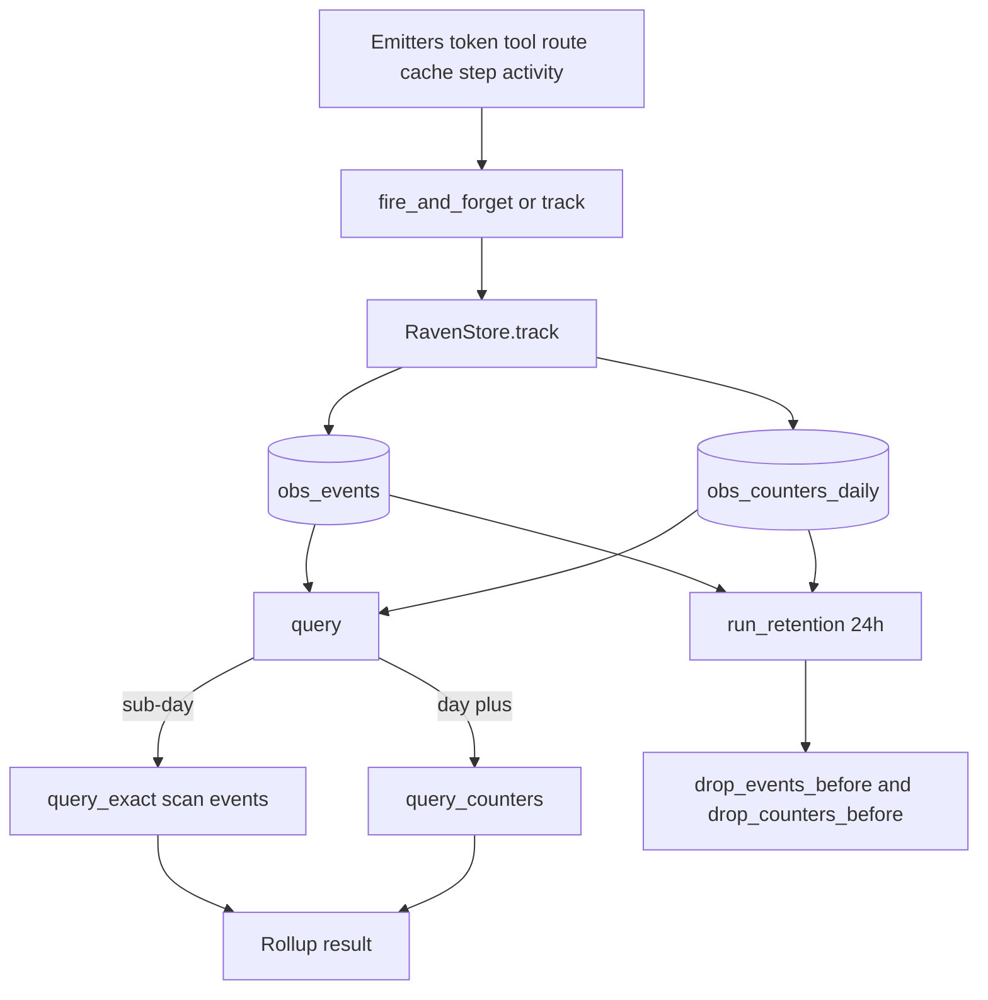

## learning_centre, security & raven — Learning Pipeline, Content Security & Event Store

> **Note:** `learning_centre` belongs to the **Intelligence plane** (see the group map in [Overview](#sec-00-overview-md)); it is bundled here with `security` and `raven` for brevity. The three subsystems below each follow the same mini-template — **Purpose → Responsibilities → Key files → Invariants**.

### learning_centre

**Purpose:** The engine's offline/batch memory-formation pipeline — it turns cheap, deterministically captured "learning signals" into durable structured memory (episodes, knowledge/process facts, a social graph, soul traits), running a cheap model on a 6-hour cadence in place of per-trajectory LLM extraction.

**Responsibilities:** It turns one-per-substantive-turn learning signals (plus working-memory flushes of tool calls/results) into durable structured memory written through the `MemorySystem` facade (see [Memory](#sec-54-memory-md)) + `user_skills`. **Note:** the "3 agents" are three system-prompted `LLM.generate()` calls — `dspy` is not a dependency of the engine at all, and it does **not** optimize prompts, routing, or few-shot. Inputs are rows in the `learning_signals` table — a `LearningSignal` is `{type, source, content, subject, temporal_ref, thread_id}`. Signals are produced two ways: (1) the **post-turn hook** in `thread.py` — after every turn with `len(user_input.strip()) >= 20`, the model summarizes the exchange into ~100 tokens and writes a `type="event", source="user"` signal; (2) **`flush_wm`** — flushes WM tool calls/results/user-input/system-events/checkpoints (messages skipped) plus a synthetic `type="outcome"` completion signal. Outputs (`LCPipelineResult`) — episodes, knowledge written/skipped, social nodes/edges, soul traits, decayed entries, contradictions, `secrets_blocked`.

**Internal components & flow (the learning loop):**
1. **Capture** — `thread.py` post-turn hook writes an `event` signal; `flush_wm`/`incremental_flush` flush WM tool data. Every ingest path calls `guard_content(...)` (secret scan) *before* INSERT.
2. **Schedule** — `LCScheduler` runs two asyncio loops: a **batch loop** (every 6h) calling `pipeline.run_batch()`, and a **sweep loop** (every 30min) that, for threads with `turn_count - watermark >= 5`, calls `incremental_flush` and prunes 24h-TTL-expired threads/ingestion chunks. Both gate on `resume_event` so `pause()`/`stop()` take effect immediately.
3. **Run pipeline** (`run_batch`) — pulls unprocessed signals; mints a `batch_id`; runs:
   - **Agent 1 — Episode creation** (per `thread_id`): skips trivial tasks, generates with `EPISODE_ENCODING_SYSTEM`, re-scans key+description+value, writes via `memory.create_episode`.
   - **Agent 2 — Knowledge extraction** (per cluster): `cluster_signals` groups by embedding cosine >0.7 (if a *real* embedding service exists) else subject-prefix. Each entry → secret scan → `dedup_knowledge` (skip ≥0.8, supersede ≥0.5, else write) → fact (conf 1.0) or inference (capped at 0.8).
   - **Agent 3 — Social graph**: one call → `write_social_updates` (attrs scanned before person creation).
   - **Mark processed** → **Phase 3 Consolidation** (cross-batch patterns, soul updates that never weaken confidence, contradiction resolutions) → **Phase 4 Deterministic** (confidence decay ×0.9, skill evolution joining `correction` signals to `skill:*` tool_calls).
4. **Produce artifact** — the memory rows themselves; `LCPipelineResult` is the run summary.
5. **Applied where** — written through the `MemorySystem` facade. **Phase 5 cleanup**: only if `wrote_something`, `delete_processed()` purges signals; else `unmark_processed(batch_id)` so the next batch retries. Finally `on_data_changed()` invalidates the consciousness cache.

**Key files:**

| File | LOC | Role |
|---|---|---|
| `signals.py` | 221 | `LearningSignal`, `SignalStore` (write/pull/mark/unmark/delete/search_fts/flush_wm); `SIGNAL_TYPES`/`SIGNAL_SOURCES` |
| `pipeline.py` | 883 | `LCPipeline`, `LCPipelineResult`; 4 system prompts; `run_batch`, `cluster_signals`, `dedup_knowledge`, `consolidate`, steps 8/11, `has_secrets` |
| `scheduler.py` | 234 | `LCScheduler` (start/stop/pause/resume/trigger_now/trigger_sweep/set_coordinator, `loop`, `sweep_loop`) |

**Invariants:** LC-inferred knowledge is capped at 0.8 confidence; only user-stated facts reach 1.0. Signals are `mark_processed` mid-batch and deleted only if `wrote_something` (else `unmark_processed` for retry) — a crash in that window leaves signals marked-but-undeleted that no later batch pulls (a small data-loss window). `flush_wm` truncates content to 10000 chars but `write` does not.

### security

**Purpose:** Content security at the boundaries — detect leaked credentials before they enter persistent memory or logs, and strip invisible/dangerous Unicode from all inbound HTTP input.

**Responsibilities:** The whole module is **pure/stateless** with no DB access — invoked by other subsystems at their write/log/ingest choke points.

- **Secret scanning (`secret_rules` + `secret_scanner` + `write_guard`) — what it detects:** 36 `SecretRule`s — gitleaks-derived regexes for AWS, GCP, Azure AD, DigitalOcean, **Anthropic** (`sk-ant-api03-`/`sk-ant-admin01-`, runtime-assembled so the literal never appears in source), OpenAI, HuggingFace, GitHub, GitLab, Slack, Twilio, SendGrid, NPM, PyPI, Databricks, HashiCorp, Pulumi, Postman, Grafana, Sentry, Stripe, Shopify, PEM keys. Plus a **JSON-field-name** pass (`secret_scanner.JSON_FIELD_NAMES` / `redact_json_fields`) catching opaque tokens by key name.
- **Where it runs:** on memory ingest (`guard_content` raising at `signals.write`/`write_batch`/`flush_wm` — the highest credential risk path); on LC memory writes (`has_secrets` non-raising at every write site — catches secrets the LLM encoder may paraphrase out); on logging (`logging_config.py` runs `redact(redact_json_fields(text))`); also in `portability.py` (export) and `server.py`.
- **On detection:** `guard_content` raises `SecretDetectedError` carrying **only labels + a `where` site** — never the matched text.
- **unicode_sanitizer:** Defends invisible/hidden prompt injection ("ASCII smuggling") — Unicode tag chars `U+E0000–E007F`, zero-width/bidi marks, directional formatting/isolates, BOM, private-use areas, null bytes — by Unicode category (`Cf/Co/Cn`) AND explicit ranges. Applied as raw ASGI middleware `UnicodeSanitizationMiddleware`, mounted in `server.py`, so **every HTTP endpoint** is covered. Sanitizes URL path, query string, JSON bodies (recursing keys+values, depth-capped at `MAX_RECURSION_DEPTH=64`). Raw ASGI (not `BaseHTTPMiddleware`) to avoid breaking SSE on `/execute`. On non-convergence returns 400 `invalid_params`.
- **write_guard:** Two thin wrappers over the scanner singleton: `check_content_for_secrets(content) -> list[str] | None` (non-raising) and `guard_content(content, *, where)` (raising). The single secret-scan import surface.

**Key files:**

| File | LOC | Role |
|---|---|---|
| `secret_rules.py` | 290 | `SecretRule`, `RULES` tuple of 36 gitleaks-derived regexes; Anthropic prefixes runtime-assembled (`ANT_PREFIX`/`ANT_ADMIN_PREFIX`) |
| `secret_scanner.py` | 179 | `SecretMatch`, `SecretDetectedError`, `SecretScanner` (scan/redact/redact_json_fields); `JSON_FIELD_NAMES` field-name pass; `get_scanner` singleton |
| `write_guard.py` | 55 | The single secret-scan facade: `check_content_for_secrets` (non-raising), `guard_content` (raising) |
| `unicode_sanitizer.py` | 286 | `sanitize_unicode`, `sanitize_value`, `UnicodeSanitizationMiddleware` (raw ASGI); `MAX_RECURSION_DEPTH=64` |

**Invariants:** Label-only exposure is cardinal — `SecretMatch` has no field for matched text, so the matched secret is never returned, logged, or persisted. `scan()` is one-match-per-rule. Anthropic prefixes are runtime-assembled so the source file isn't self-flagged. NFKC normalization is lossy (intended). Module is a pure stdlib-only leaf with zero internal deps.

### raven

**Purpose:** The engine's **observability/telemetry backbone** — structured event tracking, daily rollup counters, aggregation queries, retention.

**Responsibilities:** It persists to `obs_*` tables (neutral prefix so the codename "raven" never surfaces in SQLite errors/backups). `events.py` defines 8 frozen dataclasses, each with auto-set `kind` + `timestamp`: `TokenUsageEvent`, `ToolCallEvent`, `AgentStepEvent`, `RouteDecisionEvent`, `CacheEvent`, `RetentionRunEvent`, `ActivityTransitionEvent`, `UntypedEvent`; the `Event` union + `KIND_MAP`. `RavenStore.track` inserts into `obs_events` and (for `TokenUsageEvent` with a model) upserts a per-day/metric/model row into `obs_counters_daily`. `query` returns a `Rollup` — sub-day windows scan `obs_events` exactly; day+ windows use `obs_counters_daily`. `query` also takes `filters`, and what may be filtered depends on which store answers the window: a sub-day window filters on any payload field of the metric's event dataclass (the allowed set is derived from `KIND_MAP` so it tracks the schema rather than drifting from it), while a day+ window can filter only on `model`, because the other dimensions were aggregated away when the counter row was written. `events_page(since, kind, limit)` reads one page of raw events and returns `(events, has_more)`. The page is ascending and that is load-bearing: `since` is a forward-only lower bound, so a DESC page would keep the newest events and discard the ones *closest* to the cursor, and a poller advancing its cursor past that window could never request it again. Ascending makes a truncated read delayed rather than lossy: the caller takes the oldest events, advances its cursor to the newest it received, and picks the rest up on the next poll. One extra row (`limit + 1`) is fetched so the page can distinguish "exactly `limit` events existed" from "there are more". `api.events_page` returns that as `{"events", "has_more", "next_since"}`, where `next_since` is the timestamp of the newest event returned, or the incoming `since` when the page is empty. `RetentionPolicy` (raw 30d / counters 365d) drives `run_retention` + `retention_loop` (boot then every 24h). `api.init(db)` creates the singleton `RavenStore` **and registers an LLM usage hook** (`add_on_usage_hook`) so every model call auto-emits a `TokenUsageEvent`; `fire_and_forget(event)` schedules a detached track. Wired at boot; emitters: `TokenUsageEvent` (auto via usage hook), `ToolCallEvent` (`streaming_tool_executor`), `RouteDecisionEvent` (`herald/router`), `AgentStepEvent` (`thread.py`), `CacheEvent` (`herald/cache`), `ActivityTransitionEvent` (`utils/activity_consumers`), `track_untyped` (`key_rotation`, `/raven/track_untyped`).

**Key files:**

| File | LOC | Role |
|---|---|---|
| `events.py` | 156 | 8 frozen event dataclasses + `Event` union + `KIND_MAP`; `event_to_payload`/`event_from_row` |
| `store.py` | 159 | `RavenStore` (`track`, `events_page`/`events`, `counter`, `drop_events_before`/`drop_counters_before`) over `obs_events` + `obs_counters_daily` |
| `query.py` | 250 | `Rollup`, `query`, `WINDOW_DURATIONS`; `query_exact` (sub-day) / `query_counters` (day+); filter validation (`filterable_keys`, `COUNTER_FILTER_KEYS`, `check_filters`, `payload_matches`) |
| `retention.py` | 100 | `RetentionPolicy` (raw 30d / counters 365d), `run_retention`, `retention_loop` |
| `api.py` | 214 | Module singletons + `init`/`fire_and_forget`/`track`/`query`/`events`/`events_page`/`start_retention`/`track_untyped` |

**Invariants:** Counters are written at insert time (rollup only counts to avoid double-counting); `query_counters` only groups by `["model"]`; a filter the chosen store cannot honour raises `ValueError`, surfaced as `INVALID_PARAMS` by `POST /raven/query`, rather than being ignored — silently dropping it is the one failure mode a caller cannot detect, since the response is a well-formed 200 whose `total` is the unfiltered figure; the sub-day/day+ boundary at exactly 86400s changes the data source/precision. `fire_and_forget` silently drops if there's no loop or the store is uninitialized (best-effort).

### Public API / entry points
- **learning_centre:** `LCPipeline` + `run_batch()`; `LCScheduler` + start/stop/pause/resume/trigger_now/trigger_sweep/set_coordinator; `SignalStore`. Constructed in bootstrap.
- **security:** `check_content_for_secrets`, `guard_content`, `SecretDetectedError`; `get_scanner().scan/redact/redact_json_fields`; `sanitize_unicode`, `UnicodeSanitizationMiddleware`.
- **raven:** the `src.raven.api` module functions; the `/raven/*` HTTP routes (see [Server/Bootstrap/Auth](#sec-30-integration-server-md)).

### Inbound & Outbound dependencies
- **learning_centre — inbound:** bootstrap, `thread.py` (post-turn capture), coordinator, `activity_consumers` (pause/resume). **Outbound:** herald (LLM), `security.write_guard`, `infra.sqlite_pool`, `memory.working_memory`, `engine_core.trajectory`, `conversation_store`.
- **security — inbound:** server, logging_config, learning_centre, portability. **Outbound:** standard library only — zero internal deps; a pure leaf.
- **raven — inbound:** bootstrap, server, key_rotation, activity_consumers, thread, streaming_tool_executor, herald/cache+router. **Outbound:** `infra.sqlite_pool`, `herald.usage_tracker` (add_on_usage_hook), `herald.types`.

### Data & state — DB tables (all in `brain.sqlite`)
- **learning_centre:** `learning_signals` + `learning_signals_fts` (FTS5 with triggers; migration 008); `user_skills` (Step 11). Memory tables indirectly via the facade.
- **security:** none — stateless.
- **raven:** `obs_events`, `obs_counters_daily` (migration 013).

### Additional contracts / gotchas
(Per-subsystem load-bearing invariants are listed inline in each subsystem block above; the deeper edge cases follow.)
**learning_centre:** the trivial-task filter requires a meaningful user-sourced signal before an episode is minted.
**security:** Unicode middleware can't skip ASCII JSON bodies (`\uXXXX` escapes are ASCII bytes that decode to dangerous codepoints), so it must still walk them.
**raven:** `track` has a confusing `agent_step_id`→`thread_id` column inversion (it reads `event.agent_step_id` and writes it into the `thread_id` column, while `event.step_id` goes into the `agent_step_id` column).

### Refactoring seams / boundary observations
- **`security` is a clean leaf** (stdlib-only, stateless) — the ideal seam; extend by adding `SecretRule`s while preserving the label-only invariant.
- **`write_guard` is the single secret-scan facade** — but the LC pipeline reaches past it into `check_content_for_secrets` via its own `has_secrets` wrapper (count+log); consolidating "scan + count + log" into `write_guard` would remove duplication across six call sites.
- **Scanner singleton + raven `init(db)` globals** are module-global mutable state — awkward for testing/multi-tenant.
- **LCScheduler↔coordinator coupling is duck-typed** via `getattr(coordinator, 'memory'/'db'/…)` — fragile; a thin `SweepContext` protocol would harden it.
- **Signal capture is split** across `thread.py` (post-turn hook) + `signals.py::flush_wm` with subtly different rules — a single `SignalCapture` collaborator would centralize the policy.
