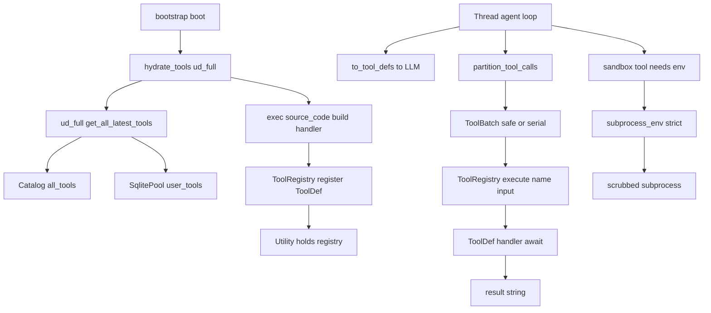
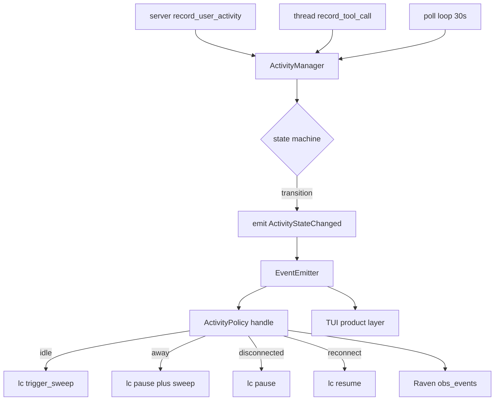
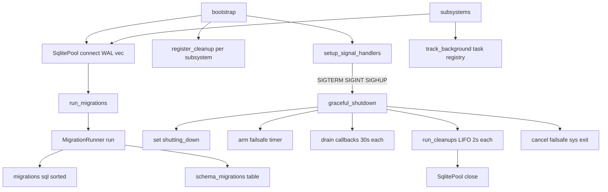

## utility_directory, utils & infra — Tool Runtime, Activity & Infrastructure

These three subsystems sit below the agent execution layer. `utility_directory` is the **capability supply chain** (how the agent learns what tools/agents/skills exist and gets executable handlers); `utils` is the **session-lifecycle nervous system** (idle/away/disconnected detection and the policy that throttles autonomous work); `infra` is the **shared substrate** (the one SQLite connection, the migration runner, the process lifecycle/shutdown machinery) that almost every other subsystem imports.

### utility_directory

**Purpose:** The Utility Directory ("UD") is the registry and runtime for the three kinds of capability the engine composes: **agents** (planners/modules), **skills** (instruction + code recipes), **tools** (things the LLM calls via `tool_use`). It exposes **four internal interfaces for three callers**: UD-Meta (lightweight metadata for capability enrichment, read by `search.py`), UD-Full (complete definitions for thread hydration), UD-Write (user-state writes; the LC is the *sole* writer), Tool Runtime (`ToolDef`/`ToolRegistry`/`hydrate_tools`). Core split: **platform definitions live in an in-memory read-only `Catalog`** (loaded from a mounted volume at boot); **user state lives in SQLite** (`user_agents`/`user_skills`/`user_tools`, migration 002). Read paths merge the two; the write path touches only SQLite.

**What it provides:**
- **`utility.py` — `Utility`**: the concurrent provisioning facade threads call directly (no coordinator roundtrip). Wraps `UDFull` + a `ToolRegistry` with a TTL cache (15 min). `get_agent`/`get_skill`/`get_tool` keyed by `name:version`. Owns **`skill_execute`** — the single entry point for all skill types (prompt-only/script-only/both/neither). It assembles a system-prompt blob from `description` + `gotchas.md` + `prompt.md`, lists `references/`, and **`exec()`s `scripts/*.py` in-process** to extract a `run` function. Trusted execution — "user brings all skills".
- **`tool_runtime.py`**: the runtime tool format. **`ToolDef`** (name, description, input_schema, async handler) plus a behavior surface — `source: ToolSource` (the provenance enum the permission pipeline keys on; see [Sandbox](#sec-50-sandbox-md)), callables `is_concurrency_safe`/`is_read_only`/`is_destructive` (each takes `tool_input` so safety varies per call), `interrupt_behavior`(+fn) (see [Agent Loop & Threading](#sec-40-engine-core-loop-md)), `is_command_execution` (bash/python — errors nuke siblings), `context_modifier_fn`, `get_summary`, `defer_loading` (Anthropic tool-search; keeps heavy schemas out of the cold-turn prompt — relevant to cache-prefix stability, see [Context & Compaction](#sec-42-engine-core-context-compaction-md)). **`ToolRegistry`** (name→ToolDef): register/get/list/`to_tool_defs`/`scope(names)`/execute. **`ToolBatch`** + **`partition_tool_calls`**: consecutive concurrency-safe calls merge into one parallel batch; each unsafe call gets its own serial batch — **conservative by design** (unknown tool / invalid input / any exception → unsafe). **`hydrate_tools(ud_full)`**: the boot-time builder — pulls every catalog tool, **`exec()`s `source_code`** in a fresh namespace to extract `handler`, registers a `ToolDef` with `source=PLATFORM` (skips malformed rows; empty registry on `ud_full is None`).
- **`ud_full.py` — `UDFull`**: full-definition queries merging platform record + user overlay; first-use bootstrapping (no user row → platform defaults); `version == "user"` routes to user-created lookups; `get_all_latest_tools` batch-loads for `hydrate_tools`.
- **`ud_meta.py` — `UDMeta`**: lightweight metadata for capability context (search.py); derives `skill_type` (hybrid/code/instruction); tools are platform-only.
- **`ud_write.py` — `UDWrite`**: the LC-only writer. Skill upsert encodes **promotion logic in SQL**: each write bumps `occurrence_count`, takes `MAX` confidence, flips `status` to `'active'` once `occurrence_count ≥ 3 AND confidence ≥ 0.8`. `COALESCE` so a null write doesn't wipe prior state.
- **`platform_registry.py` — `PlatformRegistry`**: read-only catalog access (sync) + user-table reads (async).
- **`subprocess_env.py`** — a **cross-cutting security helper** (imported by `sandbox/executor.py`, bootstrap, config, events) that builds sanitized environments for subprocess execution; its threat model, the never-mutate-`os.environ` contract, and the `off`/`default`/`strict` tiers are documented in full as part of the defense ladder (see [Security & Deployment](#sec-70-security-deployment-md)). It is mis-filed here — a sandbox concern with zero relation to the capability registry.

**Key files / types:**

| File | LOC | Role |
| --- | --- | --- |
| `utility.py` | 200 | `Utility` provisioning facade; TTL cache; `skill_execute` |
| `tool_runtime.py` | 367 | `ToolDef`, `ToolRegistry`, `ToolBatch`, `partition_tool_calls`, `hydrate_tools` |
| `ud_full.py` | 234 | `UDFull` — full-definition merge + `get_all_latest_tools` |
| `ud_meta.py` | 225 | `UDMeta`, `VERSION_USER` — lightweight metadata for search.py |
| `ud_write.py` | 206 | `UDWrite` — LC-only writer; promotion-in-SQL |
| `platform_registry.py` | 185 | `PlatformRegistry` — read-only catalog + user-table reads |
| `subprocess_env.py` | 396 | `subprocess_env`, `ScrubMode`, `set_session_mode`, `register_spawn_observer`, `register_proxy_env_fn` (canonical in [70](#sec-70-security-deployment-md)) |

### utils

**Purpose:** The **session-lifecycle subsystem** — two files implementing a producer (detector) / consumer (policy) split over an "activity" event. An **"activity"** here is *session liveness* — whether a human is actively engaging, idle, gone, or fully disconnected — the meta-state that governs whether the engine should burn money on autonomous work.

- **Producer — `ActivityManager`**: a process singleton running `active → idle (5min) → away (30min) → disconnected (1hr)`, and any non-active → active on user input. Recorders: `record_user_activity` (called by `server.py` on every execute — returns a `ReconnectSummary` when waking from away/disconnected), `record_tool_call_start`/`_end` (duration tracking, accumulating `engine_active_seconds`), `record_error`, `record_shutdown`. A 30s background poll drives inactivity transitions; on every transition it fires an `ActivityStateChanged` event onto the injected `EventEmitter`. Two stats buckets (`user_active_seconds`, `engine_active_seconds`) feed `ReconnectSummary.format_recap` (zero-LLM "while you were away" line).
- **Consumer — `ActivityPolicy`**: subscribes to the emitter and decides **what the engine does** per transition: **idle** → `lc_scheduler.trigger_sweep()` (opportunistic flush); **away** → `trigger_sweep()` + `pause()`; **disconnected** → `pause()` (stop burning $); **reconnect** → `resume()`. Every transition is also mirrored into **Raven** (`ActivityTransitionEvent` → `obs_events`; see [Learning/Security/Raven](#sec-58-learning-security-raven-md)). Every handler is guarded; a missing subsystem is a silent no-op; strong refs kept in `pending_tasks` (GC-safety).

So: **producer = `ActivityManager`** (detects + emits), **consumers = `ActivityPolicy`** (throttles LC) **+ Raven** (telemetry) **+ TUI/product** (UI).

**Key files / types:**

| File | LOC | Role |
| --- | --- | --- |
| `activity_manager.py` | 409 | Producer — `ActivityManager`, `ActivityState`, `SessionStats`, `ReconnectSummary` |
| `activity_consumers.py` | 176 | Consumer — `ActivityPolicy` (install/uninstall) |

### infra

**Purpose:** The **lowest-level shared substrate**: the DB connection, schema migrator, process-shutdown machinery, task-tracking helpers. Re-exports only `SqlitePool`, `MigrationRunner`, `serialize_f32`, `deserialize_f32`. **33 modules import from `src.infra`** across asset_directory, engine_core, herald, learning_centre, memory, raven, utility_directory, plus bootstrap/server.

- **`sqlite_pool`** — `SqlitePool` is, by its own docstring, **not actually a pool** ("no connection pooling needed"). One container = one user = one process = one `brain.sqlite`, so a single `aiosqlite.Connection` with **WAL mode** (concurrent reads, single writer) suffices. `connect()` sets `journal_mode=WAL`, `foreign_keys=ON`, `busy_timeout=5000`, best-effort loads **sqlite-vec** (recording `vec_available`) — a failure anywhere in that setup closes the connection before re-raising, so a bad PRAGMA can't leak the aiosqlite worker thread it already started. Async surface: execute/executemany/executescript, fetch/fetchrow/fetchval, commit, health_check, close. `serialize_f32`/`deserialize_f32` pack/unpack little-endian float32 blobs (dim 1536) for sqlite-vec. Bootstrap constructs the single instance and injects it everywhere via constructor.
- **`migrations`** — `MigrationRunner` applies `migrations/*.sql` in **sorted filename order**, tracking applied files in `schema_migrations`. The set is **13 files numbered 001-013, with 006 absent and 012 used twice → 12 distinct prefixes**; the full migration/table catalog (what each migration creates, the vec/fts companion pattern, TTLs) is canonical in [Data Model](#sec-20-data-model-md).
- **`graceful_shutdown`** — orchestrates ordered teardown. `setup_signal_handlers` installs SIGTERM/SIGINT/SIGHUP (SIGINT conditional — bootstrap's interrupt source may own it). Sequence: set `shutting_down`, arm a failsafe timer (`os._exit` if cleanup deadlocks), run drain callbacks (each bounded 30s), run the cleanup registry, cancel failsafe, `sys.exit`. **Double SIGINT → immediate `os._exit(1)`**. Also installs process-wide exception handlers. (Uvicorn overwrites SIGTERM/SIGINT, so in server mode those route through Uvicorn → FastAPI lifespan → `bootstrap.shutdown()`.)
- **`cleanup_registry`** — subsystems `register_cleanup(name, async_fn)` at boot; `run_cleanups()` fires them **LIFO** (reverse of boot order), each bounded 2s, failures swallowed. (Separate from `src/sandbox/cleanup_registry.py`, which is subprocess-level; see [Sandbox](#sec-50-sandbox-md).)
- **`bg_tasks`** — `track_background(task, registry, key=None)`: register+evict-on-done helper, deduplicating boilerplate in coordinator/sub_agent.

**Key files / types:**

| File | LOC | Role |
| --- | --- | --- |
| `sqlite_pool.py` | 115 | `SqlitePool`, `serialize_f32`/`deserialize_f32` |
| `graceful_shutdown.py` | 249 | `setup_signal_handlers`, `graceful_shutdown`, `register_drain_callback`, `install_exception_handlers` |
| `cleanup_registry.py` | 67 | `register_cleanup`, `run_cleanups` |
| `bg_tasks.py` | 68 | `track_background` |
| `migrations.py` | 62 | `MigrationRunner`, `run_migrations` |

### Public API / entry points
- **utility_directory:** `Utility` (get_agent/skill/tool/skill_execute/invalidate); `hydrate_tools(ud_full)`; `ToolRegistry`; `partition_tool_calls`; `UDFull`/`UDMeta`/`UDWrite`/`PlatformRegistry`; `subprocess_env()` + set_session_mode/register_spawn_observer/register_proxy_env_fn.
- **utils:** `ActivityManager` (singleton; recorders; start/stop); `ActivityPolicy.install/uninstall`.
- **infra:** `SqlitePool`, `MigrationRunner`/`run_migrations`, `register_cleanup`/`run_cleanups`, `setup_signal_handlers`/`graceful_shutdown`/`register_drain_callback`, `track_background`.

### Inbound & Outbound dependencies
- **utility_directory** — *inbound:* bootstrap (wires the whole stack), `thread.py` (ToolDef/ToolRegistry/partition_tool_calls, imports `ALWAYS_SAFE`; see [Agent Loop & Threading](#sec-40-engine-core-loop-md)), sub_agent/coordinator/agent_mcp/agent_hooks/agent_types, sandbox/executor+tools (subprocess_env), asset_directory/assets. *outbound:* `src.catalog.Catalog`, `infra.sqlite_pool`, `herald.types` (see [Herald](#sec-52-herald-md)), `engine_core.cancellation.InterruptBehavior` (see [Agent Loop & Threading](#sec-40-engine-core-loop-md)), `sandbox.permissions.ToolSource` (see [Sandbox](#sec-50-sandbox-md)). subprocess_env's only outbound is stdlib.
- **utils** — *inbound:* bootstrap, server (record_user_activity), thread (tool-call recording), away_summary. *outbound:* `engine_core.events`, `learning_centre.scheduler` (see [Learning/Security/Raven](#sec-58-learning-security-raven-md)), `raven.events` (see [Learning/Security/Raven](#sec-58-learning-security-raven-md)). **No infra dependency** — pure in-memory.
- **infra** — *inbound (widest):* **33 modules**. *outbound:* aiosqlite, optional sqlite_vec, stdlib, `package.PACKAGE_ROOT`. `graceful_shutdown` lazily imports `cleanup_registry` to avoid a cycle.

### Data & state
- **utility_directory:** platform data in-memory `Catalog` (read-only); user data in SQLite (`user_agents`/`user_skills` with promotion lifecycle/`user_tools`); `Utility` holds a 15-min TTL cache + one `ToolRegistry`; `hydrate_tools`/`skill_execute` hold **executed code** in `ModuleType` namespaces; `subprocess_env` holds module globals (`session_mode`, `proxy_env_fn`, `spawn_observer`).
- **utils:** `ActivityManager` singleton with in-memory state (current state, monotonic timestamps, per-`operation_id` start times); no persistence.
- **infra:** `SqlitePool` owns the single connection; `cleanup_registry`/`graceful_shutdown` hold module-global mutable lists/flags; `MigrationRunner` persists `schema_migrations`.

### Invariants / contracts / gotchas
1. **`subprocess_env` never mutates `os.environ`** — the one hard contract; the scrub-mode resolution, allowlist, and file-path-cred caveat live with the defense ladder (see [Security & Deployment](#sec-70-security-deployment-md)).
2. **`partition_tool_calls` fails safe**: unknown tool / invalid input / any exception → serial. Never run a destructive tool in parallel by accident.
3. **Trusted in-process `exec()`** in both `hydrate_tools` (tool source) and `skill_execute` (skill scripts) — predicated on "platform code vetted" / "user brings all skills". Any catalog-row or skill-folder compromise = arbitrary code execution in the engine process.
4. **`InterruptBehavior` defaults to `BLOCK`** on error — a broken `interrupt_behavior_fn` won't yank a mid-flight tool.
5. **UD merge precedence**: user state overlays platform; `learned_state` uses `COALESCE`. A skill's definition now returns from the catalog regardless of status — the catalog carries no status field; only the `learned_state` overlay in `get_skill()` still requires `status='active'`.
6. **Skill promotion lives in SQL** (`occurrence_count ≥ 3 AND confidence ≥ 0.8`) — business logic in an upsert.
7. **`SqlitePool` is a single connection** — WAL gives concurrent readers but one writer; callers must `await db.commit()` themselves.
8. **Migration ordering by filename, and the `012` collision**: two `012_` files; `006` is missing. Tracked by full filename so both apply, but "number = order" is broken (catalog canonical in [Data Model](#sec-20-data-model-md)).
9. **shutdown is best-effort**: `run_cleanups` swallows failures, drain bounded 30s, failsafe `os._exit`s if teardown hangs; **double SIGINT force-exits** possibly mid-write. `bootstrap.shutdown(state)` also closes `state.db` directly after the registry runs, so a nested shutdown that already emptied the process-global registry can't skip the outer engine's own connection.
10. **`ActivityManager` uses monotonic-clock** internal timing; the reconnect snapshot is taken *before* `reset_stats` so the recap reports real away-period numbers.

### Refactoring seams / boundary observations
*(indexed in the refactoring scorecard — see [Boundaries & Refactoring](#sec-80-boundaries-refactoring-md).)*
- **`subprocess_env.py` is mis-filed** — a security/sandbox concern with zero relation to the capability registry; belongs in `sandbox/` or `infra/` (it is documented with the defense ladder, see [Security & Deployment](#sec-70-security-deployment-md)).
- **Two `exec()`-based loaders** (`hydrate_tools`, `skill_execute`) duplicate "read source → ModuleType → exec → extract callable → log-and-skip"; a shared `load_callable_from_source` in infra would centralize the trust boundary.
- **`cleanup_registry`/`graceful_shutdown`/`bg_tasks` are module-global singletons** — fine for one-process-per-user but awkward to test and impossible to run two engines in one process.
- **Two parallel cleanup registries** with the same name (infra vs sandbox) — bootstrap imports both; a naming collision hazard (the activity_policy cleanup is registered with the *sandbox* one — worth a closer look).
- **The dual-`012` migration filenames** should be re-sequenced to restore "prefix = order" before it bites a future author.
