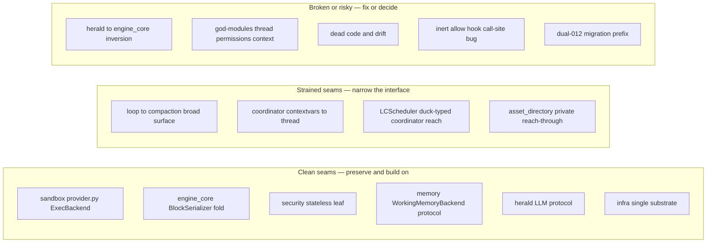
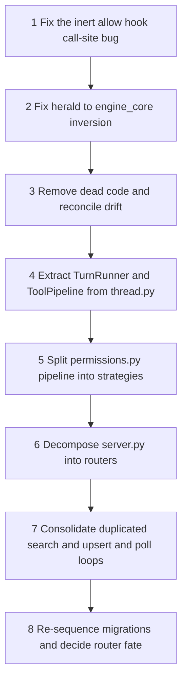

## Boundaries & Refactoring Map — Planning Your Next Work

This section is the **index and scorecard** for the architecture's structural debt. It does not re-explain each subsystem's internal seams — those live in the subsystem chapters and are linked from the table below. What lives here in full is the cross-cutting picture: the health scorecard, the one true layering inversion, and the sequenced plan you can execute against.

### The boundary health scorecard

### 1. The one true layering inversion — canonical here

**This chapter owns the framing of the single most architecturally wrong edge in the codebase.** `herald/provider.py` imports `src.engine_core.cached_snip` (the import block is at `provider.py:45` — `CACHE_EDITING_BETA_HEADER`, `CachedSnipState`, `apply_cache_edits_to_messages`, `cached_snip_prepass_enabled`, …). A *lower* layer — the model gateway, whose whole job is to be a swappable transport — reaches *up* into the *higher* agent-core layer. Every other strained seam in this atlas is a too-wide interface or a private reach-in; this is the only edge that points the wrong way through the layer stack.

The fix is small and high-confidence: move the snip logic down into herald, or inject the `cached_snip` functions through herald's `LLM` protocol (see [Herald](#sec-52-herald-md)) so the gateway never names an `engine_core` symbol. Herald's own view of this coupling is noted as its single upward dependency in [Herald](#sec-52-herald-md); the prompt-cache mechanics the snip logic serves are canonical in [Context & Compaction](#sec-42-engine-core-context-compaction-md).

### 2. The seam index — where each boundary is documented

Every subsystem seam is explained in full in its owning chapter. This table is the map; click through for the detail and the suggested split.

| Seam | Owning chapter | Severity | One-line |
|---|---|---|---|
| `herald/provider.py` imports `engine_core.cached_snip` | **this chapter** (§1) | broken | Gateway depends upward on agent core — the only inverted edge. |
| `thread.py` god-module (6,385 LOC) | [Agent Loop & Threading](#sec-40-engine-core-loop-md) | strained | Tool registration + `agent_loop` + `run_single_tool` + recovery want extracting into `TurnRunner`/`ToolPipeline`/`RecoveryStrategy`. |
| `context_engineering.py` / `compaction_orchestrator.py` breadth | [Context & Compaction](#sec-42-engine-core-context-compaction-md) | strained | Loop↔compaction surface is wide; split along existing section comments. |
| `permissions.py` 7-step pipeline (1,433 LOC) | [Sandbox](#sec-50-sandbox-md) | strained | Each numbered step wants its own strategy object; bypass-immune tier should unit-test in isolation. |
| `executor.py` (1,599 LOC) bwrap/seccomp/Landlock + fs bridge | [Sandbox](#sec-50-sandbox-md) | strained | Split the filesystem-bridge half from the process-monitoring half. |
| `server.py` (2,990 LOC) 6 route groups + SSE + lifespan | [Server/Bootstrap/Auth](#sec-30-integration-server-md) | strained | One `APIRouter` per concern; a `StreamHub` for the fan/sink globals. |
| `compaction_orchestrator` reads `getattr(self.adapter, "model")`; `post_compact_cleanup` flips `llm_provider.latched_thinking` | [Context & Compaction](#sec-42-engine-core-context-compaction-md) | strained | Private reach-ins that break silently on rename — want public accessors. |
| `refresh_scheduler`/`channel` read `self.ad.db` / `self.ad.discover_actions` | [Asset Directory & Channels](#sec-56-asset-directory-channel-md) | strained | Background tasks reach into the directory's privates; wants a public surface. |
| `LCScheduler` does `getattr(coordinator, 'memory'/'db'/'threads'/…)` | [Learning/Security/Raven](#sec-58-learning-security-raven-md) | strained | Duck-typed reach into coordinator internals; wants a protocol. |
| coordinator sets `thread.cancel_requested` | [Agent Loop & Threading](#sec-40-engine-core-loop-md) | strained | Coordinator reaches across to flip a thread's cancel flag directly; a small `thread.request_cancel()` method would make the edge explicit. |
| Contextvar coupling between `coordinator` and `thread` (per-turn gates) | [Agent Loop & Threading](#sec-40-engine-core-loop-md) | strained | Deliberate (avoids parameter sprawl) but hidden; a `TurnConfig` passed explicitly would be testable. |
| Hook call-site bug in `thread.py` | [Hooks](#sec-44-engine-core-hooks-md) | broken | `decision="allow"` is inert (see §3). |
| `herald/router.py` is a large selection subsystem (1698 LOC) resolving to one provider | [Herald](#sec-52-herald-md) | strained | `pick_model` runs every turn, but the single Anthropic-Messages wire shape lands all 14-dim selection on one concrete `Provider`. |
| `AsyncHookRegistry` orphan | [Hooks](#sec-44-engine-core-hooks-md) | drift | Fully implemented, never instantiated; the async/rewake feature it advertises doesn't exist. |
| Dual-`012` migrations + missing `006` | [Data Model](#sec-20-data-model-md) | drift | Re-sequence to restore "prefix = apply order". |

The **god-module split detail** (which classes to extract, where the internal seams already are) stays in each owning chapter; this index points you to them rather than restating the per-file decomposition.

### 3. The real correctness bug (worth fixing first)

It is a call-site bug in `thread.py` (`run_single_tool`, 5988-6380), not in the hooks modules - the hook contract is correct, the loop under-implements it. Full detail lives in [Hooks](#sec-44-engine-core-hooks-md); it is surfaced here because it tops the sequencing plan.

- **`decision="allow"` is inert.** `pre_agg.allowed` is passed inline into the `PreToolUseHookExecuted` telemetry event (`thread.py:6082`) and never read again - `check_permission` runs unconditionally (`thread.py:6113`), so the documented "allow -> skip the permission pipeline" does not happen.

### 4. Drift & dead code — reconcile the source of truth

- **`herald/router.py` is a large selection subsystem, not dead code** (1698 LOC, 14-dim scoring): the agent loop drives `pick_model` on every turn (main turn and sub-agent path), so it is fully wired. `find_allowed_model` returns the cheapest AVAILABLE+HEALTHY model from the candidate chain via `rank_chain_by_cost`; `fallback_across_tiers` walks the tier ladder downward under a `min_tier_floor` quality floor with context-window, tools, vision, and min-tier chain filters. (Detail in [Herald](#sec-52-herald-md).)
- **`AsyncHookRegistry` is an orphan** — `engine_core/async_hook_registry.py` is fully implemented + documented but never instantiated; the async/rewake feature it advertises does not exist. Wire it or delete it. (Detail in [Hooks](#sec-44-engine-core-hooks-md).)
- **`skill_forks_created` is a live counter, not dead code** — it is assigned at `pipeline.py:772` from `step11_skill_evolution`'s return, so it should not be mistaken for a vestigial field.
- **Dual-`012` migrations** (`012_context_collapse.sql`, `012_ingestion_chunks.sql`) plus a missing `006` — re-sequence to restore "prefix = apply order". The full migration catalog and its consistent count live in [Data Model](#sec-20-data-model-md).

### 5. Duplicated logic worth consolidating

- **Hybrid search** (semantic → FTS → keyword → recency) is near-identical across `episodic_memory`, `knowledge_store`, and `social_graph` — extract a shared `hybrid_search` template. (Semantics owned by [Memory](#sec-54-memory-md).)
- **`server_registry` upsert SQL** is copy-pasted in 3–4 places with subtly different `source`/`WHERE` clauses — one helper.
- **`exec()`-from-source loaders** (`hydrate_tools` in `utility_directory/tool_runtime.py`, `skill_execute` in `utility_directory/utility.py`) duplicate the trust-boundary pattern — a shared `load_callable_from_source`. The trust-boundary itself is canonical in [Security & Deployment](#sec-70-security-deployment-md).
- **Two sleep-first fail-soft poll loops** (`ActionRefreshScheduler`, `Channel.poll_loop`) — a shared primitive.
- **The streaming text parsers** (`engine_core/craft_parser.py` `CraftParser`, `engine_core/citation_parser.py` `CitationParser`) share `longest_token_prefix_suffix` via cross-import — a small shared "streaming tokenizer" module.

### 6. The clean seams to preserve and leverage

These are *done right* and are the foundation to build on:

- **`sandbox/provider.py`** — the `ExecBackend`/`SandboxProvider` `Protocol`s mean swapping bwrap for Firecracker/Fly/E2B needs zero engine-core changes. (See [Sandbox](#sec-50-sandbox-md).)
- **`engine_core/blocks.py` `BlockSerializer`** — the single fold seam; the internal event bus can be refactored freely behind the 27-type assertion + the generated `contract/block-types.md`. (Wire shape owned by [Block Wire Contract](#sec-25-block-contract-md).)
- **`security/*`** — a stateless, stdlib-only leaf; extend by adding rules. (See [Learning/Security/Raven](#sec-58-learning-security-raven-md).)
- **`memory/memory_factory.py` `WorkingMemoryBackend`** + **`herald/base.py` `LLM`** protocols — clean swap points. (See [Memory](#sec-54-memory-md), [Herald](#sec-52-herald-md).)
- **`infra`** — the single substrate; the one-process-per-user assumption (module-global singletons) is the only thing to revisit *if* multi-tenancy is ever on the roadmap. (See [Utility/Utils/Infra](#sec-60-utility-utils-infra-md).)

### Suggested sequencing

Start with the **bug and the inversion** (small, high-confidence, de-risks everything downstream), then the **drift cleanup** (makes the codebase legible), then the **god-module splits** (the big structural payoff — detail in each owning chapter), and finally the **consolidation** passes. The clean seams above mean each step is local and testable.
